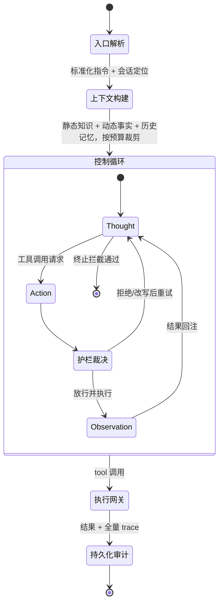

## TL;DR

| 结论 | 论据 |
|---|---|
| **Harness = 模型权重以外的一切** | System Prompt、工具定义、Hooks、上下文压缩、权限规则、子 Agent 编排，全算 Harness |
| **多数线上故障是配置问题，不是模型能力问题** | LangChain 拿同一个 GPT-5.2-Codex，只改 Prompt/工具/中间件，Terminal Bench 2.0 得分 52.8 → 66.5，排名 Top 30 → Top 5 |
| **Harness 的本质是把可靠性从模型挪到环境** | 能用硬逻辑拦住的错误，绝不交给 LLM 用理解力拦住 |
| **模型会被自己的 Harness 驯化** | Opus 4.6 在自家 Harness 里排第 33，放进为任务专门调优的第三方 Harness 排第 5 |
| **拦截点决定天花板** | 四个改动贡献最大的那一个，只是"Agent 试图退出时拦住它，逼它跑完测试" |

一句话：**Models provide the intelligence; the Harness provides the determinism.**

---

## 一、什么是 Harness：先把定义做干净

LangChain 的 Vivek Trivedy 给过一个最省字的定义：

> **Harness 就是模型权重以外的一切。**

说得更直白：模型负责"想"，Harness 负责让"想"这件事在真实环境里**可控、可观测、可回滚**。2026 年 3 月 Claude Code 的 51 万行 TypeScript 源码意外暴露后，我们终于能完整看到一个工业级 Harness 长什么样，它包含：

| 组件 | 具体是什么 | 解决什么问题 |
|---|---|---|
| System Prompt | 定义行为规范的系统提示词 | 模型不知道自己该是谁 |
| `CLAUDE.md` | 项目级指令文件，启动时注入 | 模型不知道这个项目的规范 |
| Tools | 文件读写、Bash、浏览器等可调用工具 | 模型只能输出文本，不能执行操作 |
| Sandbox | 隔离的执行环境 | 不能让模型直接操作生产环境 |
| Compaction | 上下文压缩机制 | 长对话性能衰减 |
| Hooks / Middleware | 模型调用前后插入的逻辑 | 模型不会主动自检，容易死循环 |
| Sub-agent 管理 | 子代理派生与结果回收 | 单个上下文窗口装不下复杂任务 |

Harness 这个词来自马具（harness）。马具的作用不是让马更有力气，而是**把马的力量精确地引导到正确方向，同时让骑手保持控制权**。Harness Engineering 对 LLM 完全同理。

一个更工程的定义来自 Mitchell Hashimoto（HashiCorp 创始人）：

> Harness engineering is the idea that **anytime you find an agent makes a mistake, you take the time to engineer a solution such that the agent never makes that mistake again.**

注意最后一节：`such that the agent never makes that mistake again`。不是"降低概率"，不是"提醒一下"，是**让它不再发生**。这个措辞决定了 Harness 和 Prompt Engineering 的分野。

---

## 二、"换个更好的模型就好了"是个代价极高的误解

做 Agent 系统遇到失败，最常见的第一反应是"模型还不够聪明，等下一代就好"。

HumanLayer 团队在上百个 Agent 项目后给出不同答案：

> "It's not a model problem. It's a configuration problem."

LangChain 用一次受控实验把这句话钉死了：**固定 GPT-5.2-Codex 模型，只改模型之外的东西**（System Prompt、工具配置、Middleware），其他什么都不动：

- Terminal Bench 2.0 得分：**52.8 → 66.5**
- 排名：**Top 30 → Top 5**

四个改动分别是：

1. **在 Agent 试图退出时拦截。** 最高频的失败模式是：Agent 写完代码 → 重读一遍 → 觉得没问题 → 停止，**根本没跑测试**。加一个 Middleware 在退出路径上强制拦截，注入 checklist 让它对照任务说明逐项验证。这一个改动贡献了最大的分数提升。
2. **自动扫描并注入环境信息。** Agent 在陌生环境里会浪费大量轮次探索目录结构、找 Python 版本。启动时先跑几条 bash 命令把环境事实（路径、版本、可用包管理器）直接注入上下文，Agent 不用探索，直接干活。
3. **追踪编辑次数，超阈值就打断。** Agent 有时在同一个文件上反复做小改动，打转十几次还在原地。用 hook 统计每个文件的编辑次数，超过阈值就注入"考虑换个完全不同的方案"。
4. **调整推理强度策略。** 全程最高档推理强度反而得分更低且容易超时。改成 `xhigh → high → xhigh` 的三明治：规划与验证阶段用高档，执行阶段用中档。

这四个改动**没有一个是改模型，也没有一个是改 Agent 的核心算法**，全是环境与流程的变化。这就是 Harness Engineering 的全部哲学。

回到开头那个最具体的例子——Agent 写完代码没跑测试。Prompt Engineering 的做法是"在系统提示词里写：完成代码后请编写并执行测试"，它依赖模型每次都正确理解并执行这条软约束，于是"有时候管用有时候不管用"。Harness Engineering 的做法是**在退出路径上加一道硬拦截：没检测到测试执行痕迹就不允许终止**。从此这个行为是确定性的。

---

## 三、一套 Harness 的五层结构

把上面所有东西收敛成一个可实现的分层模型，我习惯这样拆（这也是本站 [OpenClaw 原理拆解](/blog/agent/harness/openclaw-architecture/) 与 [Hermes 源码级拆解](/blog/agent/harness/hermes-agent-internals/) 两篇里对照检查用的同一套坐标系）：



### 第 1 层：入口解析（Entry）

把千差万别的输入（IM 消息、HTTP 请求、IDE 事件、定时任务）标准化成统一的内部指令结构。通道适配器负责格式翻译与附件提取，网关负责会话路由与并发队列管控。

这一层的工程价值常被低估：**会话隔离在这里确立**。OpenClaw 采用基于通道的命令队列，默认序列化执行，从根源规避异步嵌套导致的状态冲突——同会话串行保安全，显式声明的低风险任务才并行走快车道。

### 第 2 层：上下文构建（Context）

在 Agent 真正调用模型之前，把"它是谁、这里是哪、之前聊过什么"拼进 Prompt。包含三块：

- **静态知识**：项目级指令文件（如 `CLAUDE.md`），通常在启动时注入。
- **动态事实**：环境信息、工具可用性、当前日期、当前 git 分支。
- **历史与检索记忆**：会话历史 + 从长期记忆里检索回来的相关片段。

这一层必须做**预算裁剪**。上下文不是越多越好——ETH Zurich 测试 138 个 agentfile 发现，LLM 自动生成的 `CLAUDE.md` 反而使性能下降：Agent 要多花 **14%–22%** 的推理 token 处理这些指令，步骤更多、工具调用更多，但**成功率没有提升**。结论很硬：这类知识文件必须人工精心编写、少而精，它应该只装"模型自己探索不到的关键约束"，而不是当知识库用。

### 第 3 层：控制循环（Loop）

经典 ReAct 三元组：`Thought → Action → Observation` 循环，直到收敛或达到上限。

循环必须有三道保险：

- **轮次上限**（如 OpenClaw 默认 20 次）：防止死循环烧钱。
- **终止拦截**：Agent 声明"我做完了"不等于真的做完了，必须有独立校验（测试跑过了吗？产物存在吗？验收清单勾完了吗？）。
- **异常自愈**：工具超时/报错时，把结构化错误回注给模型让它换路径，而不是直接崩。可以叠加"同一文件的编辑次数阈值"这类守卫，检测到反复打转就打断，建议它换个方案。

### 第 4 层：执行网关（Gateway）

工具真正落地的地方。Claude Code 把每个工具抽象成两个关键布尔属性：

```text
isConcurrencySafe()  → 是否可并行执行
isDestructive()      → 是否不可逆
```

`Read` / `Glob` / `Grep` 并发安全，模型一次读三个文件就是真正并行的三次调用；`Write` / `Edit` 标记为串行，必须依次执行防止竞态。**工具粒度也是刻意的选择**：没有把文件操作合并成一个 `FileOperation`，而是拆成 `Read`/`Write`/`Edit`——因为工具选择本身携带意图，模型选 `Edit` 就意味着局部修改，选 `Write` 就意味着全量覆写。粒度细还带来权限细分：只读权限允许 `Read` 不允许 `Write`，这道隔离在 API 请求构建层就完成了，**不依赖模型去"理解"约束**。

权限裁决应当是一条确定性的链：

```text
① validateInput()            参数合法性，纯逻辑校验
        ↓
② PreToolUse Hooks          用户自定义 shell：批准 / 拒绝 / 改写输入参数
        ↓
③ Permission Rules          alwaysDeny → alwaysAllow → alwaysAsk
        ↓
④ tool.checkPermissions()   工具自检
        ↓
⑤ permission mode           auto（分类器裁决）/ manual（人工确认）
```

前三环都是硬逻辑，**不经过 LLM**。这正是 Harness Engineering 的本质：**让环境保证正确性，而不是依赖模型的理解能力**。还有一个漂亮的攻击面消除：被 `alwaysDenyRules` 标记的工具，**连 schema 都不会出现在发给模型的工具列表里**——模型不知道这个工具存在，于是所有"通过 Prompt Injection 诱导模型调用被禁工具"的攻击失去前提。

### 第 5 层：持久化与审计（Persistence）

全量会话数据（用户输入、工具调用、执行结果、模型中间输出）落盘成可回放的 trace 文件（如 `.jsonl`）。它同时服务三个目的：故障回溯、上下文压缩的输入源、长任务的记忆底座。

上下文压缩必须遵循一条铁律：**先 Flush 后 Compact**。快接近窗口上限时，强制 Agent 把关键状态（当前任务、已完成项、待办、重要文件路径、用户明确偏好）写入磁盘文件，压缩才安全。倒过来做，压缩会把这些关键信息一起剪掉，Agent 直接失忆。

多 Agent 场景还有个值得抄的细节：子 Agent fork 时 **System Prompt 与 Tool Definitions 字节级原封不动继承**，子任务上下文通过消息历史传入。父 Agent 已建立的 Prompt Cache 于是被子 Agent 首次请求直接命中——N 个子 Agent 共享一份缓存，而不是各自重建 N 份，省掉的是几百万 token 的重复计算。

---

## 四、生产环境踩坑与 Trade-off

**坑 1：把 Harness 当 Prompt 工程的延伸。**
Prompt 是建议，Harness 是约束。凡是"有时候管用有时候不管用"的行为，都应该搬到 Hooks / 权限链 / 拦截层去做，而不是把提示词写得更长、更恳切。

**坑 2：上下文越多越好。**
不是。上面 ETH Zurich 的数据已经说明，自动生成的知识文件让推理 token 增加 14%–22% 而成功率不升反降。上下文是预算，不是仓库。

**坑 3：忽视模型与 Harness 的耦合。**
在 Terminal Bench 2.0 上，Opus 4.6 放在 Claude Code 自己的 Harness 里排第 33，放进一个专门调优过的第三方 Harness 排第 5。OpenCode 也发现，要让 GPT/Codex 模型在自己 Harness 里表现好，必须额外加一个 `apply_patch` 工具来模拟 Codex 的 Harness 环境——因为这个模型在训练时就和 Codex 的 Harness 深度耦合了。**模型会被它的 Harness 驯化**，换 Harness 时不重新校准工具与权限，性能会莫名掉一截。

**坑 4：压缩时机一刀切。**
`autoCompact` 的典型触发线在窗口的 80%–90%。设得太激进会频繁触发压缩、丢上下文；设得太保守则一轮超长输出就可能 414。工程上更稳的做法是按"已用 token + 本轮预估输出"双指标触发。

**坑 5：把审计日志当成可选。**
没有 trace，Agent 的线上问题永远是"复现不了"。至少要能重建：模型看到了什么 Prompt、它决定调用什么工具、工具返回了什么。

---

## 🎯 面试官连环追问

**Q1：Agent 在生产环境里不按预期执行，你的排查顺序是什么？**

先分清是"能力问题"还是"配置问题"。我按 trace 反着查：

1. **看模型当时到底看到了什么**——把那次请求的完整 Prompt（含注入的上下文、工具清单）捞出来。大量问题在这一步就能定性：上下文被压缩丢关键信息、某个工具压根没进工具列表、长期记忆检索回来的是过期内容。
2. **看它在哪一步偏离**——对照 ReAct 循环，是 Thought 判断错了（能力/提示问题），还是 Action 发出后被拒绝/改写了（权限链、Hooks 拦截），还是 Observation 回注格式不对导致它误读（中间件问题）。
3. **看能否复现**——固定随机数、回放 trace。能复现就可以归类处理：这一步该由硬约束拦住的，就下沉到 Hooks / 权限规则；确实需要模型优化的，才动 Prompt 或模型。

判断标准很朴素：**如果同样的输入再跑一次结果不同，那它应该在 Harness 里解决，而不是在 Prompt 里解决。**

**Q2：Harness Engineering 和 Prompt Engineering、Fine-tuning 的边界在哪？怎么选？**

用三句话区分：

- **Prompt Engineering** 改的是模型接收到的指令，执行者是模型的理解力，输出**概率性**的改善。成本低、当天生效，但不能保证。
- **Harness Engineering** 改的是模型所处的环境：工具 schema、权限链、拦截钩子、上下文装配。它的决策环节里有硬逻辑，输出**确定性**的约束。成本中等，改动一次长期生效。
- **Fine-tuning / RL** 改的是模型权重本身，用于改变模型的**能力或风格倾向**（特定领域格式、遵循某种输出协议、降低某类拒绝）。成本最高，周期最长，且**不能可靠地禁止某件事**。

选型原则：先看这个行为是不是"有时候不发生"。如果是——比如"必须跑测试才能退出"、"敏感文件绝不能写"——那是 Harness 的活；只有当问题属于"模型不会做这件事"（比如不懂你们内部的 DSL），才考虑微调。**不要把 Harness 能解决的确定性问题拿到微调里用概率去碰。**

**Q3：你要从零搭一个 Agent Harness，最先做的三件事是什么？**

第一件，**先把 trace 打通**。全量落盘请求、响应、工具调用与结果，能按会话回放。没有可观测性，后面所有优化都是拍脑袋，而且这是唯一越早做越便宜的事。

第二件，**把权限与拦截做成独立层**，而不是散落在业务代码里。至少实现：工具级 `isDestructive` / `isConcurrencySafe` 标注、`alwaysDeny` 类工具不进 schema、`PreToolUse` 钩子可改写输入参数、危险语法（`rm -rf`、重定向到系统路径、命令替换）默认拦截。这一层必须是硬逻辑，不经过模型。

第三件，**给循环加终止校验与预算**。包括：轮次上限、token 预算、"试图退出"时的验收拦截（跑测试了吗？验收清单勾完了吗？）、以及决策时也引入"编辑却没进展"这类死循环探测。LangChain 那四个改动里最大的一块涨幅就出自这一个拦截。

这三件事做完，Agent 的失败模式就从"神秘地看运气"变成"可归因、可修的一次性缺陷"。之后才是上下文压缩策略、长期记忆、多 Agent 编排这些锦上添花的部分。
