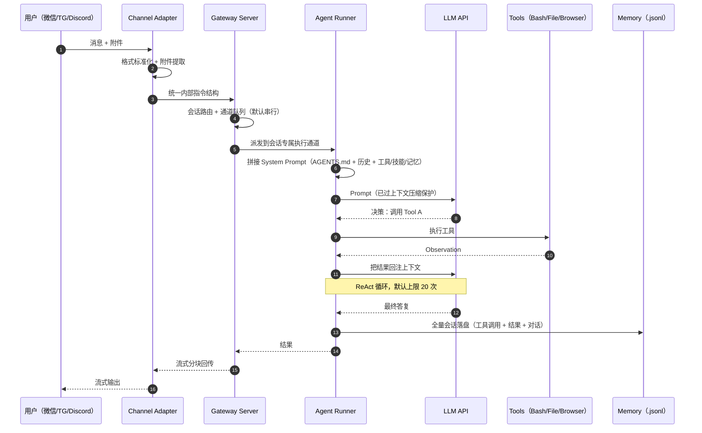

## TL;DR

| 结论 | 论据 |
|---|---|
| **它是把本地算力 + 大模型做成数字员工的开源智能体框架** | 推理引擎与执行环境解耦，跑在你自己的机器上，数据不出本地 |
| **核心流水线五步** | Channel Adapter（标准化）→ Gateway（分单与并发控制）→ Agent Runner（拼 Prompt、选模型、看住窗口）→ Agent Loop（ReAct 循环，上限 20 次）→ Memory（`.jsonl` 持久化） |
| **"Pi 内核"是它的稳定性来源** | 把模型抽象、流式推理、Agent Loop、工具执行收敛到 `read`/`write`/`edit`/`bash` 四个原语 |
| **7 个 Markdown 文件决定 Agent 的人格** | `AGENTS.md` / `SOUL.md` / `IDENTITY.md` / `USER.md` / `TOOLS.md` / `HEARTBEAT.md` / `BOOTSTRAP.md`，改文件即改性格，重启生效 |
| **最值得抄的两个设计** | 基于通道的串行队列（规避异步状态冲突）、浏览器语义快照（<50KB 替代 5MB 截图） |

本文是 [Harness Engineering：模型提供智力，Harness 提供确定性](/blog/agent/harness/harness-engineering/) 那套五层坐标的落地对照。**建议先读那一篇再看本文**——你会发现 OpenClaw 的每一个组件，都能对上 Harness 的一层。

---

## 一、定位：先把"大脑"和"手脚"分开

OpenClaw 不是聊天机器人，它的核心设计命题是**推理引擎与执行环境解耦**：

- **大脑**（大模型）负责思考：判断下一步该做什么、调用哪个工具。
- **手脚**（工具）负责执行：读文件、跑命令、开浏览器。
- 中间用一套**标准协议**让它们配合。

这个解耦带来两个直接的工程红利：**换模型不用重写工具层，加工具不用重写推理层**。这也是它能挂满数千社区 Skills 还不崩的结构性原因。

项目地址：官网 `openclaw.ai`、主仓库 `github.com/openclaw/openclaw`、技能仓库 ClawHub。技术底座是 TypeScript CLI（要求 Node.js ≥ 22），而非传统 Web 应用。

---

## 二、架构：一条指令的完整旅程



### 第 1 站：Channel Adapters —— 消息的翻译官

来自 Telegram、WhatsApp、飞书、Discord 等 IM 的消息，先经各自的 Adapter 做两件事：

1. **标准化预处理**：把不同 IM 千差万别的消息结构统一，屏蔽格式差异。
2. **附件提取**：自动识别并提取图片、文档、音频内容。

每个 IM 软件一个专属 Adapter。**每接一个新渠道，写一个新翻译官，上层系统一行不用改**——这是典型的开闭原则落地。

### 第 2 站：Gateway —— 交通警察，而非简单转发器

Gateway 是系统中枢，负责收单、派单、回传。它的设计亮点有三：

- **基于通道的命令队列**：默认**序列化执行**，每个会话有专属执行通道。这个决策直接规避了传统 `async/await` 异步嵌套带来的状态冲突与调试地狱：同一会话的任务一个一个来，防止"上一个还没干完，下一个就把状态搞乱"。
- **可显式并行**：判断为低风险、互不干扰的任务，可以声明并行运行以提高吞吐。
- **统一通信入口**：默认 WebSocket 端点 `ws://127.0.0.1:18789`。

一句话：**默认排队保安全，必要时开快车道。**

### 第 3 站：Agent Runner —— 推理引擎

它是"思考 + 调度"的核心，包含 LLM（思考决策）、tools（可执行工具）、skills（工具使用方法）三个模块，干四件事：

1. **动态拼接系统提示词**：会话历史 + 核心配置 `AGENTS.md` → 完整 Prompt。
2. **智能模型选择**：按 API 配置选模型，高流量时可自动启用备用模型保稳定。
3. **模型推理与工具调用**：LLM 判断是否需要工具，工具结果经 Gateway 回传到对应 channel。
4. **上下文窗口维护**：接近模型阈值时自动压缩，或终止无效请求，避免 token 浪费与推理失败。

OpenClaw 支持**多 Agent 模式**：各 Agent 互相独立、拥有专属配置与记忆，可并行处理不同任务。

### 第 4 站：Agent Loop —— ReAct 闭环

```text
Thought  （LLM：下一步该做什么）
   ↓
Action   （tools：执行具体命令）
   ↓
Observation（执行结果回注给 LLM）
   ↓
回到 Thought …… 直到收敛或达到上限（默认 20 次）
```

循环上限不是保守，是**防止死循环把钱烧光**。这是 Harness 里"控制循环"这一层的典型实现：循环必须有出口，出口必须可审计。

### 第 5 站：Memory —— 持久化记忆

任务结果在回传到 IM 的同时，系统会以 **`.jsonl` 格式持久化全量会话数据**（工具调用记录、执行结果、对话内容）。这既服务于回溯，也是后续上下文理解与记忆检索的数据基础。

**为什么必须持久化？** 因为大模型天生"过目就忘"——上下文窗口一关什么都不记得。把每次对话、每次工具调用写进硬盘，下次问"上周你帮我做过什么"才有得查。

---

## 三、配置：7 个 Markdown 文件定义 Agent 的灵魂

安装后在 `~/openclaw/workspace` 下能看到 7 个核心文件，它们定义了 Agent 的身份、行为准则、记忆规则与工具配置：

| 文件 | 一句话作用 | 类比 |
|---|---|---|
| `AGENTS.md` | 核心指南：行为规范、会话流程、内存管理、安全规则、群聊原则、工具使用、心跳配置 | 员工手册 |
| `BOOTSTRAP.md` | 首次启动引导：与用户对话确定名称/性格/风格/表情，写回 `IDENTITY.md` 与 `USER.md`，完成后可删 | 入职引导 |
| `HEARTBEAT.md` | 周期任务清单：邮件查收、日历提醒、天气、服务器状态检测 | 日程表 |
| `IDENTITY.md` | 身份证：名称、类型、风格、表情符号、头像路径 | 身份证 |
| `SOUL.md` | 灵魂内核：核心价值观与行为边界，拒绝"讨好型 AI" | 三观 |
| `TOOLS.md` | 环境特定的工具参数与运行环境的本地笔记 | 工具箱清单 |
| `USER.md` | 用户档案：基本信息、关心事项、项目背景、操作偏好 | 客户档案 |

**这套设计的本质，是把 Harness 的知识层从代码里挪到了文件系统。** 改一个文件就是改 Agent 的性格，重启即生效，非程序员也能参与配置。同时它也埋了一个坑（见第五节权衡 3）：**这些文件会被全量读进 System Prompt，写得越长越贵**。

---

## 四、底层：Pi 内核 —— 为什么把复杂度收敛到 4 个原语

OpenClaw 的底层不是传统 Web 应用，而是嵌入了一个极简推理内核 **Pi**。

**Pi 的定位**：通用轻量推理引擎，负责模型抽象、流式推理、Agent Loop 与工具执行。设计上遵循极简主义——把核心能力收敛到四个底层原语：

```text
read   （读）
write  （写）
edit   （改）
bash   （执行命令）
```

类比操作系统：文件操作就那几板斧，复杂功能全在上层组装。**核心越小，越不容易出错、越稳。**

**融合方式（三层解耦）**：OpenClaw 通过 SDK 把 Pi 嵌进 Gateway 架构，实现三个动作：

1. **清空 Pi 自带的内置工具**，避免与上层工具冲突；
2. 通过 `customTools` 接口把 OpenClaw 的工具链完整注入 Pi；
3. 形成三层分工：**Pi 管"怎么执行"**，**OpenClaw 管"有哪些工具"**，**Skills 管"工具怎么组合解决具体问题"**。

第三层尤其关键：它让算法工程师也能贡献能力。想加一个"查 GitHub 仓库"的技能，只需要写一份 `SKILL.md` 说明书，不用碰底层代码。

**一份完整的 `SKILL.md` 通常包含五部分：**

```text
1. 自然语言描述  → 用途、适用场景、物理限制
                   （例："此工具用于管理 GitHub 仓库，请谨慎执行删除操作"）
2. 命令示例      → 具体 CLI 调用方式，让模型通过 Few-shot 掌握拼写规范
3. 参数说明      → 各参数语义与取值范围
4. 安全红线      → 明确禁止的行为（如敏感密钥的传输路径规则）
5. 接口与返回结构 → Base URL、请求方法、期望的 JSON 返回格式
```

---

## 五、五大设计亮点与代价

### 1. 记忆机制：短期 + 长期 + 混合检索

| 层次 | 载体 | 行为 |
|---|---|---|
| 短期记忆 | `memory/YYYY-MM-DD.md` | 仅追加每天上下文日志，会话开始时自动读当天和昨天 |
| 长期记忆 | `MEMORY.md` | 持久化保存用户偏好、重要决策，跨会话保留 |

- **混合检索**：短期/长期记忆切成 chunk 后，用**向量检索 + 关键词匹配**双路召回。这是典型的精度/召回折中：向量补语义相似，关键词补精确命中。
- **上下文压缩**：接近窗口阈值时，**先执行 Memory Flush**（强制把关键状态落盘），再压缩总结。顺序很重要——反过来的话，压缩会把关键信息一起剪掉。

### 2. 系统操作：四种本地能力 + 语义快照

- **Shell 执行**：三种运行环境——沙箱（Docker，高风险）、本地宿主机（常规）、远程设备（跨设备）。
- **文件系统**：读、写、编辑。
- **浏览器**：基于 Playwright，但**抛弃了图像截图路线**，改用**语义快照（Semantic Snapshot）**——基于页面可访问性树（accessibility tree）生成文本化表征。
  - 收益极其具体：**文本表征不足 50KB，而截图通常是 5MB 级**。token 消耗下降两个数量级，模型还能通过 `[ref=1] button "Sign In"` 这类标识精准定位元素。
- **进程管理**：创建、终止本地进程。

语义快照是整个项目里我最欣赏的一个取舍：**AI 不需要"看"网页，它需要"读"网页**。把多模态问题降维成文本问题，成本、准确率、稳定性三头都赢。

### 3. 心跳机制：从被动响应到主动自治

在 `HEARTBEAT.md` 里用类 Cron 的定时机制定义周期任务（每 4 小时查服务器、每天早上推天气），Agent 从而具备 7×24 小时运行能力。

这里是 Agent 产品形态的分水岭：**有心跳，AI 才从"客服"变成"员工"**。

### 4. 安全：有限权限设计

让 AI 操作你的电脑，等于把家门钥匙给它。OpenClaw 参考 Claude Code 的策略做了两层：

- **命令白名单**：用户对命令做单次允许 / 始终允许 / 拒绝；基础安全命令（`head`、`grep`）直接放行，高风险命令需授权。
- **危险语法拦截**：默认拦截包含命令替换、重定向（如重定向到 `/etc/hosts`）等危险 Shell 语法结构。

关于"为什么必须在结构性层面而非 Prompt 层面拦截"，参见 [Harness Engineering](/blog/agent/harness/harness-engineering/) 里权限链五道闸门的讨论：**前三道必须是硬逻辑，不经过 LLM**。

### 5. 代价与坑

**坑 1：默认串行带来的吞吐损失。** 同一会话串行是拿安全换来的，代价是长任务期间该会话被完全占满。适合个人助理场景，不适合高并发场景——需要并行时必须显式声明，且要自己承担状态冲突风险。

**坑 2：配置文件越写越胖。** 7 个 Markdown 全量注入 System Prompt，`AGENTS.md` 写得越细，每轮 token 成本越高，且可能重蹈 [Harness 篇](/blog/agent/harness/harness-engineering/) 里提到的 ETH Zurich 实验覆辙——自动生成的知识文件让推理 token 增加 14%–22% 而成功率不升。**这些文件应该只装模型自己探索不到的约束。**

**坑 3：`memory/日期.md` 只按日期窗口读取。** 会话开始时只读当天和昨天，跨三天以上的长任务会丢上下文，而且"日期邻近"不等于"语义相关"。应该补混合检索召回，而不是纯时间窗口（详见下面 Q2）。

**坑 4：ReAct 循环上限 20 次既可能不够、也可能太多。** 复杂重构任务 20 次往往不够，需要拆子 Agent；而任务发散时 20 次足以烧掉可观成本。工程上应按任务类型调粒度，并设置 **token 预算**做第二道保险。

**坑 5：`SKILL.md` 是供应链攻击面。** 社区 Skill 里藏一条把环境变量插进 curl 的命令就能泄漏密钥。轻量防御是加载前做静态扫描 + 危险语法黑名单；更完整的做法可参考 [Hermes 源码级拆解](/blog/agent/harness/hermes-agent-internals/) 里的 `skills_guard` 设计——90+ 威胁正则、符号链接逃逸检测，外加按 Skill 来源分级处置的信任矩阵。

---

## 六、同类替代：想读源码该看谁

| 项目 | 特点 | 适合场景 |
|---|---|---|
| **Nanobot**（HKUDS） | 超轻量 Python 版 OpenClaw 替代品，代码量缩小约 99% | 想快速读懂核心逻辑、做二次开发 |
| **NanoClaw**（qwibitai） | 不到 1k 行 TypeScript 重写核心，OS 容器级隔离，8 分钟能读完 | 轻量部署 + 安全要求高 |

想理解概念 → 读 NanoClaw（1k 行）；想看完整工程实现 → 读 OpenClaw；想研究"经验沉淀"这条差异化路线 → 读 Hermes。

---

## 🎯 面试官连环追问

**Q1：为什么 OpenClaw 的 Gateway 要默认串行执行，而不是全异步？这在分布式系统设计里不是开倒车吗？**

不是倒车，是**把并发正确性从"寄希望于代码写对"降级为"结构上不可能出错"**。

Agent 会话的状态不是无状态的 HTTP 请求，它有极强的时序依赖：上一轮的 Observation 是下一轮 Thought 的输入，工具还在写文件时若并发发起另一个针对同一文件的编辑，就会出现覆盖写与读脏数据。异步嵌套让这类竞态极难复现和调试，而且一旦出错，往往是"模型行为变怪"这种最难归因的形式。

采用**每会话一个专属执行通道 + 默认串行**，把并发粒度退回到会话级——同一会话严格有序，会话之间依然并行。这在工程上就是"用队列换确定性"。代价是单会话吞吐受限，所以它把"并行"做成显式声明：程序员判断任务互不干扰时手动开启，把风险 decision 交还给明确知道自己在做什么的人。

一句话：**默认串行是把并发安全的责任从每个调用方身上收回到系统结构上。**

**Q2：`memory/YYYY-MM-DD.md` 每天一个文件 + 会话开始时只读当天和昨天，这个设计有什么隐患？**

三个现实问题：

1. **跨天任务的上下文断裂。** 任务在 23:50 开始、次日 01:20 结束，新会话读"今天 + 昨天"恰好覆盖——但如果任务跨了三天，第三天的会话就读不到第一天的内容了，而第一天的日志里往往有最关键的需求描述。
2. **日志文件无限增长。** 追加写没有治理，久了单日文件会非常大，会话开始时全量读取会吃掉大量上下文预算。
3. **"日期邻近"不等于"语义相关"。** 一周前定下的架构决策今天依然重要，但它不在"今天 + 昨天"里；反之昨天的临时调试噪音会被无差别读进来。

改进方向通常是：日志文件按大小滚动（比如超过 N 行就切分）；召回改为**混合检索**（日期邻近 + 向量语义 + 关键词），而不是纯时间窗口；以及把"稳定偏好/长期决策"与"流水日志"分开存——也就是 OpenClaw 里 `MEMORY.md` 与 `memory/日期.md` 的分工，只是把窗口读取换成检索召回。

**Q3：如果让你给 OpenClaw 加一个企业级特性，你加什么？**

我会加**工具调用的可审计与策略外置**，具体三件事：

1. **结构化审计流**：把每次工具调用（谁、什么 Prompt、哪个工具、参数摘要、结果摘要、耗时、是否命中拦截）落成一条可查询的事件，而不是只存对话文本。企业环境里，"AI 改了生产数据库哪个字段"必须能在事后 5 分钟内回答出来。
2. **策略即代码（Policy as Code）**：把命令白名单、危险语法黑名单、路径边界外置成独立的策略文件（类似 OPA），与 `AGENTS.md` 这类"人格文件"分离。人格可以随业务改，安全策略必须集中治理、版本控制、灰度发布。
3. **预算与熔断**：按会话/租户设 token 与工具调用上限，达到阈值自动降级（换小模型、缩小上下文、拒绝高风险工具）而不是直接失败。这是把 LLM 应用在成本与可用性上做成可运营系统的前提。

这三件事的共同点是——**它们都属于 Harness，不属于模型**。这也正是 [Harness Engineering](/blog/agent/harness/harness-engineering/) 想说的事。
