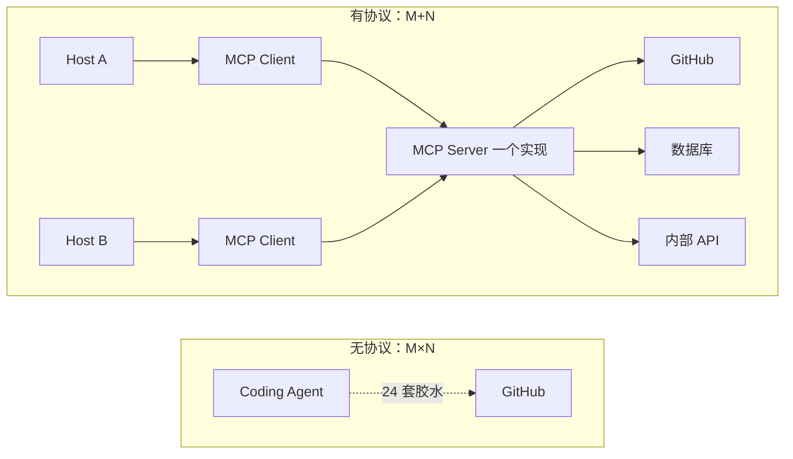
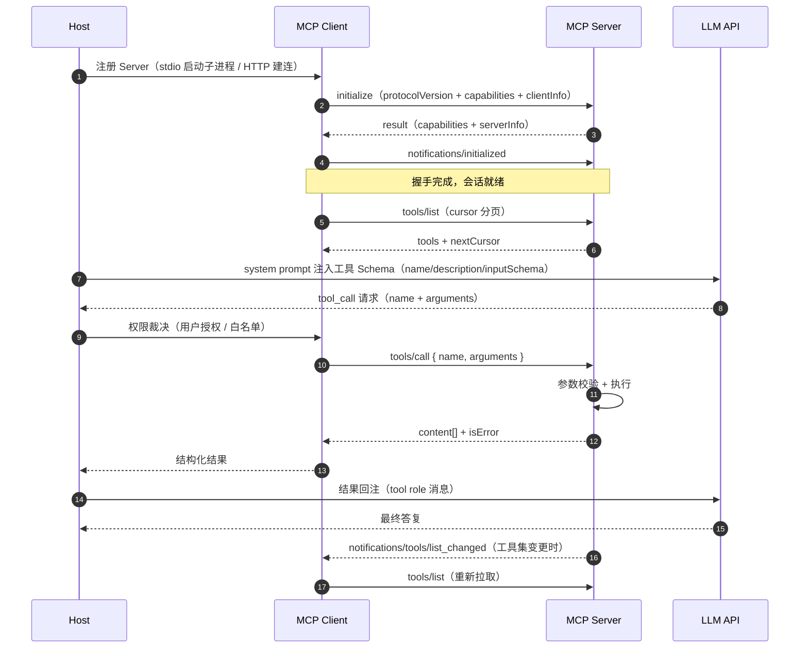

## TL;DR

| 结论 | 论据 |
|---|---|
| **MCP 解决的是 M×N 集成问题，不是"更强的 Function Calling"** | M 个 Agent 应用 × N 个数据源/工具，没有协议时就是 M×N 次定制胶水代码；有协议后 M+N |
| **协议分两层：消息层 JSON-RPC 2.0 + 传输层（stdio / Streamable HTTP）** | 消息格式与传输方式解耦，同一套 method 可以在本地子进程和跨机器 HTTP 上跑 |
| **三大原语的控制权完全不同** | Resources（应用驱动）、Prompts（用户驱动）、Tools（**模型驱动**）——这是设计意图，不是功能划分 |
| **stdio 的坑不在协议，在进程模型** | Server 是 Host 启动的子进程，1:1 生命周期绑定，天然无法横向扩展；连接池池的是"会话"而不是 socket |
| **Streamable HTTP 之后，主流部署形态是"有状态会话 + 可选流式响应"** | SSE 旧版的双端点（GET 推送 + POST 发送）+ session id 粘性，曾是负载均衡与防火墙的重灾区 |
| **多租户鉴权是 MCP 落地最脆弱的一环** | 本地 stdio 没有鉴权模型，HTTP 传输引入 OAuth 2.1 + audience 校验 + scope 粒度，做错了就是把用户 token 直接送进第三方 Server |

理解 MCP 的正确姿势：**它先把"上下文注入"标准化，再把"工具发现"标准化。** 这正是 [Harness Engineering：模型提供智力，Harness 提供确定性](/blog/agent/harness/harness-engineering/) 里上下文构建层（第 2 层）与执行网关层（第 4 层）之间那一段的协议化。

---

## 一、为什么必须有一个协议：M×N 困局

先看没有协议的世界。假设你有 4 个 Agent 应用（Coding Agent、客服 Agent、数据分析 Agent、浏览器助手），每个都要接 6 类外部能力（GitHub、数据库、文件系统、搜索、内部 API、浏览器）。Function Calling 的做法是：**每个组合各写一遍胶水代码**——M × N = 24 套。每套都要写工具描述、Schema、提示词模板、错误处理，而且换个框架就不能复用。

MCP 的解法是把集成数量降到 **M + N**：



Anthropic 把它比作 **AI 应用的 USB-C**：设备侧实现一次接口，主机侧接入任意设备。2024 年 11 月开源以来，OpenAI、Google DeepMind、Microsoft 相继宣布支持，Cursor、VS Code、Zed、Sourcegraph 等都做成了 Host。

但要注意 USB-C 比喻的边界：**MCP 只在同一个信任域内工作得很好**。跨信任域的场景（把用户 GitHub token 交给任意第三方 Server）不是 USB-C 能解决的，那是鉴权与边界问题，见第五节。

---

## 二、三层拓扑：Host、Client、Server

三层角色必须分清，面试里混用这三个词是经典减分项：

| 角色 | 是什么 | 例子 | 职责 |
|---|---|---|---|
| **Host** | 用户直接使用的应用 | Claude Desktop、Cursor、VS Code、你的 Agent 服务 | 管理 Client 实例、裁决权限、注入 UI |
| **Client** | 协议客户端，**每个 Server 一个** | stdio 子进程句柄、HTTP 连接池 | 1:1 与 Server 建会话、发 JSON-RPC 请求、处理能力协商 |
| **Server** | 轻量进程/服务，暴露能力 | GitHub Server、Postgres Server、文件系统 Server | 提供原语（Resources/Prompts/Tools）、执行调用 |

关键点：**Client 不是全局单例，而是"每个 Server 连接一个 Client 会话"**。这个设计直接决定了连接池的形态（第五节展开）：Host 要管的是 N 个独立会话的生命周期，而不是一个多路复用的连接。

**能力协商（Capability Negotiation）** 在握手时完成。Client 发 `initialize` 声明自己支持什么（`sampling`、`roots`、`elicitation`…），Server 回 `initialize` result 声明自己提供什么（`tools`、`resources`、`prompts`，以及是否支持 `listChanged` 通知）。之后双方互发 `notifications/initialized`。这意味着**新版本协议可以做前向兼容**：能力没协商上，对应 method 就不会出现在工具列表里。

---

## 三、协议报文：JSON-RPC 2.0 + 生命周期握手

MCP 的消息格式就是标准的 **JSON-RPC 2.0**（request / notification / response，`jsonrpc: "2.0"`、`id` 关联响应）。没有自定义二进制格式——这换来了可调试性（`mcp dev` 能直接看报文）。

完整的握手与调用时序：



四步值得拆开讲：

### ① `initialize` 不只是打招呼

它做三件事：约定 `protocolVersion`（如 `2025-03-26`）、交换 `capabilities`、交换 `clientInfo` / `serverInfo`（名称 + 版本，用于日志与问题定位）。版本不兼容时 Server 直接返回不支持的错误——**这是唯一的硬失败点，其余全可协商**。

### ② `tools/list` 是动态发现的全部意义

客户端在连接前**根本不知道有哪些工具**。连上之后调 `tools/list` 拿到 Tool 列表，每个 Tool 带：

```json
{
  "name": "get_current_weather",
  "description": "当你想查询指定城市的天气时非常有用。",
  "inputSchema": {
    "type": "object",
    "properties": {
      "location": { "type": "string", "description": "城市或县区" }
    },
    "required": ["location"]
  }
}
```

这样的 inputSchema 恰好就是 [Tool 篇](/blog/agent/tool-calling/tool-calling-and-sandboxing/) 里讲的 Function Calling JSON Schema——**MCP Server 的输出可以直接喂给任何模型的 `tools` 参数**，这正是 USB-C 的接法。换成数据源不用改客户端一行代码。

### ③ `tools/call` 的错误不抛异常

Server 执行失败返回的是 **`isError: true` + `content[]`**，不是 JSON-RPC 层面抛 error。这个设计有实际后果：**协议层的"调用成功"和"业务成功"是两件事**，客户端必须把 `isError` 的结果照样回给模型，让模型自己判断重试还是换方案。把它当异常吞掉，模型就会拿着"工具没返回"错下去。

### ④ `notifications/tools/list_changed`：缓存的失效信号

Server 声明支持 `listChanged` 后，工具集变化会主动推送通知，客户端重新 `tools/list`。这是缓存正确性机制——**没有它，客户端对 tools/list 的缓存只能靠 TTL**，而 TTL 在 Server 升级后会读到过期 Schema。

---

## 四、传输层选型：stdio 与 HTTP/SSE/Streamable

传输层和消息层是解耦的。MCP 至今主要三种形态：

| 维度 | **stdio** | **HTTP + SSE（旧版）** | **Streamable HTTP（2025-03 起）** |
|---|---|---|---|
| 拓扑 | Client 拉起 Server 子进程 | 跨机器 HTTP | 跨机器 HTTP |
| 连接模型 | stdin/stdout 一对管道 | **双端点**：GET 开 SSE 收 + POST 发 | **单端点**：POST 发，按需升级为 SSE 流式响应 |
| 会话状态 | 无（进程即会话） | 有，`Mcp-Session-Id` 头粘住 | 有，session 头 + 可选流 |
| 鉴权 | **无**（本来就是自己的子进程） | OAuth 2.1 + Bearer | 同左 |
| 适用 | 本地工具（文件系统、本地脚本） | 遗留部署 | **远程/多租户生产部署** |
| 主要坑 | 子进程生命周期、事件循环、stderr 污染管道 | 需要粘性会话、代理缓冲 SSE、断线重连要重放 `Last-Event-ID` | 有状态 server 仍然难水平扩展 |

### stdio：看着最简单，坑最多

stdio 把 Server 跑成 Host 的**子进程**，通过标准输入输出走换行分隔的 JSON。优点是没有网络开销、没有端口管理、没有鉴权。但工程上有一串具体的坑：

```text
① 子进程生命周期与 Host 绑定：Host 退出 server 必须退出，
   Server 崩溃 Host 要能发现（否则模型拿到的是哑掉的工具）
② stdout 只能走协议，日志必须重定向 stderr，
   否则一行日志就能污染整条 JSON-RPC 流
③ Host 默认继承全部环境变量 → 密钥平泄露面
④ Windows 下 stdio 子进程 + asyncio 事件循环策略冲突（Proactor 卡死）
⑤ 冷启动开销：每次 Host 启动都要 spawn 一次，Python server 100~300ms
```

我在 OpenClaw 那篇里看到的做法可以对照着看：[OpenClaw 架构拆解](/blog/agent/harness/openclaw-architecture/) 是把工具链（含 bash/file/browser）**注入内核而不是拉起外部进程**，换取的是更低的启动延迟与更少的进程面；MCP 反过来用"进程即隔离"换取**独立部署与第三方代码风险隔离**。两种路线没有高下，只有适用面。

### HTTP+SSE 到 Streamable HTTP 的演进

旧 SSE 模式有两个端点（GET `/sse` 收 + POST `/messages` 发），靠 session id 关联。真实部署的麻烦：

- **负载均衡必须粘性会话**：session 状态在 Server 内存里，请求落到另一个实例就 404 会话失效。云上 ALB 配置错了，现象是"时好时坏的 MCP"。
- **代理与防火墙**：SSE 长连接被 Nginx/企业代理缓冲掉，症状是流式响应整批到达而不是增量到达。
- **断线重连**：客户端要带 `Last-Event-ID` 重放，服务端要做消息缓存，否则重连后丢事件。

2025 年 3 月的协议修订把它统一成 **Streamable HTTP**：客户端 POST 到单一端点，Server 可以返回单个 JSON，也可以把响应升级成一条 SSE 流。顺手解决了"GET 端点被滥用/误配"和一部分代理缓冲问题，但**有状态会话的扩展难题一个都没少**——只是协议层不再逼你用双端点。

---

## 五、生产环境的三个死穴

### 死穴一：连接池池的是"会话"，不是 socket

多租户高并发下，最直觉的错误设计是：做一个 MCP Server 集群，前面放负载均衡，Client 里开几十个连接复用。

错在哪：**MCP Client 与会话是 1:1 绑定到逻辑上的**。如果 Server 工具集是按用户/租户定制的（比如只暴露该用户有权限的仓库），那么一个会话绝对不能跨租户复用。这时"池"的正确形态是：

```text
池的 key = (server_id, subject, scope)   # 不是 server_id
池的容量上限由「Server 端单实例可承载会话数」决定，不由客户端决定
空闲会话要 TTL 驱逐 + Last-Used 淘汰（否则 stdio server 进程无限堆积）
```

如果工具集是**公共的、无租户差异**，才可以安全做多路复用：一个 Client 会话服务所有请求，代价是失去"按租户鉴权"的粒度。**先判工具集是不是租户相关的，再决定池怎么建**，这个判断比池的实现重要得多。

### 死穴二：鉴权模型跨了信任域就失效

stdio 场景根本不需要鉴权——进程是你自己拉起来的，环境变量是你自己给的。一旦换成 HTTP 传输，信任域就变了：Server 是别人的服务，Client 替它拿着**用户**的凭证。

MCP 规范（2025-03 auth spec）采用 OAuth 2.1，落地时最容易错的三点：

1. **token 的 audience 必须校验**。模型侧 SDK 经常把上游 token 原样透传给 MCP Server，Server 如果不校验 `aud` 包含自己，一个认真做了签名的 token 就能拿去访问另一个 Server——典型的 token 混淆攻击。
2. **scope 要按工具粒度下发**，不是一个 `mcp:all`。用户只授权了"读 GitHub issue"，工具列表里就不该出现 `create_issue`——**下发了就是诱导**，这跟 [Harness 篇](/blog/agent/harness/harness-engineering/) 里"被 alwaysDeny 的工具连 schema 都不给模型"是同一条原则：模型不能调用它不知道的工具。
3. **凭证不能进 system prompt、不能进 trace 日志**。链路里任何一个把 `arguments` 落盘的地方都是泄露点；`Authorization` 头要单独脱敏。

### 死穴三：stdio Server 无法水平扩展

这套拓扑里 Server 的实例数 = Host 数。100 个用户在本地跑 Claude Desktop，就有 100 份 GitHub MCP Server 进程。每个进程自己带一份连接池、一份缓存、一份凭据刷新。资源浪费是次要的，**运维是致命的**：升级一个 Server 要等所有客户端各自升级，没有统一的版本与观测面。

所以业界的实际形态是：**本地 Server 做个人工具，远程 Server 做团队共享，中间用 Gateway 聚合**。Gateway（类似 ClawHub 或自建代理）负责认证、限流、工具集编排，把 N 个本地进程的运维收敛成 1 个服务的运维。代价是多一跳延迟与一个新故障点。

---

## 六、踩坑清单与 Trade-off

| 坑 | 症状 | 对策 |
|---|---|---|
| Server stdout 被日志污染 | JSON 解析偶发失败，错误信息像半个 JSON | server 日志强制走 stderr；写入前用换行分帧；加 `2>&1` 重定向测试 |
| stdio 子进程静默死亡 | 工具调用全部超时，但 Host 显示"已连接" | Host 侧 monitor 子进程存活，死亡即摘除该 Server 的工具并上报 |
| 冷启动拖慢首字延迟 | 每次对话前 lib 200ms | Host 常驻预热 `initialize`，会话与 `tools/list` 结果缓存 + `list_changed` 失效 |
| 工具数膨胀撑爆 system prompt | 6 个 Server × 20 工具 = 120 个工具全量注入 | 按能力协商裁剪 + 按需加载（渐进式披露，见 [Hermes 篇](/blog/agent/harness/hermes-agent-internals/) Tier 0/1/2 的设计） |
| HTTP Server 会话 404 | 多实例部署，间歇性失败 | 加粘性会话，或把会话状态外置 Redis，让 Server 无状态化 |
| SSE 被代理缓冲 | 流式变批量，前端像卡住 | nginx `proxy_buffering off` + `X-Accel-Buffering: no` 头 |
| `isError` 被当异常吞 | 模型拿着空结果硬答 | 协议错误（JSON-RPC error）与业务错误（`isError: true`）分流处理，后者必须回给模型 |

**Trade-off 总结**：MCP 拿"协议标准化 + 生态复用"换掉了两部分——**换掉了对传输的精简控制**（你要接受 JSON-RPC 的开销和 SSE 的怪癖）、以及**换掉了内联工具的低延迟**（多一次协议往返）。40 个工具以内、单租户、本地场景，直接内联工具（像 OpenClaw 的 Pi 内核那样）通常更快；一旦涉及跨团队复用、第三方能力接入、Host 多端统一，MCP 的收益才会超过成本。

---

## 🎯 面试官连环追问

**Q1：MCP 和 Function Calling 到底什么关系？有了 MCP 是不是就不需要写工具描述了？**

三层关系：**MCP 不取代 Function Calling，它取代的是"工具发现的胶水层"**。

Function Calling 是模型侧能力——模型怎么表示"我要调 `get_weather(location=北京)`"，这是 OpenAI/Anthropic 在推理层就支持的输出协议。MCP 是应用侧协议——Host 怎么发现"这个 Server 上有哪些工具、Schema 长什么样、结果怎么回传"。二者的接缝恰好是那个 JSON Schema：MCP `tools/list` 返回的 `inputSchema` 原样就能塞进模型的 `tools` 参数。

所以"有了 MCP 还写不写工具描述"的答案是：**要写，但只写一次、写在 Server 侧**。`description` 还在，而且比以前更重要——因为在 MCP 生态里它是唯一索引，写得好不好直接决定模型选得准不准。变的只是**写在哪、复用几次**：从"每个应用各写一份（M×N）"变成" Server 写一份，所有 Host 复用（M+N）"。

反过来说，如果你的场景是单应用 + 少量私有工具，上 MCP 是纯增成本：多一层进程/连接管理、多一跳延迟、多一套鉴权。

**Q2：stdio 和 Streamable HTTP 怎么选？如果让你给一个团队设计 MCP 接入网关，核心决策点是什么？**

选型的判断顺序是三条，按权重排：

1. **Server 是谁的代码？** 自己团队的代码、部署在你控制的机器上 → stdio 最简单（无鉴权、无端口、无网络故障面）。要接第三方/跨团队服务 → 必须 HTTP 传输，重点转到鉴权与租户隔离。
2. **工具有没有租户差异？** 工具集因用户而异（按权限裁剪仓库、按部门裁剪 SQL 库）→ 会话必须带租户身份，池按 `(server, subject, scope)` 建，Server 必须能按 token 动态裁 `tools/list`。公共无差异工具 → 用无状态网关 + 单会话复用，扩展性最好。
3. **Server 要不要独立升级？** 要 → 远程化，本地只留 Client。

网关本身我会做四层：**接入层**（OAuth 2.1 换 token、audience 校验、scope→工具集映射）、**路由层**（Server 注册表 + 健康检查 + 熔断，Server 挂了立刻从 Host 的工具列表摘除）、**执行层**（请求队列 + 超时 + 结果截断，结果长度上限必须在这里强制，不能让超长 output 回流到 Host 把上下文撑爆）、**观测层**（每次 `tools/call` 落 trace：谁、什么工具、参数摘要、返回大小、耗时、是否被降级）。这四层里最难的是执行层的限流与截断策略——它是 [Tool 篇](/blog/agent/tool-calling/tool-calling-and-sandboxing/) 沙箱与截断机制的协议化版本，**必须做在网关而不是每个 Host 里**，否则 N 个 Host N 套策略，出事没法统一收口。

**Q3：Server 的 `tools/list` 该不该缓存？怎么在"启动快"和"不过期"之间权衡？**

必须缓存，关键是失效策略分场景。

- **本地 stdio Server**：生命周期短（Host 启动到退出）、工具集极少在会话中途变。做法是 Host 启动时预热一次并缓存整个会话，同时监听 `notifications/tools/list_changed` 做主动失效。冷启动开销靠"Host 启动即预初始化"摊掉，不让它落在用户第一次提问的关键路径上。
- **远程 HTTP Server**：工具集变更相对频繁（Server 升级、租户权限变化），会话长。做法是短 TTL（比如 60s）+ `list_changed` 长连接推送双保险——SSE/Streamable HTTP 的连接本来就在，推送成本几乎为零，TTL 只是兜底连接断开的窗口。
- **多租户场景**：token 刷新、权限变更会让同一会话的工具集悄悄变化。这类**不能只靠推送**，要在权限敏感操作（如 `tools/call` 返回无权限）时强制重新 `tools/list`，把"用过期工具集调用了不存在的工具"变成自愈而不是错误。

权衡的本质：缓存的是"发现成本"（一次网络/进程往返 + schema 拼装），赌的是"过期成本"（拿到过期工具集）。`list_changed` 存在时，赌局几乎不亏；不存在时（老 Server），TTL 才是唯一防线。**永远不要缓存 `tools/call` 的执行结果**——那是业务幂等性问题，不是协议层的缓存机会。
