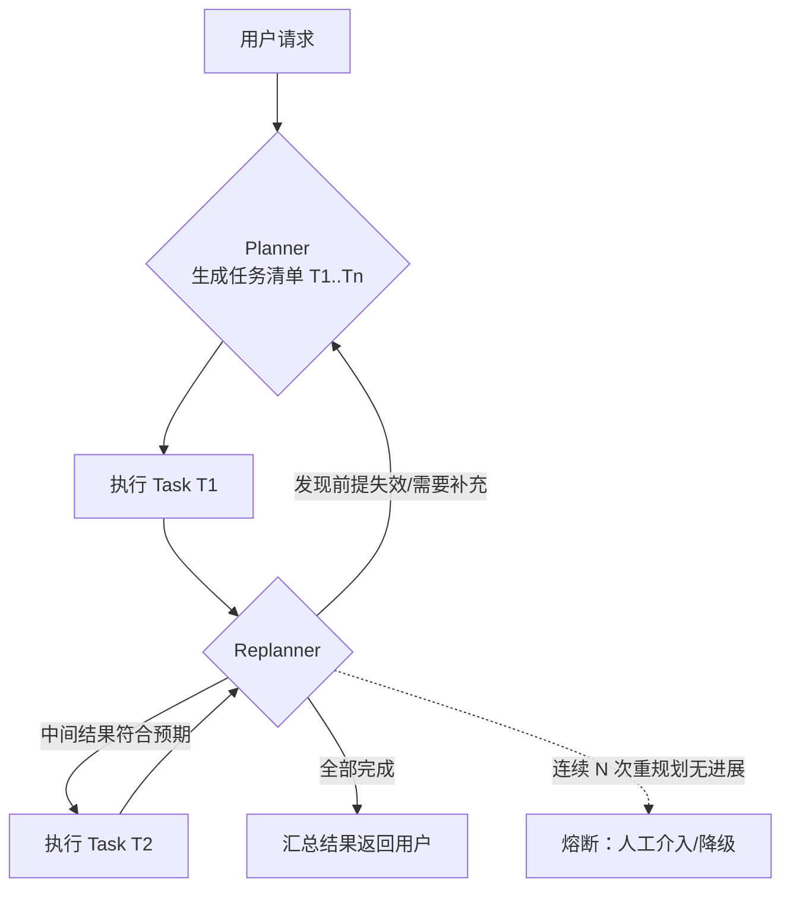
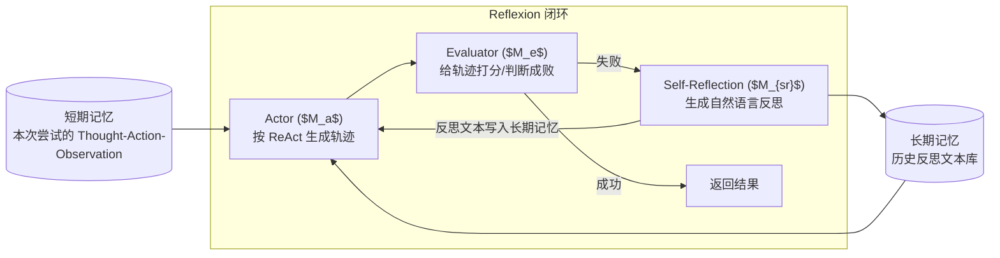

## TL;DR

| 结论 | 论据 |
|---|---|
| **规划范式没有银弹，只有"控制权交给谁"的差异** | Prompt 规划=模型自由发挥（灵活、不可审计）；硬编码流程=程序定死（可控、僵化） |
| **ReAct 的价值是灵活性，代价是 Token 与延迟双高** | 每轮 Thought 都要重放全部历史，长任务下输入 Token 线性膨胀 |
| **Plan-and-Execute 把"想全局"和"做局部"分离，是生产主流** | 加 Replanner 后能动态修正，但对规划器质量要求极高——规划错了后面全错 |
| **ReWOO 反其道：计划里带变量占位符，最少 2 次 LLM 调用** | 推理与观察分离，省 Token 但**完全没有纠错机会**，适合稳定的工具链 |
| **Reflexion / LATS 用"反思"替代"重试"，成本在评估而不在执行** | 反思文本进长期记忆，不更新权重实现自我修正；LATS 用 MCTS 换质量，计算开销爆炸 |
| **生产的正确答案是混合**：主干硬编码保底，节点级 ReAct 兜底，异常路径才重规划 | 三者不是互斥选项，是同一套系统的三层 |

Planning 的所有努力，本质都是在回答 [Harness Engineering](/blog/agent/harness/harness-engineering/) 里那个问题：**循环该在什么时候继续、什么时候终止、走错了怎么回来。**

---

## 一、先想清楚：规划权该给模型还是给代码？

动手选范式之前，有个更前置的判断，几乎所有 Agent 项目死掉都死在这里。

**交给 Prompt（模型自由发挥）**，当：

- 问题不确定、场景复杂、没有标准化流程；
- 场景会临时变化（今天要爬网页，明天要读数据库）；
- 需要多个备选方案——创意、文案、初稿；
- 业务频繁变化，硬编码改不动（维护成本压不过来）。

**交给代码（人工/程序定死）**，当：

- 流程固定、可控性要求高：KYC 实名认证、法务审签、风控策略；
- 合规安全不能容忍违规输出，必须可解释、可审计；
- 核心业务关键性高（金融交易的步骤），宁可牺牲灵活度也要保证可验证；
- 需要严格按顺序联动外部系统（数据库 → API → 对账）。

**现实里的正确答案是混合**：主干流程用代码固定，在需要创造力的节点用 Prompt 做局部规划。电商售后系统里，"身份信息验证、是否符合退货政策"这两步必须硬编码——用户说一句"我是VIP通融一下"不能让模型自由裁量；而"给用户写一封什么样的致歉说明"可以交给模型。

判断维度收敛成四个问题：**允许多少创造力？可控性与风险承受度？维护成本？可解释性与审计要求？** 四个都回答完，范式选择基本没有争议空间了。

---

## 二、规划方法的全景谱系

按"计划从哪来"可以把方法分成五类，这也是面试里被问"你了解哪些规划方法"时的答题骨架：

| 类别 | 思想 | 代表 |
|---|---|---|
| **任务分解** | 分而治之，先拆再解 | CoT、ReAct、Plan-and-Solve、HuggingGPT |
| **多计划选择** | 生成多条路径，评估选优 | ToT、CoT-SC、RAP |
| **外部规划器辅助** | LLM 只做形式化翻译，专业求解器出解 | LLM+P（PDDL） |
| **反思与优化** | 拿执行反馈迭代修正 | Reflexion、CRITIC、Self-Refine |
| **记忆辅助规划** | 从长期记忆检历史经验辅助规划 | MemoryBank、REMEMBER |

下面按工程相关度逐个拆。

### 2.1 CoT 与 ToT：只会想，不会做

Chain-of-Thought 把复杂问题分解逐步求解，零样本版只要在 prompt 里加一句"让我们一步步思考"。它的天花板很明显：**一条链走到黑，中间错了后面全错，而且不能跟外部世界交互**。

Tree-of-Thoughts 让模型在每一步生成多个候选思路，显式长出搜索树，用 BFS/DFS 探索+评估剪枝。质量上限高于 CoT，但**每次扩展都要跑一次模型**，成本随树深指数增长。工程上只有两类场景值得上：一次错代价极高的决策（架构选型、合规判断），或离线批处理（跑一夜没关系）。

### 2.2 LLM+P：让专业的来解决专业的

LLM 不擅长长期规划与精确推理，而传统规划方法在问题被规范化表达后能用搜索算法找到最优解。LLM+P 的做法是把自然语言描述的规划问题**翻译成 PDDL**（Planning Domain Definition Language），交给经典规划器求解，再翻译回自然语言。

PDDL 分两部分：**领域定义**（可能的动作、前提条件、效果）与**问题定义**（初始状态、目标状态）。

这条路线的适用面很窄——要求问题本身可以被严格形式化（仓储调度、类似 SAT 的组合编排）。但只要用对了，**它是唯一一个"结果可验证"的规划路线**：规划器输出的每步都有前提条件校验，不满足就是发现矛盾。金融风控、工业编排这类"错一步就要追责"的场景，LLM+P 的严谨性是 ReAct 系给不了的。

### 2.3 ReAct：单步循环的全部细节

ReAct = Reasoning + Acting。核心是把推理轨迹与行动交替进行：

```text
Thought 1: 我需要先确认仓库最新的 release 版本
Action 1: run_shell("gh release list --limit 1")
Observation 1: v2.4.1   2026-09-30
Thought 2: 下载这个版本的源码
Action 2: checkout(v2.4.1)
Observation 2: OK
...直到收敛
```

它对纯 CoT 的改进有两个：**可解释**（每步推理落轨迹，出问题能定位到第几步）、**可交互**（能拿外部真实信息修正内部知识）。代价在 Token：**每一轮都要把之前所有 Thought + Action + Observation 重新塞进 prompt**，长任务下输入长度线性膨胀，TTFT 也随之恶化。

所以 ReAct 的天花板场景是：轮次少（3-8 轮）、每轮 observation 小、需要灵活的短链路任务。超过这个规模就该考虑下面两种结构化规划。

---

## 三、Plan-and-Execute 与 ReWOO：把"想"和"做"分开

### 3.1 Plan-and-Solve / Plan-and-Execute

Plan-and-Solve 针对 Zero-shot-CoT 的三类错误（计算错误、缺失步骤、语义误解）——先制定计划分解子任务，再执行。它解决了"缺失步骤"：把题目拆开，模型不会漏掉隐含环节。

**Plan-and-Execute 是它的工程化升级，关键增量是 Replanner**：



Replanner 在每个子任务完成后重新思考：把原有计划 + 已完成步骤 + 最新 observation 一起塞进 prompt，更新任务列表。**这个回环是 Plan-and-Execute 区别于 ReWOO 的核心**——它保留了对错误的响应能力。

代价同样明确：**LLM 调用次数从 2 次变成 1+N 次**（每个子任务后都可能触发一次重规划），且对规划器的能力要求极高：初始计划的质量决定整体天花板。规划器弱 → 后面全是垃圾步骤的精致重排。

### 3.2 ReWOO：token 极简主义

ReWOO（Reasoning without Observation）反其道而行：**推理与外部观察分离**。三个角色：

- **Planner**：把问题分解为子任务并定序，生成**带变量占位符**的完整计划；
- **Worker**：按计划调用工具，把结果填回占位符；
- **Solver**：综合全部计划与证据生成最终答案。

```text
计划（Planner 一次生成）:
  #E1 = Search("Qwen3 发布时间")
  #E2 = Search("Llama 4 发布时间")
  Answer = Compare(#E1, #E2)

执行（Worker，不经过 LLM）:
  #E1 → "2026-04"    #E2 → "2025-04"
```

优势极其量化：

1. **最少 2 次 LLM 调用**（Planner + Solver），中间执行不需要模型；
2. Planner 不依赖工具输出——**可以在不真实调用工具的情况下离线微调规划器**；
3. 每个步骤彼此独立，天然可并行（这也是 LLMCompiler 的直接前身）。

代价是**零纠错**：计划生成即定死，工具跑坏了没机会改。所以 ReWOO 只适用于**工具链稳定、无二异性、可预测的任务**（固定表单查询、固定数据拉取）。开放式任务用 ReWOO，第一个错误之后就是连环错。

### 3.3 LLMCompiler：并行 DAG

LLMCompiler 把 ReWOO 的并行做到极致，四个模块：

1. **函数调用规划器**（LLM）：理解输入，分解子任务并确定依赖，生成**任务依赖 DAG**；
2. **任务获取单元**（无 LLM）：贪婪策略取出可执行任务，用实际值替换后续任务的占位符并解除阻塞；
3. **执行器**（多个）：并发执行任务；
4. **动态重规划**（LLM）：根据中间结果生成新子任务与依赖。

例子很直观："微软市值要增长多少才超过苹果？"——查微软、查苹果两个子任务**无依赖，并行执行**，比 ReAct 省掉整整一个串行回合同步。

这里要强调一个常见误读：LLMCompiler 的收益来自**识别并行的依赖关系**，不是"开多个线程跑模型"。如果规划器生成的 DAG 实际是一条链，并行度就是 1，收益归零，还多付一次规划器的 Token。**DAG 的质量决定这个框架值不值。**

### 3.4 三种范式的硬指标对比

| 维度 | ReAct | Plan-and-Execute | ReWOO | LLMCompiler |
|---|---|---|---|---|
| LLM 调用次数 | N 次/轮（1+N 循环） | 1 + M 次重规划 | **2 次** | 规划 1 + Joiner 1 |
| Token 增长趋势 | 每轮重放全部历史，**线性膨胀** | 规划+执行状态，中 | **最低** | 中 |
| TTFT（首次响应） | 低（直接开始） | **中**（要先完整规划） | **最高**（等计划+全部执行） | 高 |
| 中途纠错 | 天然支持 | **强**（Replanner） | 无 | 有（动态重规划） |
| 并行度 | 1（串行） | 1 | 高（步骤间独立） | **最高**（DAG） |
| 错误传播 | 逐步暴露 | 计划级隔离 | **计划错误→全错** | DAG 局部隔离 |
| 适用 | 短链路探索 | **复杂长任务（生产主流）** | 稳定工具链、省 Token | 多独立子任务、低延迟 |

---

## 四、Reflection：让 Agent 从错误里学，而不是重试

### 4.1 Reflexion：Actor + Evaluator + Self-Reflection

Reflexion 借强化学习的思想——**不更新权重，用语言反馈实现自我修正**。三个角色：



- **Actor**：从策略采样行动、从环境拿观察、生成轨迹（可用 ReAct）；
- **Evaluator**：输入轨迹算奖励分——这里可以省事用**启发式**：长时间未完成（低效）、连续相同动作拿到相同观察（幻觉/死循环），都属于要打低分的轨迹；
- **Self-Reflection**：把失败原因写成自然语言："第三步没有先检查依赖版本，导致构建失败"，**存进长期记忆**，下一次尝试作为上下文的一部分。

工程上这一步的价值：**反思比"原样重试"强得多**——重试十次同样的错，平均九次白烧钱；带反思的重试，模型第二次就绕开那个坑。代价是每次失败都要额外两次模型调用（评估 + 反思）。

### 4.2 Self-Discover：对任务本身反思

相比 Reflexion 对执行过程反思，Self-Discover 反思的是**任务结构**：先从原子推理模块库（批判性思维、逐步思考、类比…）里选出对当前任务有用的模块（SELECT），把一般描述改写成任务相关的（ADAPT），再组装成结构化可执行计划（IMPLEMENT，键值对形式，类似 JSON）。

它的定位是"**给任务现造一个思维框架**"。在固定类型任务反复出现时，Discovery 的结果可以固化下来变成流程——这和 [Hermes 篇](/blog/agent/harness/hermes-agent-internals/) 里"把复杂任务沉淀成 Skill"是同一种思想的两种实现：前者运行时现造，后者落盘成资产。

### 4.3 LATS：把 MCTS 搬进 Agent

LATS（Language Agent Tree Search）融合 ToT、ReAct、Plan-and-Solve、Reflexion 与强化学习，核心是**用蒙特卡洛树搜索平衡探索与利用**：

- 树的节点表示**状态**，边表示**行动**（ReAct 的行动空间 = 工具调用 ∪ 推理步骤）；
- 每轮从当前状态采样 n 个行动，与环境交互得到子节点；
- 选择用 UCT：$\text{UCT}(s) = V(s) + w\sqrt{\ln N(p)/N(s)}$，$V(s)$ 是节点期望价值，$N$ 是访问次数；
- 价值评估用 LLM 当 value function，并引入 self-consistency 启发（被选次数多的动作更可靠）；
- episode 结束反向传播：$V(s) \leftarrow (V_{old}(N-1) + r)/N$；
- **reflection**：拿到奖励后让模型反思错误轨迹，反思存进记忆，供后续迭代参考。

它是目前质量上限最高的范式，也是**计算成本最高的**：一次任务背后可能几十次模型调用 + 多次环境交互。LatS 只在"质量远重要于成本"的场景成立——比如离线跑高质量合成数据、生成训练用的正样本。把它放在在线服务里，成本和延迟都不可接受。

### 4.4 BabyAGI 与 AutoGPT：任务列表驱动

两个早期开源系统的共同内核：**一个动态任务列表**。

BabyAGI 三个组件：Task Creation Agent（根据执行结果不断新建子任务）、Task Prioritization Agent（重排优先级）、Execution Agent（执行当前最高优先级任务）。AutoGPT 则是 AI Config + Memory + Planner + Command Executor 四模块。

它们的历史价值大于工程价值——**验证了"任务列表 + 优先级重排"这个最小闭环可行**，也演示了它的失效模式：没有终止条件的任务创建会让列表无限膨胀，以及"重排"本身烧掉的 Token 很快超过任务本身。今天回看，这套结构更接近后来 LangGraph 的 state machine + checkpointer。

---

## 五、生产环境怎么做：三层混合架构

把上面所有范式塞进一个可运维的系统，我的定型方案是：

```text
┌─ 第一层：确定性主干（硬编码 / 工作流引擎）
│   身份校验、风控、审批、不可绕过的合规步骤
│   模型无权改这里，只在这里拿输入、交结果
│
├─ 第二层：节点级 ReAct（循环由 Harness 兜底）
│   每个需要灵活性的节点自带：轮次上限、编辑次数阈值、
│   退出前验收拦截（没跑测试不让停）
│   —— 这三条就是 Harness 的死循环保险
│
└─ 第三层：规划 + Replanner（Plan-and-Execute）
    仅在第一层判断"此任务需要全局拆解"时触发
    规划结果存为可审计的 plan artifact
    单步失败 → 局部重试；连续 M 步失败 → 触发重规划；
    连续 K 次重规划无进展 → 熔断降级（转人工 / 换小模型走确定性分支）
```

动态重规划（Re-planning）的触发条件值得单独定死，这是最容易拍脑袋的地方：

| 触发条件 | 动作 |
|---|---|
| 单步工具失败/超时 | 原参数重试 1 次 → 失败即报 Replanner |
| 连续 2 步 Observation 高度相似 | 判定打转，强制换路径（不等模型自己说放弃） |
| 计划前提被推翻（目标对象不存在、权限不足） | 立即重规划，不要带着错前提往下走 |
| Token 预算消耗超 60% 但任务完成度 < 30% | 预警回收：砍掉可选支线，保核心目标 |
| 重规划次数用尽 | 熔断，把已有中间结果 + 失败原因交人工 |

注意最后两条——**它们不是模型能自己判断的**，必须由外层循环以硬编码方式强制执行。这正是 [Harness Engineering](/blog/agent/harness/harness-engineering/) 的核心主张：**"什么时候停"这件事不能交给被监督者自己决定。**

---

## 六、踩坑清单

**坑 1：用 ReAct 硬扛长任务。** 超过 15 轮的 ReAct，输入 Token 大半是历史轨迹。演进路径应该是：ReAct 起步 → 观察历史膨胀 → 上摘要/滑窗（代价：丢细节）→ 换 Plan-and-Execute（控住规划结构）。**不要等烧到账单难看再动**。

**坑 2：Plan-and-Execute 的规划器用弱模型。** 计划质量决定天花板，这里省钱等于全链路省钱假象。实践是分级：规划/反思用最强模型，执行层用便宜模型——这与 [Harness 篇](/blog/agent/harness/harness-engineering/) 里"规划与验证高强度、执行中强度"的三明治策略完全一致。

**坑 3：Reflexion 的评估器用启发式却当成 ground truth。** "连续相同观察"这个启发式在**工具本身有缓存**时会误判（同样的输入就该返回同样的结果，不是模型幻觉）。评估器要区分"模型在原地打转"和"环境在正常复读"。

**坑 4：ReWOO 用在开放式任务。** 看它省 Token 就上，结果第一步检索失败，后面九步全在错误前提上演算。判据很简单：**这个任务的工具链是不是每次输入都一样稳定？** 不确定就用 Plan-and-Execute。

**坑 5：LATS 放上在线服务。** 一次请求几十次模型调用，延迟和成本双爆炸，还得配限流。它的正确位置是离线数据生成，或只在最高优先级的请求上开。

**坑 6：重规划没有熔断。** 只在 happy path 上设计的 Replanner，遇到"怎么改都不对"的任务会无限重烧。M 次失败转熔断这一条必须在写第一版时就加。

---

## 🎯 面试官连环追问

**Q1：ReAct 和 Plan-and-Execute 在实际项目里怎么选？给一个可落地的判断流程。**

我会按四个问题走，全走完基本不会选错：

1. **任务轮次预期多少？** ≤8 轮 → ReAct 够用，收益是启动快、实现简单。>15 轮 → ReAct 的 Token 膨胀会变成主要成本，直接上 Plan-and-Execute。
2. **中间步骤能不能被计划出来？** 能预先列出"先查什么、再算什么都清楚" → Plan-and-Execute 的规划质量高。任务本身是探索性质（"看看这个仓库有什么问题"） → **别规划**，规划只会得到一堆空话步骤，ReAct 的灵活性才对路。
3. **错误的代价形态是什么样？** 少次关键失败 → 要 Replanner 兜底（动态修正）；低价可容忍大量失败 → ReAct 莽过去更省心。
4. **有没有可并行的独立子任务？** 有 → 至少用 LLMCompiler 式的 DAG 并行，别白白串行烧延迟。

四个问题答完，90% 的任务有明确答案。剩下 10% 是混合场景（主干固定 + 节点探索），那就是我第五节的三层架构：**主干硬编码、节点 ReAct、异常才重规划**。

**Q2：Plan-and-Execute 的"重规划"具体怎么做？什么时机触发？失败了怎么不失控？**

机制上，Replanner 每次拿三样东西重新生成计划：原始目标、已完成步骤及其 observation、当前剩余步骤与失败原因。它输出的是**修订后的完整任务列表**，而不是增量补丁——因为增量补丁会让模型悄悄绕开没做的前置步骤。

触发时机我定五条（第五节那张表）：单步工具失败重试一次后、连续两步观察高度相似（打转）、计划前提被推翻、Token 预算超 60% 而完成度不足 30%、以及人工显式介入。

防失控靠三道硬闸，全部由外层代码控制，不靠模型自觉：

1. **重规划次数配额**：同一任务最多 K 次（我一般设 3），用尽即熔断；
2. **规划产物落盘**：每次规划作为可审计 artifact 存下来，出事能回放"它第 2 次为什么改了方向"；
3. **预算熔断**：Token 与工具调用双预算，任一耗尽即降级——交出中间结果 + 明确失败原因，给人工兜底。

最后一条最关键：**熔断不是失败，是设计内的正常出口**。没有熔断的 Replanner 一定会在某个边缘任务上烧到天价账单。

**Q3：Reflexion 和 LATS 都引入"反思"，它们解决的是一个病吗？值不值得上生产？**

不是同一个病，成本结构也完全不同，生产取舍要分开说。

**Reflexion 治的是"重复犯同样的错"**：单任务内迭代，靠语言反馈修正，成本是每次失败多两次模型调用（评估 + 反思），**没有爆炸风险**。生产上完全值得上——尤其工具调用类任务（模型第二次就知道带对参数）。前提是评估器要可靠（启发式规则要小心"环境复读"误判）。

**LATS 治的是"单次选错路"**：靠多路径树搜索在决策那一刻就选对，成本是每次决策都展开 n 个候选 + 反向传播 + 反思，**调用次数乘数级增长**。它本质是拿计算换质量，跟"治迭代错误"是两条路。

所以值不值得上生产就看两件事：**质量是否远重要于成本？任务是否只跑一次但必须对？** 两个都是 → LATS 值得（甚至该放离线）。任何一条否 → 不值。Reflexion 则是默认该有的基础设施——它跟重试的区别只是"多带了一句从失败里学来的话"，这个差价太便宜了。

**如果两个都想上，正确的顺序是先 Reflexion 后 LATS**：前者是单任务内的反馈回路，后者是任务间的策略搜索，混用会互相污染（树搜索的每一步都触发反思，成本瞬间不可控）。
