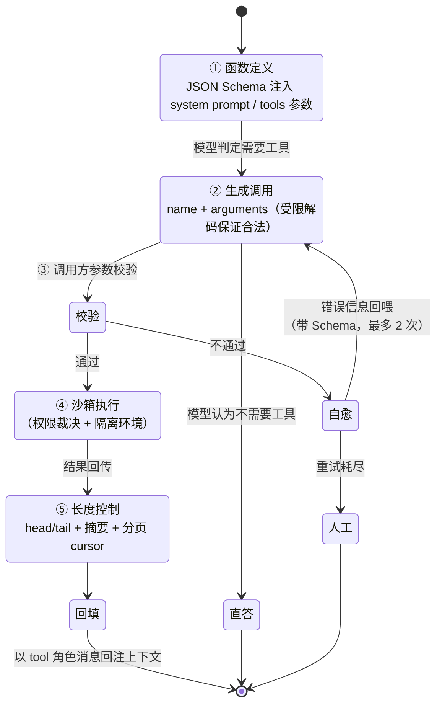

## TL;DR

| 结论 | 论据 |
|---|---|
| **模型会输出合法 JSON 不是模型的功劳，是解码器的功劳** | 受限解码在每一步 logits 上把违反 JSON Schema / grammar 的 token 置 -∞，非法输出在采样前就被消灭 |
| **自由文本协议（` 标签）已被受限解码淘汰，但历史系统里仍有一堆** | 用正则解析模型输出的系统，容错成本全部落在调用方 |
| **参数幻觉的自愈回路：Schema 校验 → 错误回喂 → 重试，最多 2 次** | 超过 2 次说明工具描述有问题，该改的是 Schema 不是重试次数 |
| **结果长度必须由调用方强制截断，不能指望模型自觉** | 一次全表 SELECT 能塞爆上下文并连带污染后续所有轮次 |
| **高危工具的分级：白名单 / alwaysAsk / 沙箱执行 / dry-run 预览** | 权限裁决必须在调用前完成，链里前三道是硬逻辑不经模型 |
| **并行不是开多个线程，是依赖声明** | `isConcurrencySafe` 标注 + DAG 依赖分析，共同决定哪些调用真正可以同时跑 |

这篇是 [Harness Engineering](/blog/agent/harness/harness-engineering/) 执行网关层（第 4 层）的正面展开：**工具调用是全站最靠近"不确定性撞上确定性"的地方**。

---

## 一、一次工具调用的完整链路

标准链路五步，后面所有工程问题都挂在这五步上：



五步在 MCP 时代的对应关系：**第 2 步的输出格式由厂商 tools 参数约束，第 1 步的 Schema 由 `tools/list` 动态发现**——这正是 [MCP 篇](/blog/agent/mcp/model-context-protocol-deep-dive/) 讲协议的原因：Schema 的来源从"每个应用各写一份"变成"Server 写一次、所有 Host 复用"。

---

## 二、受限解码：合法 JSON 从哪里来

新手最常见的误解：模型经过"工具调用微调"，所以会输出合法 JSON。恰恰相反——**后训练只让模型倾向于那样输出，真正保证合法性的是推理层的受约束解码（Constrained Decoding）**。

原理：自回归生成每步都产出 logits。受限解码在两个位置做干预：

```text
① grammar/JSON Schema → 编译成有限状态自动机（FSM）
   状态 = JSON 结构里当前允许出现什么
   转移 = 当前 token 是否把 FSM 推向合法下一状态
② 每步采样前，把 FSM 判定非法的 token 的 logits 置为 -∞
   剩下的候选里照样按 temperature 随机采样
   既保证结构合法，又不完全丧失多样性
```

两个关键工程实现：

- **逐 token mask 的开销**：每次前向多一次 FSM 查表 + 词表 mask。xgrammar 这类实现把 mask 计算缓存成「结构化相同的前文共享同一 mask」，把开销压到接近可忽略。但它改变不了一个事实：**非法 token 在采样前就被消灭**。
- **流式增量校验**：模型一边吐 token，客户端一边做增量 JSON 校验。好处是非法参数在生成过程中就能被发现，而不是等完整输出后再解析失败。

这解释了两个生产现象：

1. **用没有受限解码的端点做工具调用，JSON 合法性断崖下降**。自己部署开源模型时（vLLM 的 `guided_json` 默认关闭），不显式传 `extra_body={"guided_json": schema}`，`tool_calls` 会偶发不可解析。
2. **历史上那套让模型自己拼 `<tool_call>` 类标签、再用正则解析的系统，代价全在调用方**：正则容错、多个 JSON 混排解析、中文引号、尾随逗号——这些坑今天已被原生 tools 参数 + 受限解码消掉。**如果还在维护这套，迁移原生协议是最高优先级的技术债。**

---

## 三、参数幻觉：自愈回路怎么设计

即使受限解码保证 JSON 合法，**语义错误**照样一堆：`city` 传了"北京市"而接口只认"Beijing"、必填字段漏传、`unit` 传了字符串 `"celsius"` 而 Schema 要枚举值。这些结构合法但语义错误，Schema 校验拦不住，要靠执行层自愈。

```python
def call_with_repair(tool, args, schema, max_retries=2):
    for attempt in range(max_retries + 1):
        err = validate(args, schema)           # ① 结构校验：类型/必填/枚举/数值范围
        if err:
            args = llm.repair(args, err)       # ② 错误回喂，让模型重新生成参数
            continue
        normalized = normalize(args)           # ③ 参数归一化
        try:
            return tool.execute(normalized)    # ④ 真正执行
        except ToolError as e:                 #    业务失败：404/超时/无权限
            if attempt < max_retries:
                args = llm.repair(args, f"执行失败: {e}")
                continue
            raise
    raise ToolUnrecoverable(f"{max_retries} 次修复后仍失败")
```

### 归一化：比重试更便宜的第一道防线

| 现象 | 归一化规则 |
|---|---|
| `location` 传了"北京市" | `rstrip("市")` + 同义词表（杭州/余杭区 → 城市码） |
| 日期传"下周三" | 相对时间换算成绝对时间戳 |
| `unit` 传"摄氏"而非 `celsius` | 枚举同义词映射表 |
| 数字传成字符串 `"42"` | 类型强转（仅 Schema 允许范围内） |
| 列表传了单值 | 包装成 `list[value]` |

判断标准：**归一化规则能否穷举？** 能 → 写代码；不能（"把所有提到的人和公司名提取出来"）→ 交给模型修复。把可穷举的归一化丢给模型，是白烧 token。

### 重试上限为什么是 2

- 第 1 次失败：通常是模型对参数语义理解偏差，错误回喂后大概率修正；
- 第 2 次失败：说明**工具描述或 Schema 本身有问题**，再重试只是烧钱；
- 正确动作：停止重试 → 记录失败样本 → 改 Schema 的 `description`（补示例、补边界说明）→ 下次同类错误自动消失。

**连续两次同类修复，本质是工具定义的 bug 在向你要债。**

---

## 四、结果回填：长度是头号杀手

Schema 约束了输入，输出完全是另一个世界。一次 `SELECT * FROM orders` 可以返回 50MB，模型从此再也不会正常工作。

长度控制必须由调用方强制，四层递进：

```text
L1 硬截断：超过 N char 用 head+tail 截断（保留错误开头与结尾）
   风险：破坏 JSON/CSV 结构完整性，截断后的内容不可解析
L2 结构化降维：结构化数据先聚合/分页（top-K、count、distinct）再交给模型
L3 卸载引用：大结果落盘成文件，回填的是路径 + 前 20 行预览；
   Agent 后续按需 read/grep 这个文件（OpenClaw 四原语的正确用法）
L4 分页 cursor：给工具加 limit/offset 语义，让模型翻页而不是一次吞完
```

L3 最被低估。它把"结果太长"从"截断丢信息"变成"延迟加载"，Agent 反而获得处理任意大结果的能力——**上下文是工作区，不是仓库。**

另外必须要求 Server 配合：`tools/call` 要有**明确的 output limit 契约**（超 8k 字符返回结构化摘要 + 完整结果文件路径）。前端拼命截、后端不加约束，等于上游决堤。

---

## 五、并行调用：可并行的依赖声明

模型一次可以请求多个工具调用（`tool_calls` 数组）。但"一起发出"不等于"一起执行"。

参照 [Harness 篇](/blog/agent/harness/harness-engineering/) 里 Claude Code 的工具接口设计，每个工具必须声明：

```text
isConcurrencySafe()  → 可并行执行
```

- `Read` / `Glob` / `Grep` / 只读 API → 并发安全，模型同时读三个文件就是真正的三次并行；
- `Write` / `Edit` / `append` → 串行执行，防止同文件竞态覆盖；
- HTTP 只读查询 → 并发安全，但要控并发度（否则把下游打挂）；
- 入参依赖前一个调用的返回 → 不是并发问题，要靠 DAG 编排（LLMCompiler 思路）。

生产上的并发护栏：

| 护栏 | 实现 |
|---|---|
| 并发度上限 | 信号量限制同时执行的工具数（默认 4-8，按下游容量调） |
| 同资源互斥 | 按 target_key 分桶串行（同文件的 write 排队，不同文件的并行） |
| 超时隔离 | 单个工具超时不影响同批其他调用；超时标记单独回喂 |
| 部分失败容忍 | 批量结果分别回填：成功的原样，失败的说明原因，让模型决策重试哪些 |

最后一条最重要：**批量调用里的一个失败不能炸掉整批**。常见错误是 try/catch 包住整个 for 循环，一个工具 404 就把其他三个成功结果全丢了。

---

## 六、安全边界：高危工具的权限护栏

工具调用是 Agent 唯一能真正造成损失的动作。护栏设计四条铁律：

### 铁律 1：裁决在调用前，前三道不经模型

```text
① 参数白名单校验     （类型/范围/枚举/路径边界）
② 工具级 permission rules
     alwaysDeny  → 直接拒绝；且该工具 schema 不进模型视野
     alwaysAllow → 预授权放行
     alwaysAsk   → 强制人工确认（无视 mode）
③ 输入内容扫描     （危险语法：rm -rf、重定向到 /etc、命令替换）
④ 沙箱执行
⑤ 人工确认（manual mode）
```

注意 ② 的第一条：**被 deny 的工具连 schema 都不该发给模型**——模型不知道它存在，Prompt Injection 诱导调用它的攻击就失去前提。这和 [MCP 篇](/blog/agent/mcp/model-context-protocol-deep-dive/) 讲的 scope 不下发是同一件事：**没下发的能力等于不存在的能力。**

### 铁律 2：Bash 类工具按命令族分级

| 级别 | 例子 | 策略 |
|---|---|---|
| **L0 默认放行** | `ls`、`cat`、`head`、`grep`、`pwd`、`echo` | 白名单直接过 |
| **L1 需确认** | `git commit`、`npm install`、`pip install` | alwaysAsk |
| **L2 沙箱内执行** | 未知脚本、依赖安装、编译 | Docker 容器：无网络 / 只读 rootfs / 资源限额 |
| **L3 结构拦截** | `rm -rf`、重定向到 `/etc`、`curl \| bash`、`$(...)` 命令替换 | 语法级硬拦，不可通过 |
| **L4 永不允许** | 写 `~/.ssh/`、读 `/etc/shadow`、`git push --force` 到 main | 不进工具集 |

L3 必须是语法级拦截（解析 AST / shellcheck 类工具），不能用字符串黑名单——`$(echo rm) -rf`、反引号、`r\m` 这类变形能绕开任何字符串黑名单。

### 铁律 3：SQL 工具不只是只读账号

给 Agent 一个只读数据库账号只是起点。真实防线三层：

```text
① 连接级：只读副本、独立低权账号、行级安全（RLS）限定租户可见数据
② 语句级：执行前解析（EXPLAIN / sqlparse），拒绝 DDL、拒绝无 WHERE 的
   UPDATE/DELETE、强制 LIMIT 上限（SELECT 必须带 LIMIT ≤ 500）
③ 资源级：statement_timeout + 单次返回行数上限 + 临时表空间配额
```

第 ② 层的"强制 LIMIT"要做成**执行器改写**而不是提示词请求——提示词约束模型"记得加 LIMIT"，模型十次里有三次忘；执行器改写是确定性的。**凡是提示词能解决的，都是概率；执行器能解决的，才是保证。**

### 铁律 4：沙箱边界依威胁模型定

| 威胁 | 缓解 |
|---|---|
| Agent 误操作破坏宿主机 | Docker / gVisor；无特权、只读 rootfs、临时 overlay、CPU/内存/PID/磁盘限额 |
| 恶意依赖（`npm install` 装后门） | 容器内无网络或白名单代理；`--ignore-scripts` |
| Prompt Injection 诱导高危调用 | alwaysAsk + alwaysDeny 双保险；高危结果只回"已执行/被拒绝"摘要 |
| 凭据泄露 | 沙箱内**不注入生产密钥**；由 secret broker 按调用签发短期 token |

最后一条常被忽略：**沙箱里不该有值钱的东西**。如果沙箱进程能读到 `~/.aws/credentials`，前面所有隔离都是装饰。

---

## 七、踩坑清单

| 坑 | 症状 | 对策 |
|---|---|---|
| 自部署模型没开受限解码 | tool_calls 偶发 JSON 解析失败 | vLLM/llama.cpp 显式开启 guided_json / grammar |
| 批量调用一个失败炸全批 | 三个成功结果 + 一个 404 全丢 | 逐条 try，失败单独回喂 |
| 结果不设上限 | 上下文膨胀、后续轮次被污染、账单失控 | 服务端 limit 契约 + 调用方 L1-L4 分层截断 |
| 黑名单拦危险命令 | `$(echo r\m) -rf /` 绕过 | 语法级解析，不用字符串匹配 |
| 沙箱注满生产凭据 | 一次注入泄露全部密钥 | secret broker 签短期 token，沙箱零静态凭据 |
| 工具描述含糊 | 模型选错工具或传错参数 | description 写清"何时用、何时不用"，参数给正反例 |
| 工具数量 > 30 | 选择准确率下降、prompt 膨胀 | 按场景分组按需暴露（渐进式披露，参考 [Hermes 篇](/blog/agent/harness/hermes-agent-internals/) Tier 0/1/2） |

---

## 🎯 面试官连环追问

**Q1：受限解码（Constrained Decoding）具体怎么工作？为什么有了它工具调用的 JSON 基本不会错？有什么代价？**

三步：把输出要求（JSON Schema 或 BNF/EBNF grammar）编译成有限状态自动机；每生成一个 token 前，查表得到"当前 FSM 状态下合法的下一个 token 集合"，把 logits 里不在集合内的置为 -∞；从剩余候选里正常按 temperature / top-p 采样。

"基本不会错"指的是**结构永远合法**：括号闭合、类型正确、必填字段存在、枚举值合法——这些采样前就被消灭。但它不管语义正确性（`"city": "北京市"` 完全合法，接口只认英文），所以 Schema 校验 + 归一化 + 自愈重试三层一个都不能省，只是由"经常触发"变成"偶尔触发"。

代价有三：①每步多一次 mask 计算与词表扫描，带来一点延迟（xgrammar 类实现靠缓存共享 mask 压得很小，但不是零）；②强制语法削掉边缘但合理的表达；③复杂递归 schema（oneOf 嵌套）编译出的 FSM 可能很大，编译时间与内存都上来。经验：简单扁平 schema 放开用；复杂 schema 拆分，或退回"宽松 JSON + 后校验"的混合模式。

**Q2：Agent 调用 Bash 工具，你怎么设计沙箱与权限，既让它干活又不搞坏机器？**

按威胁模型分层，不搞一刀切。

**静态防线（调用前）**——权限链四道，前三道硬逻辑不经模型：参数白名单 / alwaysDeny+alwaysAsk 规则（deny 的工具 schema 都不进模型视野）/ 危险语法语法级拦截。危险命令不做字符串黑名单，要解析成 AST 判结构：`$( )`、反引号、管道到 `bash`、重定向到 `/etc`、`~/.ssh` 统统结构性拒绝。

**执行环境（调用中）**——容器化分级：默认容器无网络（或白名单代理）+ 只读 rootfs + 临时 overlay 提供工作区 + 资源限额。npm/pip 安装加 `--ignore-scripts`。最关键一条：**容器内不注入任何静态生产凭据**，外部 API 由 secret broker 按单次调用签发短期 token，泄露窗口从"永久"缩到"一次请求"。

**动态防线（调用后）**——高危操作结果不当原始输出回给模型，只回"已执行/被拒绝 + 摘要"；所有工具调用落审计 trace（工具名、参数摘要、容器 ID、退出码、耗时），可回放可告警。

组织层面再补一条：**给毁坏能力设置不可绕过的物理上限**——容器只挂临时卷，宿主机目录一个都不挂。这样即使前面防线全被绕过，损失也止于一个垃圾容器。

**Q3：模型一次要调 5 个工具，其中 2 个是写操作、1 个的入参依赖第 1 个的返回，你怎么调度？**

先分类，再编排，不直接 `Promise.all`：

第一步，**静态分类**：读每个工具声明的 `isConcurrencySafe()`、目标资源、以及入参里是否引用其他调用的返回（依赖边）。这个例子会得出：3 个读类可立即并行、2 个写操作必须同资源串行、1 个挂依赖边不能先跑。

第二步，**构图**：有依赖的调用连成 DAG，独立分支并行执行。这里复用 LLMCompiler 的思路：规划器产出 DAG，调度器按拓扑序取可执行集合。单次编排不需要 LLM，纯代码拓扑排序就够。

第三步，**执行护栏**：全局信号量限并发（默认 4-8，按下游容量调）；同资源互斥（写同一文件按 target_key 分桶串行，不同文件并行）；单调用超时隔离，超时单独回喂，**绝不让一个失败炸掉整批**。

第四步，**结果回填策略**：成功的原样回，失败的带原因回。让模型看到"3 成功、1 超时、1 被拒"的全景，由它决定重试哪些。**不要代替模型做决定**——比如自动把被拒的那个用不同参数重试，这会绕过 alwaysAsk 的人工确认环节。

核心原则：**并行是执行优化，顺序是正确性要求，不能混为一谈。** 把并发度调大解决不了依赖顺序问题，画出 DAG 才能。
