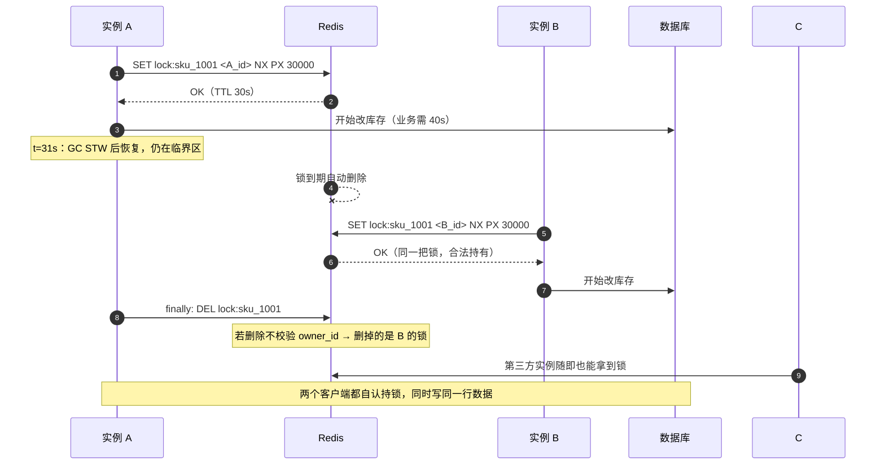

## TL;DR

| 结论 | 论据 |
|---|---|
| **`SETNX key value + EXPIRE` 不是原子操作，所以它不是一个锁** | 两步之间进程崩溃 = 永远没人能拿到、也没人释放的死锁 |
| **误删别人锁的根因是"不知道锁是不是自己的"** | 删除前必须 Lua 校验 owner_id，`GET==me AND DEL` 必须一次原子执行 |
| **业务没跑完锁过期是真凶，GC STW 就足以致命** | 锁 30s、任务 40s，第 31 秒 B 拿到同一把锁，A 与 B 同时改同一条数据 |
| **续期靠看门狗：后台线程周期性把锁 TTL 推回 30s** | 锁还在用就不会过期；宕机/停止则停止续期，锁自然释放 |
| **Redlock 不解决"模型正确性"，只提高可用性** | Kleppmann 的批评核心：GC STW / 时钟跳变下 Redlock 照样不安全；出路是 Fencing Token |
| **生产结论：锁只用来防并发浪费，不保证互斥正确性** | 真正要互斥的地方，用单调递增的 Fencing Token 让存储层拒绝旧令牌的写入 |

---

## 一、三个致命坑：从一次真实推演开始

场景：秒杀扣库存。服务 A、B 两个实例都执行"查库存 → 扣库存 → 写回"。没有锁，两个请求同时读到 `stock=1`，都写回 0，超卖一单。于是加上 `SETNX`：

```python
# 第一版代码
if redis.set("lock:sku_1001", "1", nx=True):
    try:
        stock = get_stock()
        set_stock(stock - 1)
    finally:
        redis.delete("lock:sku_1001")
```

这段代码有**三个**独立的坑，按引爆顺序排：

### 1.1 坑一：加锁不是原子的

`SETNX` 与 `EXPIRE key 30` 是两条命令。进程在两条之间崩溃（OOM kill、机器掉电、异常没进 finally），锁永存——**没有 owner，没有 TTL，谁也别想再拿到**。系统表现为：这个 SKU 永久无法下单，重启 Redis 才好。

修复是把它合成一条原子命令：

```bash
SET lock:sku_1001 <owner_id> NX PX 30000
```

`NX` 保证互斥，`PX` 保证兜底超时。**从这一刻起，锁才具备"最坏情况下能自动解"的性质**。

### 1.2 坑二：误删别人的锁

A 拿到锁，业务跑到 31 秒，锁已过期。B 拿到同一把锁开始改库存。A 这时执行 `finally: redis.delete("lock:sku_1001")`——**把 B 的锁删了**。C 立刻也能拿到锁，三个实例同时写库存。

根因：**删除时不知道这把锁是不是自己的**。修复是 Lua 原子校验：

```lua
-- KEYS[1]=锁, ARGV[1]=owner_id
if redis.call("GET", KEYS[1]) == ARGV[1] then
    return redis.call("DEL", KEYS[1])
else
    return 0
end
```

为什么必须 Lua：`GET` 与 `DEL` 之间一旦有间隔，B 的锁就可能被 A"合法地看着、然后误删"。整个判断-删除必须一次原子执行。**这是分布式锁的及格线**，做不到这一点的实现都不该上线。

### 1.3 坑三：业务没跑完，锁先过期

最致命的一坑。锁 TTL 30 秒，业务逻辑需要 40 秒——原因往往不是代码烂，而是**环境抖动**：一次 Full GC STW 停了 40 秒、一条慢 SQL 卡了 25 秒、下游超时拖了 45 秒。

时间线：



```text
t=0     A 拿到锁（TTL 30s）
t=31    锁过期；B 拿到同一把锁
t=31.5  A 的 GC 停了 40 秒后恢复，继续执行"写回库存"
t=31.5  A 与 B 同时拥有"执行临界区"的事实许可
→ 数据错乱，而且事后无法归因（两边日志都显示"我拿了锁"）
```

前两个坑是"锁坏了"，这个坑是"锁还在，但它保护的东西已经过期"。它会以一种极难排查的方式出现：**两个线程都持有合法的所有者身份，却同时进入了临界区。**

---

## 二、续期：Redisson 看门狗（Watchdog）

对坑三的自然答案是"锁的寿命应该跟着业务走"。Redisson 的看门狗是这个思路的标准实现：

```text
调用 tryLock(leaseTime 不传) 时：
├── 默认 lockWatchdogTimeout = 30000ms
├── 加锁成功 → 注册一个 Netty Timeout 定时任务
├── 每 1/3 TTL（10s）检查一次：
│     业务还在跑（锁没被显式 unLock）？
│       └── 用 Lua 把 TTL 重置回 30000ms（pexpire）
│           key 还存在？不存在 → 锁已因宕机释放，任务终止
└── 业务结束 unLock → 取消定时任务
```

三个设计细节值得注意：

1. **续期本身也是原子的 Lua**：`if GET==me then PEXPIRE`。续期同样可能撞上"锁已过期被别人拿走"，不校验就会**用旧 identity 续别人的锁**——那比误删更糟。
2. **续期周期取 TTL/3**：容忍两次续期失败不失锁，又不至于空转过热。
3. **宕机即停**：进程挂了，看门狗随之消失，锁在 30 秒后自然释放。**"活着续、死了放"这个语义完全靠客户端的心跳维持，不靠服务端。**

看门狗把坑三从"必然发生"压成"只在极端场景发生"：**持锁进程发生超过一个续期周期（10s）的不可恢复停顿**。但 10 秒以上的停顿真实存在——GC STW、容器冻结、宿主机过载。这引出下一篇的主线，也引出 Redis 分布式锁最深的争议。

---

## 三、Redlock 与世纪论战

### 3.1 单点 Redis 的结构性弱点

一个 Redis 主库做锁，主库一旦 failover（对应 [哨兵选主](/blog/backend/redis/sentinel-quorum-and-raft-leader-election/) 篇的场景）：A 的锁在主库 A1 上，A1 还没同步到从库就宕机，新主 A2 上没有这把锁，B 在新主上加锁成功——**A 与 B 同时持锁，锁在故障转移中静默蒸发**。

Redlock（antirez，2014）的答案：向 N 个（典型 5 个）**相互独立**的 Redis 主库（不需要从库）加锁，逐个 `SET NX PX`，只在**多数派（≥3）成功且总耗时远小于 TTL**时才算拿到。多数派在线 = 锁在线；少数派被抢走也不影响大局。这样容忍少数节点故障而不牺牲锁的存在性。

### 3.2 Kleppmann 的批评

Martin Kleppmann 的著名反驳不是"算法写得烂"，而是指出**它假设了一个不成立的世界**：

1. **时钟与进程停顿不可靠**。锁的"过期"依赖客户端估算的流逝时间。一次 GC STW 超过锁 TTL 时，客户端还没走到"我超时了"这一步，锁已在服务端过期、被别人拿走。Redlock 的"总耗时远小于 TTL"判断，挡不住进程侧不可感知的停顿。
2. **它要在分布式系统里拿到"线性一致性"，却只在可用性上做了工程**。多数派成功只证明"多数节点现在没有这把锁"，不证明"在整个加锁时刻前后，没有别人持有它"——后者需要全局时钟或共识，而 Redlock 恰恰绕开了共识（复用从库只是备份，不参与仲裁，因此从库提升反而丢锁）。
3. **antirez 自己的方案细节也在演化**（后来引入更短的 TTL、随机停顿让客户端错峰），实质上承认了初始版本不够。

### 3.3 论战的落地结论：Fencing Token

两边的共识在最后落到同一处——**不要指望锁本身保证互斥，让被保护的资源自己带一个单调递增的令牌**。

```text
加锁服务（Redlock 或任意实现）在授予锁的同时：
    token = token_generator.next()   # 单调递增，全局唯一
把 token 连同请求下发给存储层：
    UPDATE stock SET n = n - 1
      WHERE sku = ? AND token >= service_fencing_max;
    -- 或者写入时带 token，存储层只接受比当前 fencing max 更新的
```

这样即使两个客户端同时"持锁"（锁的互斥性失败），**旧 token 的写入会被存储层拒绝**。锁退化成一个**优化**（减少无谓的并发尝试），真正保证互斥正确性的是一路单调递增的令牌。这就是 Kleppmann 提出的出路，也是 Chubby 论文里同样的模式。

### 3.4 生产选型表

| 方案 | 互斥保证 | 可用性 | 适用 |
|---|---|---|---|
| 单点 `SET NX PX` + owner_id + 看门狗 | 单点内靠 TTL 语义，failover 期间有窗口 | 高 | 绝大多数业务：防重复提交、防重复消费、秒杀减库存 |
| Redlock（5 节点） | 同上：**仍不保证线性一致** | 更高（容忍少数节点故障） | 多机房且单点 Redis 不足以活的场景 |
| `SET NX` + Fencing Token | 存储层保证互斥正确性 | 同锁 | 真正要求互斥正确的地方（扣款、库存、状态机流转） |

**我的默认建议**：单主 + owner_id + Watchdog，**同时在业务层加 Fencing Token**。Redlock 在你没有 5 个独立可用区的时候不要上——多数派 Redis 的运维复杂度会先杀死你。

---

## 四、踩坑清单

| 坑 | 现象 | 对策 |
|---|---|---|
| setnx + expire 分两步 | 锁永久残留 | 合成 `SET NX PX` 一条 |
| 删除不校验 owner | 误删别人的锁，多人进临界区 | Lua `if GET==me then DEL` |
| TTL 拍脑袋定太短 | 业务没跑完锁先过期（GC STW 即可致命） | 看门狗续期 + lease 语义 |
| 看门狗续期不校验 owner | 用旧身份续别人的锁 | 续期也用 Lua 原子校验 |
| 锁内做 RPC 且无超时 | 调一次下游，锁续期到天荒地老 | 临界区只放纯本地操作；外部调用移出 |
| 主从 failover 丢锁 | failover 瞬间两人持锁 | 存储层 Fencing Token 兜底 |
| 锁里做重试风暴 | 解锁失败 → 客户端死循环重试 → 雪崩 | 指数退避 + 最大重试 + 熔断 |

---

## 🎯 面试官连环追问

**Q1：SETNX 实现分布式锁有什么问题？你怎么写一个"生产可用"的版本？**

三个问题对应三层修复。**加锁原子性**：`SETNX`+`EXPIRE` 两条命令，中间崩溃就死锁，合并为 `SET key owner NX PX ttl` 一条。**身份缺失**：value 必须是唯一 owner_id（UUID+线程标识），不能是 `"1"`——否则删除时无法判断是不是自己的锁。**误删**：删除走 Lua `if GET==me then DEL`，判断与删除必须原子。

但"生产可用"不止这三步。第四层是**锁过期**：TTL 定 30 秒，业务 40 秒，第 31 秒锁就没了。解法是续期——Redisson 看门狗每 TTL/3 检查业务是否还在跑，在跑就 `if GET==me then PEXPIRE` 续回去。第五层是**代码纪律**：临界区只放纯本地操作，RPC 和慢 SQL 一律移出或加独立超时（否则续期会一路护送到天荒地老，锁名存实亡）。

还能再讲一层就超出面试要求了：第六层是**承认 Redis 主从 failover 会丢锁**——A1 的锁没同步到从库就宕机，新主上 B 加锁成功，两人同时持锁。这时要么接受"锁只防重复提交不保证互斥正确"，要么在存储层加 Fencing Token 拒绝旧令牌写入。**能主动说清"我的锁保护到哪一层、哪一层保护不到"，比声称"我的锁绝对安全"更有说服力。**

**Q2：看门狗机制具体怎么工作？它自己有没有坑？**

工作方式三步：加锁时不传 leaseTime → 后台注册一个定时任务，每 `lockWatchdogTimeout/3`（默认 10 秒）执行一次续期 Lua（`if GET==me then PEXPIRE 30s`）；业务结束 `unLock` 时取消定时任务。它用 Netty 的 `Timeout` 实现，续期失败（key 不存在）就静默终止——因为那意味着锁已释放或进程已该退出。

它的坑有四个，都是真实会踩的：

1. **续期与业务的生命周期不同步**：如果业务线程还在跑但看门狗线程因为某种原因没被调度（线程池打满、进程几乎 hang 死），续期会断。锁 30 秒到期释放，别人进来。
2. **续期 Lua 不校验 owner**：某些裁剪版实现直接 `PEXPIRE`，会在锁已过期、已被别人拿走后，用旧身份把别人的锁续上——比不续期更糟。
3. **续期掩盖了业务过慢**：业务明明写了死循环，看门狗兢兢业业续了 30 分钟，系统看起来"持锁正常"，实际下游全被阻塞。**看门狗需要配合全局持锁时长告警**，持锁超阈值就报警乃至强制 kill。
4. **可重入语义要小心**：`tryLock` 重入次数记录也在 Redis 里，同一个线程多次加锁的 TTL 续期只认最后一个，嵌套里的释放要靠计数配对，漏配一次就整个锁生命周期错乱。

生产里我的做法：**看门狗开，但 TTL 设上限**（甚至自定义 watchdog 允许的最大续期次数），把它当"防短停顿"的保险，不当"无限持锁"的许可。

**Q3：Redlock 到底安全吗？Kleppmann 和 antirez 在争什么？**

争的是"分布式锁到底该保证什么"。

**antirez 的立场**：Redlock 是**安全性（大多数节点同意就没别人拿锁）+ 活性（容忍少数节点故障）**的折中，比单点 Redis 更好地在故障下维持锁的存在性。它是一个工程上"足够好"的锁。

**Kleppmann 的批评**：这个安全性是假的，因为它依赖两个不可靠假设——客户端能准确感知"过了多久"和"锁还没被别人拿走"。一次 GC STW 超过 TTL，客户端还没意识到自己"超时"，锁在服务端已经过期被 B 拿走；Redlock 的"多数派成功 + 总耗时 < TTL 残留"判断完全建立在客户端时钟与进程连续性上，而这两者恰恰是分布式系统里最不可靠的东西。**它形式上像共识，实质上绕开了共识**（没有 leader 纪元、没有日志，只有多数派 SET），所以它给不了线性一致性。他的替代方案是 Fencing Token：不指望锁互斥，让存储层用单调令牌拒绝旧写入，把正确性问题从"锁"转移到"资源自身"。

我的落地观点：**这场论战对工程决策的影响是"扔掉对 Redis 锁的幻想"**。用 Redis 锁做"防重复提交、防并发浪费"，它是好用且够用的；用 Redis 锁做"保证互斥"，无论单点还是 Redlock 都做不到——把那份正确性交给 Fencing Token 或真正的共识系统（etcd/ZooKeeper）。面试里能给出这个分层结论，基本就到底了。

**加分项**：能指出 Redlock 要求 N 个**相互独立**的 Redis（不是同城多机房的一个集群，也不是主从副本），实际生产里很少凑得齐，这也是它在国内落地少的原因之一。
