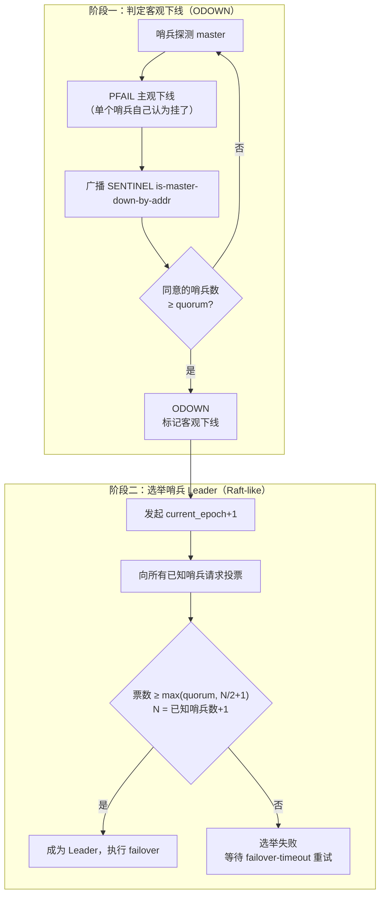
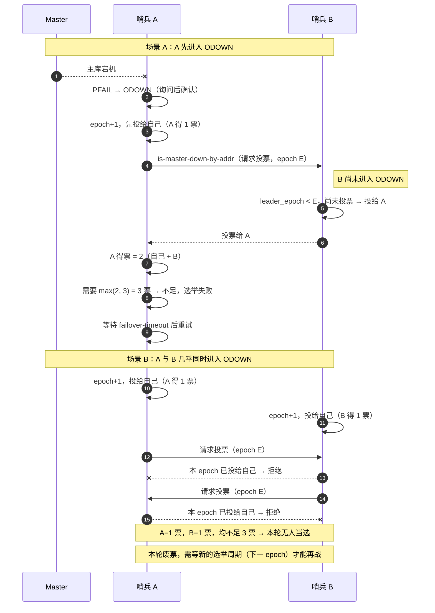

## TL;DR

| 结论 | 论据 |
|---|---|
| **故障转移有两个完全不同的阶段，阈值不同** | 判定客观下线（ODOWN）要 **quorum** 票；选举 Leader 要 **max(quorum, N/2+1)** 票，N = 已知哨兵数 + 自己 |
| **N 是"已知哨兵总数"，不是"当前存活数"** | 已挂掉的哨兵不会被从已知列表里移除，所以 N 不会随哨兵宕机而下降，门槛不会自动放宽 |
| **5 哨兵挂 3 个，quorum=2 → ODOWN 能过，选举必挂** | 选举门槛 = max(2, 5/2+1) = **3**，存活哨兵最多只凑得出 2 票 |
| **这是静默降级，不是故障转移** | 主库宕机前集群看起来完全健康，所以监控捕捉不到——等到真故障时才发现已经不具备自动切换能力 |
| **解法不是把 quorum 调到 1** | 真正要做的是保证任意时刻可达哨兵 ≥ N/2+1，并把"哨兵存活数"纳入告警 |

---

## 一、从一个真实的生产推演切入

拓扑：**1 主 + 4 从 + 5 个哨兵**，每个哨兵配置 `sentinel monitor mymaster 10.0.0.1 6379 2`（`quorum=2`）。

某个周四凌晨：

1. 一次云厂商的可用区抖动，**3 个哨兵实例随之失联**（它们恰好集中部署在同一个可用区）。
2. 存活哨兵剩 2 个，集群仍在正常提供服务（主库活着），没人报警。
3. 上午 09:14，**主库真的宕机了**。

所有人都在等哨兵做故障转移。两条 minutes 过去，什么都没发生。

先看下来 diagnosing 结果：

```text
+odown master mymaster 10.0.0.1 6379      ← 客观下线判定成功了
#failover-delay ...                        ← 但选不出 Leader
```

ODOWN 过了，为什么 failover 不动？因为**这是两件事**。



---

## 二、两个阶段的票数门槛到底怎么算

先用一句话记住区别：

> **阶段一是"大家都觉得它挂了吗"，阶段二是"谁来动手"。前者要的是意见，后者要的是授权。**

### 阶段一：ODOWN 判定，阈值 = `quorum`

单个哨兵自己判定主库不可用，这只是**主观下线（PFAIL, Possibly FAIL）**——它可能只是这一个哨兵到主库的网络抖了。

于是哨兵向其他哨兵发 `SENTINEL is-master-down-by-addr` 问同一件事。当**明确声称主库已下线的哨兵数 ≥ quorum** 时，PFAIL 升级为 **ODOWN（Objectively Down）**。

在我们的场景里 quorum=2，存活的 2 个哨兵都认为主库挂了 → **2 ≥ 2，ODOWN 立刻成立**。这正是日志里看到的 `+odown`。

### 阶段二：Leader 选举，阈值 = `max(quorum, N/2+1)`

ODOWN 不等于可以动手。允许多个哨兵同时执行故障转移会把集群撕成两个主库，所以必须先选出一个 Leader。Redis 哨兵用的选举逻辑是 **Raft-like** 的（epoch + 先到先得投票 + 多数派）。

核心判定可以用这段伪代码表达：

```c
/* sentinelGetLeader() 的核心逻辑 */
int voters       = dictSize(master->sentinels) + 1;  /* 已知哨兵 + 自己 */
int votersQuorum = voters / 2 + 1;                   /* 多数派 */

if (winner && (winner->numVoted < votersQuorum ||
               winner->numVoted < master->quorum)) {
    winner = NULL;   /* 两个条件都必须满足 */
}
```

于是 Leader 的当选条件是：

\[
\text{votes} \ge \max(quorum,\ \lfloor N/2 \rfloor + 1)
\]

代入我们的场景：

| 变量 | 值 | 说明 |
|---|---|---|
| 已知哨兵数 `dictSize(master->sentinels)` | 4 | 自己不在里面 |
| `N = 4 + 1` | **5** | 注意是**已知哨兵总数** |
| `votersQuorum = 5/2+1` | **3** | 多数派 |
| `master->quorum` | 2 | 配置项 |
| 实际门槛 | `max(2, 3)` = **3** | 必须拿到 3 票 |
| 存活哨兵数 | 2 | 只剩 2 个能投票 |

**最多 2 票 < 3 票。选举永远失败。**

### 最容易踩的认知陷阱：N 不会随哨兵宕机而下降

新手常以为"剩 2 个哨兵，那多数派就是 2/2+1 = 2 票嘛"。**错。**

`master->sentinels` 这个字典里保存的是**哨兵发现过的所有哨兵**，挂掉的哨兵**不会被自动移除**（它只是不再响应）。所以：

> **宕机的哨兵依然在计数里，却不投票。**

这是一个刻意的设计：如果 N 随存活数下降，那么网络分区时两个分区都会各自"算出自己占多数"，从而各自选出一个 Leader——这正是多数派（majority）机制存在的意义。代价就是你看到的这个死局：**存活哨兵不足以构成多数派时，系统宁可不做故障转移。**

从 CAP 的角度看，这里选的是 **CP**：宁可不可用，也不牺牲一致性（避免双主）。

---

## 三、微观推演：剩下的 2 个哨兵到底发生了什么

设存活哨兵为 **A** 与 **B**，两者都能感知主库宕机，已进入同一 `current_epoch`。下面两种时序都会走进死路。



### 场景 A：错峰 —— 2 票，还是不够

A 率先满足 ODOWN（先观察到、先问完）。它自增 epoch、给自己投一票，然后向 B 请求投票。

**关键点：B 即使自己还没判 ODOWN，也照样会投票。** 投票的前提是"本 epoch 尚未投给任何人 + 请求的 epoch 更大"，并不要求投票者自身认为主库已下线。所以 B 投给 A，**A 拿满 2 票**。

可是 `2 < max(2, 3) = 3` → **A 依然不能成为 Leader**。它会在本次选举周期结束仍未胜出时放弃这一轮，等待 `failover-timeout` 后带着更大的 epoch 重新发起。`&nbsp;但重试时票池还是同一批存活哨兵，上限仍是 2 票，结果不变。** 这就是你在日志里看到反复 `-failover-abort-not-elected` 的原因。

### 场景 B：同时 —— 1 票对 1 票，分裂

A 和 B 在同一时间窗口各自进入 ODOWN，各自自增到同一个 epoch E，**并且都先把票投给自己**（先看我们自己——每个哨兵在发起选举时总是先给自己投一票）。

随后两边互发投票请求。此时接收方发现自己**在 E 轮已经投过票了**（投给了自己），直接拒绝。结果：A 得 1 票，B 得 1 票，谁也过不了 3 票线。

这一轮废票。必须等下一个 epoch（由 `SENTINEL_FAILOVER_DELAY` 或故障的重试时间窗口驱动）再战——但下一轮存活哨兵依旧只有 2 个，**上限还是 2 票**。

> **两种时序都失败，因为失败的原因不在时序，在票数上限。**

---

## 四、那为什么要把两个阈值设计得不一样？

这才是最值得回答的问题。既然 ODOWN 只要 quorum 票，为什么选举不也用 quorum？

因为两件事的**风险模型完全不同**：

| | 阶段一：ODOWN 判定 | 阶段二：Leader 选举 |
|---|---|---|
| **要回答的问题** | 主库是不是真的挂了？ | 谁有权动手？ |
| **判错的代价** | 该判没判，只是多观望一会儿；不该判却判了（其实是误判却升级成 ODOWN），代价是触发一次本不该有的选举流程 | 选出**两个** Leader 会让集群出现双主，写入会分裂，恢复后需要人工挑选保留哪些数据 |
| **因此需要** | 相对**宽松** —— 快速发现真故障 | 绝对**严格** —— 必须多数派，防止分区各选各的 |
| **阈值** | `quorum`（可配，可以很小） | `max(quorum, N/2+1)` |

双 Leader 是分布式系统里最贵的一类错误（数据不一致、丢写、人工介入），所以**执行权必须握在一个绝对多数认可的实例手里**；而 ODOWN 判定宽松一点没关系，因为它的输出只是一次选举流程，最坏情况也就是"多试了几次"。

这也解释了为什么源码里是两个条件的**与**（AND）关系：**既不能少于多数派，也不能少于 quorum**。设计者刻意保留了这个"冗余"：

- 只满足多数派但不满足 quorum：说明配置方认为"如此少数的确认不足以判定故障"，宁可不选 Leader；
- 只满足 quorum 但不满足多数派：说明这个 quorum 配得太小，集群整体规模已经不支持对自己做决定了。

把 quorum 配到不大于 N/2+1 时，第一个条件永远比第二个严格，quorum 那条就退化为空谈；把 quorum 配成 N/2+1，两个条件合并成一条——这也是上一节建议"让 quorum ≥ N/2+1"的由来。

---

## 五、工程权衡：怎么把这个集群从死局里捞出来

### ① 哨兵不是越多越好

先破除一个直觉：哨兵数不是越大越安全。它带来三类成本：

| 成本 | 说明 |
|---|---|
| **通信开销** | 每个哨兵会对每个主/从建 TCP 连接并周期性发布 hello；哨兵实例越多，主库要接受的订阅与 INFO 压力越大 |
| **投票难度上升** | 需要路基的票数 `N/2+1` 随 N 线性上升；更重要的是**少数哨兵宕机更容易让存活数低于多数派**（本例就是这么翻车的） |
| **故障面变大** | 哨兵越多，出现网络抖动误判的概率也越高 |

实践建议：**3 或 5 个哨兵**，奇数。并且**绝不能把多个哨兵集中部署在同一台机器或同一个可用区上**——本例的 3 个哨兵之所以一起没，是因为它们共享了故障域。

### ② `quorum` 到底该配多少

两种常见配法：

| 配法 | 例子（5 哨兵） | 特点 |
|---|---|---|
| `quorum = 2`（很多教程推荐） | ODOWN 只要 2 票，**两个独立的哨兵**就能判定客观下线 | 灵敏，但会出现本例的"能判不能选" |
| `quorum = N/2+1 = 3` | ODOWN 与选举门槛**一致** | 更不容易误判，且**不会出现"判了 ODOWN 却选不出 Leader"的尴尬窗口** |

我的建议偏向**让 quorum ≥ N/2+1**：这样 ODOWN 一旦成立，就一定有足够 Sentinel 完成后续动作，"ODOWN 了但 failover 不动"这个锅就从根上消失了。代价是新故障的检测灵敏度略降（需要多数哨兵都看到）。

运维上一个常被忽略的点：**`quorum` 可以在线改**——`SENTINEL SET mymaster quorum <n>` 会立刻生效并被持久化。灾难中这是把系统从"只读"里解放出来最快的手段（前提是你先意识到卡在选举而不是 failover 执行上）。

### ③ `down-after-milliseconds`：误判与 RTO 的直接权衡

```
哨兵判定目标 PFAIL 所需的连续无响应时间阈值，默认 30000 ms。
```

| 调小（如 5000ms） | 调大（如 60000ms） |
|---|---|
| ✅ RTO（故障恢复时间）明显缩短 | ✅ 网络抖动/主库瞬时阻塞（如 `DEBUG SLEEP`、大 key 删除、长 GC）**不会被误判** |
| ❌ 一次跨可用区的网络抖动就可能触发一整轮无谓选举 | ❌ 真的宕机时要干等 60 秒才开始动作，RTO 拉长 |

工程上的取舍依据不是"想多快"，而是**最长的可接受瞬间阻塞有多久**。若主库上经常跑耗时的 `KEYS`、大 key 删除、`FLUSHDB`、`INFO` 阻塞，那这个阈值必须比这些操作的最坏耗时更长，否则你会收获一个"每月随机切换一次主库"的集群。

同时注意：**`down-after-milliseconds` 也是从库被判下线、并被排除出晋升候选的阈值**，调得过大会让一个早就死掉的从库长时间留在候选列表里，被选成新主。

### ④ 别把鸡蛋放在一个可用区

本例的根因不是 quorum，是**3 个哨兵共享同一个可用区**。正确的部署模式是：

```text
AZ-A：1 主 + 1 从 + 1 哨兵
AZ-B：      1 从 + 1 哨兵
AZ-C：      1 从 + 1 哨兵
```

任意 AZ 全挂，剩下 2 个哨兵 —— 糟糕，这依然只有 2 票不够 3。所以更稳的写法是保证**任意时刻可达哨兵 ≥ N/2+1**：想要容忍丢一个 AZ，就得让剩余 AZ 里的哨兵数过半（例如 3 个 AZ 各 1 个哨兵 + 2 个额外哨兵，或干脆 5 个 AZ / 5 个哨兵）。

### ⑤ 补两个常被忽略的参数

- **`min-replicas-to-write 1` + `min-replicas-max-lag 10`**：主库在从库延迟过大时拒绝写入，防止主从切换时丢掉大量已确认的写入。它解决的是另一类问题（写入丢失），但和哨兵组合起来才是完整的高可用方案。
- **`parallel-syncs`**：切换后允许多少个从库同时对新主做全量同步。设太大会让新主瞬间被 fork/net 压力打挂；设太小会让恢复时间拉长。一般设 1–2。

### ⑥ 告警要盯"哨兵存活数"，而不是只盯主库

本例最阴险的地方：**集群是健康的（主库活着），只是哨兵多数派已经丢失。** 常规监控在看主库存活、主从延迟，没人看哨兵数。

至少要加两条：

```text
① 已知哨兵数 < N        → 立即告警（3 个哨兵失联那一刻就该收到）
② 可达哨兵数 < N/2 + 1  → 立即告警（此时已失去故障转移能力）
```

配合 `+sdown` / `+odown` 事件的日志告警，才能在真正的故障到来之前把窗口补上。

---

## 🎯 面试官连环追问

**Q1：5 个哨兵挂了 3 个，剩下的 2 个还能干任何事吗？这时候该怎么办？**

理论上不行，实践上要分层看。

**能做的**：这 2 个哨兵依然正常提供服务发现（`SENTINEL get-master-addr-by-name` 会返回当前主库地址，即使主库已经 ODOWN 标记），依然在做监控、在做配置传播。也就是说读写的路径没断——应用还在连主库，只是主库挂了而已。

**不能做的**：它们拿不到 `max(2, 5/2+1)=3` 票，所以**无法选出 Leader，无法触发 failover**。集群失去了自动故障转移能力，这是一个**静默降级**——表面是"高可用"，实质已经退化成"单主"。

**线上该怎么办**（按优先级）：

1. **先恢复哨兵多数派**，而不是急着切主。能拉起旧哨兵就拉起；拉不起来：**新建哨兵实例加入**——但要注意新建哨兵要重新被其他哨兵发现（通过订阅 master 频道 hello 消息），这需要一个 SENTINEL hello 的传播周期（通常是秒级到十几秒）。
2. **如果旧的 3 个哨兵不可能回来了**：在线下调 quorum —— `SENTINEL SET mymaster quorum 2` 不能解决问题（门槛已经是 max 里的 N/2+1=3 在起作用）。真正能解的是**降低 N**：N 来自每个哨兵记录的"已知哨兵字典"，重启哨兵会清空这个字典（重启后它会重新通过 hello 消息发现同伴）。让存活的 2 个哨兵逐个重启，它们重启后各自只知道对方和新发现的哨兵，`dictSize(master->sentinels)+1` 降到 3，`3/2+1 = 2` → **可以选出 Leader**。
3. **最后一招是手动**：`SENTINEL failover mymaster` 强制发起故障转移——但需要注意这条命令也需要 Leader 语义，通常由收到命令的哨兵执行；在多数派缺失的场景下，可以用 Sentinel 的**强一致性要求之外的运维通道**（例如由运维直接选定一个健康的从库执行 `REPLICAOF NO ONE` 提升为新主，再把其他从库指向它）来做紧急恢复。这个动作是最后选项：它会绕过共识机制，操作前必须确认旧主库确实已经无法恢复（防止脑裂双写）。

面试里能把第 2 点（"重启哨兵让 N 归零重算"）讲出来是加分项——它说明你理解 N 的来源是每个哨兵自己的本地视图，而不是全局配置。

**Q2：既然说选举是 Raft-like，它和标准 Raft 有什么不同？**

差别体现在三处，理解它们能避免把两者混为一谈：

1. **term/epilogue 粒度不同。** Raft 的 Leader 是长期任职的，任期内持续工作；哨兵的 Leader 是**一次性的**——它只为**一次特定的故障转移**而选举，failover 完成或被放弃后 Leader 身份就作废。所以哨兵更像"每次行动选一次指挥官"，而不是"选出一个常任 Leader"。
2. **投票限制不同。** 标准 Raft 要求候选人的日志至少和投票者一样新；哨兵选举**完全没有日志/数据新鲜度的比较**——它只比较 epoch，先到先得。这在只有"选谁动手"这个目的的场景下是够用的，但如果你把它当成通用共识组件用，就会踩坑。
3. **日志复制与持久化不同。** 哨兵没有 Raft 的 log replication 和状态机。它的持久化和一致性保证来自另一条路径：配置的 epoch 做了持久化（保证重启后能识别新配置），但具体的状态同步依赖 Redis 自身的主从复制。**哨兵保证的是"谁来决定"，不是"数据如何同步"**。

一句话总结：**哨兵借了 Raft 的选主外壳，但它的语义是"一次性的行动授权"，不是"长期的状态机领导者"。**

**Q3：为避免"双数组出现两个 Leader"，除了多数派投票，还有什么其他防线？**

多数派是核心机制，但工程上还叠了三层：

1. **epoch（配置纪元）单调递增。** 每个哨兵的每个选举轮次都带一个 epoch，旧的 Leader 如果网络隔离后"醒了"并执行旧 epoch 的动作，它的配置版本号更低，**会被其他实例以其更高的 epoch 拒绝/覆盖**。这解决的是"旧 Leader 诈尸"。
2. **failover 状态机 + 超时。** 选举出的 Leader 要走完完整的 failover 状态机（`wait_start → select_slave → send_slaveof_noone → wait_promotion → reconfig slaves`），且整体受 `failover-timeout` 约束。超时未完成就放弃本次 failover，等待下一轮尝试。这避免 Leader 在半吊子状态下无限期持有权力。
3. **新主一旦被选出，哨兵会主动改写旧主的配置。** 当旧主重新上线时被配置成新主的从库（`+convert-to-slave`）。即使短时间内出现过两个"主"，恢复路径也是确定性的——**旧主降级为从库并做全量同步**，把人肉挑数据的概率降到最低。

所以完整的防脑裂设计是：**事前多数派（不让两个 Leader 同时产生）+ 事中 epoch 拒绝（旧 Leader 回来也不被承认）+ 事后配置收敛（旧主自动降级为从库）**。三层都有才敢说这套方案可用。
