## TL;DR

| 结论 | 论据 |
|---|---|
| **Redis 复制默认异步，主库返回 ACK 时从库还没收到命令** | `WAIT numreplicas timeout` 只是等从库 ACK，也无法在主库崩溃时兑现承诺 |
| **脑裂的本质：同一时刻两个节点都认为自己是主库** | 网络分区中哨兵在少数派侧选不出 Leader（见[哨兵选主篇](/blog/backend/redis/sentinel-quorum-and-raft-leader-election/)），多数派侧选出新主并提升从库——旧主在另一侧继续收写 |
| **静默丢失路径：旧主恢复后被降级为从库并执行 FULLRESYNC** | 新主的 RDB 快照整体覆盖旧主数据，分区期间旧主收到的写入全部蒸发 |
| **`min-slaves-to-write` 是有效兜底，但只在"降级窗口"内有效** | 它让主库在从库不足时拒绝写入，把写可用性换成丢失窗口收缩；延迟阈值与网络抖动要权衡 |
| **CAP 里 Redis 主从是 AP 为主，数据丢失是设计内结果** | 要强一致就得换共识协议（或接受写入阻塞），这正是主从架构的原生取舍 |

---

## 一、紧接上一篇：故障转移之后发生了什么

上一篇讲了哨兵如何在 quorum 与 Leader 选举的两阶段阈值之间卡死、又如何最终选出 Leader 执行 failover。现在 disk 上的终点：**哨兵 Leader 已经把一台从库 `SLAVEOF NO ONE` 提升为新主库，其他从库被 `SLAVEOF 新主` 重定向，流量切到新主。**

看起来恢复完成了。但如果旧主库不是宕机而是**网络分区**——它仍在运行，仍在少数派客户端那侧接收写入呢？

这就进入脑裂（Split-Brain）。

---

## 二、脑裂推演：两个"主库"并存

```mermaid
sequenceDiagram
    autonumber
    participant C1 as 客户端（分区A）
    participant M1 as 旧主库
    participant S1 as 哨兵（多数派侧）
    participant S2 as 从库→新主
    participant C2 as 客户端（分区B）

    Note over C1,S2: 网络分区：机房交换机抖动
    S1->>M1: 探测失败（PFAIL→ODOWN）
    S1->>S1: 选出 Leader，提升 S2 为新主
    S1->>C2: 配置更新，流量指向 S2
    C2->>S2: 写入（走新主）
    C1->>M1: 毫不知情，继续写入旧主！
    Note over M1: 旧主仍返回 OK 给客户端
    Note over M1: 分区期间收到的写入 = 孤儿数据
    rect rgb(30, 30, 40)
    Note over S1,M1: 网络恢复
    S1->>M1: SLAVEOF S2（降级 + 全量同步）
    M1->>S2: FULLRESYNC —— 用 S2 的快照覆盖本地全部数据
    Note over C1: 分区期间旧主上的写入全部蒸发
    end
```



关键点逐个拆：

**1. 分区初期哨兵做了什么。** 多数派侧的哨兵判定旧主 ODOWN 并完成选主（上一篇的流程），新主产生，客户端被重定向。**旧主在少数派侧完全不知道这一切**——它收不到哨兵的心跳，也收不到客户端的"你降级了"通知。

**2. 旧主仍在服务。** Redis 主库没有"多数派确认"机制，从库挂了不耽误它接收写入。所以分区期间：**新主在收写，旧主也在收写**。两边都返回 `OK`，都自认合法。

**3. 恢复即毁灭。** 网络恢复后，哨兵/配置中心把旧主降级为从库，指向新主。旧主执行同步——因为它的复制偏移量（replid / offset）与新主对不上（新主有自己的新写入历史），Redis 判定需要 **FULLRESYNC**：把本地数据集**整体**换成新主的 RDB 快照。

**4. 丢失就这样发生。** 分区期间旧主收到的所有写入，在 FULLRESYNC 的瞬间被覆盖。客户端曾经收到 `OK` 的数据，消失了。**没有任何告警，`INFO replication` 之后一切看起来都正常。**

复现这个事故的最小实验（本地三节点即可做）：`iptables` 把旧主与哨兵、从库之间的包全 DROP（模拟分区，不是宕机），观察旧主侧持续写入 → 恢复链路 → `INFO` 看到旧主 `master_link_status=up`，但它 dbsize 已被快照重置到分区前水平，期间写入 count 为 0。

---

## 三、为什么主从复制会这样：异步复制的原罪

Redis 默认**异步复制**：主库执行命令、返回客户端、把命令放进复制缓冲区、异步发给从库。客户端收到 OK 的那一刻，从库可能还没收到这条命令。

```text
客户端 ──SET k v──> 主库执行 ──OK──> 客户端
                        └──(异步)──> 从库应用
```

这个设计的收益是**低延迟**（不阻塞客户端等从库 ACK），代价就是主从切换时的丢失窗口：**主库崩了，最新一批写还没同步过去。**

`WAIT numreplicas timeout` 是官方给的缓解：阻塞直到至少 numreplicas 个从库确认收到。但它有两个致命边界：

1. **它只保证"从库收到了"，不保证"从库应用了"**——ACK 发生在命令进入从库输入缓冲后、实际执行前；从库此时挂掉，命令照样丢。
2. **它挡不住脑裂**：WAIT 是主库视角的同步语义，网络分区时旧主给少数派从库 WAIT 成功（或超时仍继续服务），对多数派侧毫无约束。

`WAIT` 的正确用法是**缩短写丢失窗口**（配合 sentinel failover 的判定时间），不是消灭它。

---

## 四、min-slaves：缩小窗口的权衡艺术

真正在生产里被用作兜底的是两个配置：

```conf
# 主库在"没有至少 1 个从库"或"所有从库延迟都超过 10 秒"时拒绝写入
min-slaves-to-write 1
min-slaves-max-lag 10
```

语义：主库周期性检查从库健康度，达标数 < `min-slaves-to-write` 或达标从库的最大 lag > `min-slaves-max-lag` 时，主库对**写命令返回错误**（只读模式生效）。只有 `SET`/`LPUSH` 等写命令被拒，读照常。

对脑裂的作用机制：分区发生时，多数派侧的哨兵提升新主；旧主在少数派侧，它的从库（在全量同步路径上）很可能不满足 min-slaves 条件 → **旧主拒绝写入，不再产生孤儿数据**。丢失窗口从"整个分区时长"压缩到"min-slaves 检测生效前的几个心跳周期"。

**但它做不到线性一致，原因有三：**

1. **它是滞后的**：主库靠周期性检查（默认每秒）发现从库不健康，从"分区开始"到"拒绝写入"之间有秒级窗口，这期间的写入照样丢。
2. **它有自反馈风险**：网络抖动导致 lag 短暂越线 → 主库停止写入 → 业务报错 → 若此时从库恰好是延迟大的那个，阈值再放大波动……配置过紧会把一次抖动放大成一次可用性事故。
3. **它不覆盖"新旧主同时可写"的场景**：如果 min-slaves 设置得太松（比如要求 0 个从库），它等于没开；设置得太紧，主库在正常滚动发布时也会被拒写——**你在用可用性换一致性，换多少要精算。**

**配置方法论**（按集群规模反推）：

```text
N 个哨兵的主从集群：
  min-slaves-to-write = N/2（向下取整）    # 与哨兵多数派对齐
  min-slaves-max-lag  = 秒级的内网抖动上界（通常 10~15s）
```

贪婪一点 min-slaves-to-write 越大越安全，越大越容易因单从库抖动而全集群拒写。**任何大于 1 的配置都该配一个集群级告警**——你实际上在说"我愿意偶尔不可用，换不丢数据"。

---

## 五、Trade-off：CAP 视角的原罪

把 Redis 主从集群放进 CAP 框架：**网络分区发生时，它选择 AP**——继续服务（新旧主都可写），牺牲一致性（分区期间数据分裂）。这不是 bug，是异步复制的设计代价。

| 目标 | 手段 | 代价 |
|---|---|---|
| 不停服 | 异步复制 + 哨兵自动切换 | 分区窗口丢数据 |
| 不丢数据 | `WAIT k from库` / `min-slaves-to-write` | 写延迟上升 / 部分场景拒写 |
| 强一致 | 换共识协议（etcd/ZooKeeper 类） | 写延迟与运维复杂度上台阶 |

具体到延迟的心智账：内网 P99 1ms 的情况下，`WAIT 1 0.05` 大约给每次写加 1-3ms；`min-slaves-max-lag 10` 则在故障场景才触发代价。**对于读多写少、允许事后对账修补的业务（缓存、会话、统计），拒绝为强一致付这个账是对的；对于账户余额、库存这类账目类数据，答案不是"Redis 配得更聪明"，而是换一个为一致性设计的存储。**

---

## 六、踩坑清单

| 坑 | 现象 | 对策 |
|---|---|---|
| 只监控主库存活，没监控从库 lag | 分区后旧主拒写排查半天 | lag 与 min-slaves 达标数进告警 |
| FAILOVER 后不校验数据 | 新主上线但旧主期间写入蒸发 | 对账任务：按业务 ID 比对新旧主变更日志 |
| `min-slaves-to-write 0` | 以为开了其实是裸奔 | 显式配置 ≥1，并对集群做只读演练 |
| `min-slaves` 与哨兵阈值不一致 | 哨兵切走了，旧主还在可写 | 两个阈值对齐（N/2 与多数派一致） |
| 恢复后直接删旧主数据 | 人工介入破坏最后一份冗余 | 降级后先快照归档再清理 |
| 客户端没做重定向感知 | 恢复后仍连旧主 | 客户端走哨兵发现或代理层，不缓存主库地址 |

---

## 🎯 面试官连环追问

**Q1：Redis 主从切换真的会丢数据吗？丢多少？怎么降到最低？**

会丢，丢的量等于**"已确认给客户端但未同步到从库"的那部分写入**——因为复制默认异步，客户端收到 OK 时从库可能还没应用。上界就是主库崩溃前一刻的复制积压，工程上通常是几十到几千条写命令，取决于写入速率和积压时间。

降到最低有四层手段，从架构到配置：①**缩短检测时间**——`down-after-milliseconds` 调小（哨兵更快判定）+ `min-slaves-max-lag` 调小，减少"主库已死但仍在服务"的窗口；②**加同步语义**——关键写命令用 `WAIT N timeout`，不等够从库 ACK 就不返回客户端（代价是写延迟 + 从库故障时写不进去）；③**脑裂兜底**——`min-slaves-to-write` 让主库在从库不足时拒写，直接把"孤儿数据"消灭在产生之前；④**事后补偿**——对账系统按业务 ID 比对主从变更日志，把丢的那部分从上游（消息队列、Binlog）重放。前三是缩窗口，第四是承认窗口存在并修补——**生产环境四个都要有，只配前三不承认第四的，是假装问题不存在。**

诚实的结论要敢说：**Redis 主从架构下，写到客户端 OK 的那一刻数据仍可能丢。**要么接受（配前三层），要么换协议。任何声称"用 Redis 锁和主从实现零丢失"的说法，都可以直接判定为没踩过坑。

**Q2：min-slaves-to-write 能根除分区数据丢失吗？为什么？**

不能，它只是把丢失窗口从"整个分区时长"压到"从失联到配置生效的几个检测周期"。三个原因：

1. **滞后性**：主库对从库健康的检查是周期性的，分区发生那一刻从库数量已掉，但主库要等下一次检查才更新状态。这个间隙内它照常接写——这些写入照样在恢复时被 FULLRESYNC 覆盖。
2. **它保护的是"不产生孤儿"，不保护"切换正确"**：即使主库在分区时拒写，网络恢复后的 FULLRESYNC 覆盖依然发生；它保证的是"覆盖发生时没有新东西可丢"，而不是"不覆盖"。
3. **配置两难**：`min-slaves-to-write` 越大，单从库/网络抖动就越容易触发全集群拒写——把一次抖动放大成可用性事故。这是用可用性换一致性，交换比要按业务精算，不存在"根治"的甜点位。

所以正确定位：**它是最后一道工程兜底，是缩小概率和窗口的闸，不是一致性的证明。** 要根除，要么把写路径挪到带共识的系统（如 etcd/ZooKeeper），要么接受对账补偿。这也回到 [哨兵选主篇](/blog/backend/redis/sentinel-quorum-and-raft-leader-election/) 的同一结论：**哨兵与 min-slaves 的所有机制，都是在"主库崩溃或分区"这个既定事实下做损害控制，不是在消灭损害。**

**Q3：如果让你设计一个"允许丢少量数据但不能错乱"的会话存储，你怎么配？**

需求先翻译成两个可操作的目标：**错乱指两个客户端读到互相矛盾的会话状态**（比丢几轮更不可接受，会导致业务状态机跳变）；**少量丢失可以接受**（用户重登即恢复）。

配置分四层：

1. **复制与故障转移照常**：哨兵 3-5 个，quorum 对齐多数派，`down-after-milliseconds` 取 10-15s（会话场景对 RTO 不敏感，别为快切换换来误判）。
2. **`min-slaves-to-write 1`、`min-slaves-max-lag 15`**：这是允许丢但防错乱的核心——旧主在分区时从库失联即拒写，**新写入走新主，不会出现新旧主同时收写**。这里选 `1` 而不是 `N/2`：会话允许丢，但绝不允许两份同时演进，而 `1` 配 15s lag 在真实网络下几乎不会因抖动误触发。
3. **写入端加单调版本号**：每个会话存 `version`（Redis 的 `INCR` 或时间戳+节点 ID 拼接），写入带版本，读出来校验；客户端缓存旧版本时服务端直接返回"会话已变更，请刷新"。**这是最小成本的防错乱机制——不依赖任何外部组件。**
4. **对账从简**：会话数据天然可重建（重新登录、重新初始化），不做 Binlog 重放；只保留"写失败重试 + 客户端版本校验"两层自愈。

如果业务升级成"会话里的购物车不能丢"，那第 4 层要换成持久化队列重放，第 2 层的 `min-slaves-max-lag` 也要收紧——**数据分级决定配置分级，这是存储选型的通用纪律**（对应 [数据库选型篇](/blog/backend/storage/database-selection-for-llm-applications/) 的原则：一致性要求按数据类别走，不按技术方便走）。
