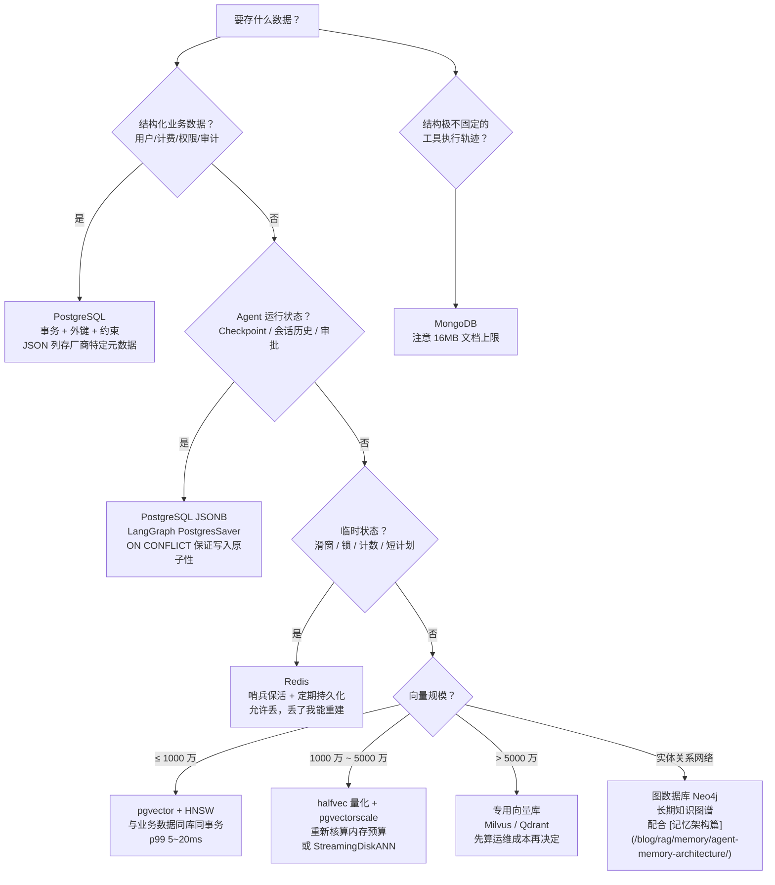

## TL;DR

| 结论 | 论据 |
|---|---|
| **先给每类数据指定唯一负责系统，再谈技术选型** | 大模型应用的数据分五类：身份与业务、会话与状态、临时工作区、派生索引、原始文档——混放是万恶之源 |
| **一千万向量以内，pgvector 就是正确答案** | 配 HNSW 索引延迟 5~20ms，与业务数据同库同事务；一千万到五千万才需要 halfvec 量化 + pgvectorscale；五千万以上再评估专用库 |
| **Agent 会话状态落 PostgreSQL JSONB，不落 Redis** | Redis 是临时层，重启即丢；LangGraph 的 PostgresSaver 是生产标配，且 PG 单字段可达 1GB（MongoDB 文档有 16MB 上限） |
| **不要因为模型输出是 JSON 就放进文档库** | JSON 语法不免除身份、归属、校验与关联的需要——该有外键的数据进了 Mongo，查询时哭 |
| **专用向量库是最后选项，不是第一选项** | 先问三个问题：向量规模、元数据过滤复杂度、运维成本预算。三个都越界了，才考虑 Milvus/Qdrant |

配套阅读：[混合检索流水线](/blog/rag/retrieval/vector-index-and-hybrid-search/) 讲索引参数与 BM25+Dense 融合，[Agent 记忆系统](/blog/rag/memory/agent-memory-architecture/) 讲记忆分层，本文讲这些能力分别该落在哪块存储上。

---

## 一、先分类：五类数据，五种命运

大模型应用的数据看起来五花八门，按**生命周期和一致性要求**分只有五类：

| 类别 | 内容 | 特征 | 默认归宿 |
|---|---|---|---|
| **身份与业务** | 用户、租户、计费、权限、审计日志 | 结构化、强一致、要事务 | PostgreSQL（或 MySQL） |
| **会话与状态** | 对话历史、Agent Checkpoint、审批记录、工具结果 | 半结构化、随请求增长、要持久 | PostgreSQL JSONB |
| **临时工作区** | 活跃会话滑窗、分布式锁、限流计数、未完成的 token | 秒级~分钟级寿命、可丢 | Redis |
| **派生索引** | 摘要、Embedding、缓存 | 可重建、丢了不致命 | pgvector / 专用向量库 / Redis |
| **原始文档** | 上传的 PDF、解析中间产物 | 大对象、只追加 | 对象存储（S3/MinIO） |

一条贯穿性原则：**状态分持久（用户消息、审批、工具结果、最终状态）、临时（未完成的 token、锁、短期计划）、派生（摘要、嵌入、缓存）三等**。把临时数据当持久的存（查库慢、清理难），把持久数据当临时的存（重启全丢），是两类最常见事故。

另一条反直觉铁律：**不能因为模型输出是 JSON 就把数据放进文档库**。JSON 语法不免除身份、归属、校验与关联的需要——用户消息该有 `user_id` 外键、该有非空约束、该能按租户 JOIN，这些进了 Mongo 都得在应用层手写，而应用层手写等于没有约束。

---

## 二、选型决策树

用这棵树的三个纪律：

1. **每类数据只有一个负责系统**。同一个事实存两份（PG 一份、ES 一份、向量库一份）就要维护三条同步链路，漂移是迟早的；
2. **可派生的数据不配做唯一事实源**。Embedding、摘要都能从原始文档重建，所以源文档和访问策略要留在向量索引之外；
3. **临时数据允许丢，是设计出来的**。Redis 里的滑窗会话崩了，从 PG 的完整历史重建即可——这不是缺陷，是分层。

---

## 三、pgvector 的边界：什么时候它真的就够了

社区有个惯性误解："上 RAG 就要配 Milvus/Qdrant"。现实分档很清楚：

| 向量规模 | 方案 | 预期延迟 |
|---|---|---|
| **≤ 1000 万** | 原生 pgvector + HNSW | p99 5~20ms，多数生产负载够用 |
| **1000 万 ~ 5000 万** | halfvec 量化 + 内存预算 + pgvectorscale 的 StreamingDiskANN 后端 | 需重新做容量规划 |
| **> 5000 万** | 认真评估专用向量库的总成本 | 别硬扛 |

**一千万以内选 pgvector 的三个理由**：① 与业务数据同库，检索后可以直接 JOIN 元数据表、走同一套事务和备份；② 少维护一个集群，对中小团队就是少一个故障域；③ 元数据过滤和向量检索在一个 SQL 里完成，一致性天然成立。只有当"查询 p99 超出服务目标、需要独立多区域复制、向量数超出单机内存 HNSW 承载"三个条件同时出现，专用库的迁移才划得来。

但 pgvector 的生产坑一个都躲不掉，按踩雷频率排序：

1. **`maintenance_work_mem` 默认只有 64MB**：HNSW 构建期间排序/合并放不下，构建速度下降 10~50 倍甚至直接失败。建索引前先 `SET maintenance_work_mem = '4GB'` 以上；
2. **运算符类与查询运算符不匹配会静默全表扫**：索引建的时候用一种距离（如 L2），查询用另一种（余弦）， planner 直接忽略索引——某 3 万行数据集上同一个查询从 226ms 到 0.982ms 的差别就在这；
3. **隐式类型转换使索引失效**：把嵌入存成 `JSONB` 或传参时类型不匹配，索引白建。嵌入列必须声明 `vector(N)`；
4. **先向量检索后过滤，结果数量不足**：租户过滤把 top-50 过滤成 3 条，更靠前的匹配被漏掉。多租户场景用部分索引（按租户分区）；
5. **持续写入与索引维护争用**：高写入负载下 HNSW 的插入抖动会拖慢查询，批量插入比逐条快一个量级；
6. **冷缓存放大 p99**：索引不在内存时首次查询奇慢，发布后要主动预热。

这些坑的共性：**都不是"pgvector 不行"，而是"没按生产标准配置"**。把 maintenance_work_mem、ef_construction、ef_search、shared_buffers 五个参数按文档调到生产目标，一千万级内它是可靠组件。

---

## 四、Agent 全生命周期：每类状态落点的推演

### 4.1 Checkpoint（会话状态）→ PostgreSQL JSONB

LangGraph 的 Checkpointer 在图每个 super-step 边界保存状态快照，按 thread 归集，带来人工介入、记忆、时间旅行、容错四类能力。生产选 PostgresSaver 的理由：

- **单字段可达 1GB**，MongoDB 的检查点文档有 16MB 上限，塞进图片/PDF 直接 `DocumentTooLarge`；
- **原子写入**：`thread_id` 主键 + checkpoint JSONB 字段，`ON CONFLICT (thread_id) DO UPDATE` 一行搞定；
- **可查询**：`checkpoint->'values'->'evidence'` 直接取任意字段，`jsonb_path_exists` 能找出"卡在某个节点的会话"——这是运维 Agent 的刚需；
- 代价：写入延迟增加约 12ms，以及两个必须做的运维——**thread_id 超 255 字符会报数据库错误**（用 UUID 或哈希），**检查点无限累积会抬高延迟和存储**（定期清理 + 保留策略）。

Redis 为什么不适合当 Checkpoint 主存储：它是临时层，`MemorySaver`/纯 Redis 方案进程重启即丢失，而 Checkpoint 的核心价值恰恰是"跨进程、跨重启的容错与时间旅行"。

### 4.2 短期滑窗 → Redis

当前 trial 的工作记忆（最近 k 轮原文）放 Redis：毫秒级读写、带 TTL 天然过期、崩了可从 PG 的完整历史重建。这也是[记忆架构篇](/blog/rag/memory/agent-memory-architecture/)里工作记忆四层裁剪的存储落点。但 Redis 做在线链路组件有个前提——**高可用必须是真的**：[Redis 哨兵 quorum 那篇](/blog/backend/redis/sentinel-quorum-and-raft-leader-election/) 的教训是，5 哨兵挂 3 个后 ODOWN 能判、Leader 选不出，表面健康的集群已经丧失自动故障转移能力。会话态全押 Redis 的团队，先把哨兵多数派和"哨兵存活数告警"配好，否则一次分区就是全站会话清零。

### 4.3 长期知识图谱 → 图数据库 + 向量库双写

跨会话的用户偏好、事实网络（"谁和谁、什么属于什么"）是图结构，查询模式是多跳关系遍历——这是 Neo4j 这类图数据库的主场，向量库和 PG 都做不好。工程上是**双写**：实体关系进图库，实体描述的 Embedding 进 pgvector，检索时图遍历 + 向量召回合并。别指望一个系统兜两种查询模式。

### 4.4 审计日志 → PostgreSQL，冷热分离

工具审批、模型调用、成本归因，全进 PG：结构化、要事务、要能按租户按时间范围 JOIN 查询。实践要点：**大文本单独存附表**（列表查询只读短预览字段）、账单做预聚合日表、超过六个月的历史定时归档到对象存储。审计数据是"出事时要能查"的底线，别为了省事塞进 Mongo 之后发现查不动。

### 4.5 工具执行轨迹 → MongoDB（谨慎使用）

结构极不固定、通常整体读写的载荷（一次工具调用的原始入参/出参/堆栈）适合文档库。但注意 Mongo 单文档更新虽原子，**跨文档关联查询吃力**——一旦你发现自己在应用层拼 JOIN，就是选错了。原则同上：先问"这数据要不要外键和约束"，要，就回 PG JSONB。

---

## 五、生产环境踩坑与 Trade-off

1. **起步架构用不着五个系统**。PostgreSQL（业务 + JSONB + pgvector）+ Redis（缓存计数）+ 对象存储（原始文档）+ 队列（推理与摄取移出请求路径）四件套能撑到很大规模。MongoDB、图库、专用向量库都是后来的事——**每多一个有状态组件，就多一份备份、监控和故障预案**。
2. **KV Cache 不是数据库该管的事**。有些团队想用 Redis 缓存"推理上下文"省钱，方向就错了——推理引擎的 [KV Cache 与 Prefix Caching](/blog/production/serving/kv-cache-internals-and-optimization/) 活在 GPU 显存里，是引擎内机制；应用层该做的是把**可变内容后置、固定前缀前置**提高前缀命中率，而不是把 KV 搬到 Redis 走一趟网络。
3. **缓存一致性按数据分级设计**。派生数据（摘要、缓存）用 TTL + 懒重建，容忍短暂不一致；业务数据（配额、权限）必须强一致，走 PG 事务。用一套策略兜所有数据，必然不是太松就是太紧。
4. **连接池是 Agent 场景的隐形瓶颈**。长任务（一次 Agent 运行几十秒）会一直持有数据库连接，直连模式下连接池很快耗尽——长任务一律走连接池中间件（PgBouncer 类），并注意事务模式下 `SET LOCAL` 设置会话参数（如 `hnsw.ef_search`）的方式。
5. **监控分两层**：组件层（PG 复制延迟、Redis 命中率、向量索引构建进度）和业务层（Checkpoint 表膨胀速度、单 thread 检查点数量）。后者才是 Agent 应用特有的——前者传统 DBA 监控都覆盖了。

---

## 🎯 面试官连环追问

**Q1：产品经理说"我们的知识库会到五千万文档，直接上 Milvus 吧"——你怎么回应？**

先拆问题再回答。① **文档数 ≠ 向量数**：五千万文档切块后可能是两亿向量，也可能经过去重/多版本合并只剩三千万——先算真实向量数，一千万以内 pgvector 完全够，迁移纯属自找麻烦。② **查询形态比规模重要**：如果 90% 查询带强租户过滤，问题本质是"多租户隔离下的检索"，该用部分索引或分表解决，不是换数据库；如果确实需要独立的向量检索集群、多区域复制、与业务库隔离的扩缩容节奏，才值得上 Milvus/Qdrant。③ **算总账**：专用库的收益是规模弹性，成本是一个新集群的部署、监控、备份、故障预案，以及"向量与业务数据跨库不一致"的长期对账。标准回答句式：**"先按一千万档设计 pgvector，把切换的触发条件写成明确的数字（p99 延迟、内存水位），到了再迁"**——可演进比一步到位重要。

**Q2：Agent 的会话状态，为什么最终大多落在 PostgreSQL JSONB 而不是 MongoDB？**

三个 MongoDB 答不上来的需求。① **大小上限**：MongoDB 文档 16MB，Agent 状态里塞过几轮工具结果（整段 HTML、长 JSON）就爆，PG 单字段 1GB 量级。② **可查询性**：排查"哪些会话卡在反思节点""某个用户的最后一轮输出了什么"，JSONB 可以直接 `checkpoint->'values'->>'evidence'`、`jsonb_path_exists`，Mongo 要么靠文档设计恰好匹配查询，要么上聚合管道硬写。③ **原子性与一致性**：Checkpoint 写入是"读-改-写"竞态（多节点并发更新同一 thread），PG 的 `ON CONFLICT DO UPDATE` 一行解决，Mongo 要小心多文档事务。当然 Mongo 在"结构极不固定的工具轨迹"上仍有位置——但那是原始载荷存储，不是状态存储。**边界：状态要可查询、要原子，进 PG；载荷要灵活、整体读写，进 Mongo。**

**Q3：从零设计一个 Agent 平台的存储，给你五分钟，说出版图。**

按数据类别过一遍，每类一句话。① **身份与业务**（用户、租户、配额、计费）：PostgreSQL，事务 + 外键，没得商量。② **会话与 Checkpoint**：PG JSONB，LangGraph PostgresSaver，配 thread_id 用 UUID、检查点保留策略 30 天。③ **短期工作区**（活跃会话滑窗、限流计数、分布式锁）：Redis，哨兵 3 节点 + quorum ≥ 多数派 + 哨兵存活数告警——[哨兵那篇](/blog/backend/redis/sentinel-quorum-and-raft-leader-election/)的教训直接抄。④ **检索索引**：pgvector 起步，HNSW，`maintenance_work_mem` 调够，embedding 列 `vector(N)`，运算符类对齐；配 BM25 走 RRF + Cross-Encoder 混合检索，细节在[检索篇](/blog/rag/retrieval/vector-index-and-hybrid-search/)。⑤ **长期记忆**：用户偏好进 PG 键值 + 图库存实体关系，Embedding 进向量库，双写。⑥ **原始文档与轨迹**：对象存储 + PG 审计表，轨迹这种结构多变的进 Mongo 但要设 16MB 监控。收尾一句：**这套图表的每一项都是"先单一职责、后按数字触发迁移"——选型文档的价值不是画出终局，而是写出每个组件的升级触发线。**
