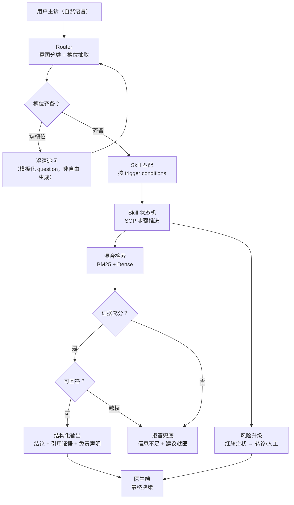

## TL;DR

| 结论 | 论据 |
|---|---|
| **医疗场景的失败成本不是"答不好"，是"敢答"** | 幻觉在这里不是体验问题，是医疗风险与合规红线；自由 ReAct 的下一步动作不可枚举 |
| **两层架构：轻量 Router（路由 + 槽位填充）+ 受控 Skill 状态机（SOP 工作流）** | 上层只做"该进哪个流程、缺哪些信息"，下层按预定义状态机推进，执行路径事前可审计 |
| **Skill 是声明式的：触发条件、步骤、坑点、验证方式四段固定结构** | 状态迁移可静态推演，出问题能定位到具体步骤；与 [Hermes](/blog/agent/harness/hermes-agent-internals/) 的 SKILL.md 同源 |
| **防幻觉三件套：BM25+Dense 混合检索、证据强制绑定（Citation）、无证据拒答** | 规则区与证据区分区标注，模型只能基于证据区作答，没有证据必须说"信息不足" |
| **人机协同是架构组件而非口号** | 角色定位：Agent 初筛分析 + 医生最终决策，关键节点强制交回人工 |

---

## 一、为什么医疗场景不能用纯自由的 ReAct

先立一个判断：**范式选择由失败成本决定，不由能力上限决定。**

ReAct 的价值是灵活：模型自己观察、自己决定下一步、自己处理异常。这个灵活性在开放域是好东西，在医疗问诊里是三个具体的坏东西：

**1. 动作空间不可枚举。** 问诊系统不能"模型觉得该看检查单就看检查单"。先问什么、后问什么、哪些红旗症状必须立刻触发转诊，这些是 SOP，不是策略。纯 ReAct 把每一步交给概率，审计时你甚至无法回答"它当时为什么问了这个"。

**2. 幻觉不可控。** 医疗知识问答错一个剂量、错一个禁忌症，后果不是"用户体验差"。模型在长链路 ReAct 里每一步都在做自由裁量，幻觉会沿着链路放大——第二轮基于第一轮的幻觉继续推理。

**3. 延迟与不可复现。** 每轮 Thought 都要重放历史，问诊这种 10-20 轮交互的场景，延迟和成本都不可接受；而且同样的输入两次跑出不同问诊路径，合规审计直接判不合格。

所以正确形态是 [Planning 篇](/blog/agent/patterns/agent-planning-architectures/) 里那句话的工程化：**主干流程硬编码，节点级用模型**。医疗场景对这一原则的要求更极端——**主干几乎全硬编码，模型只在节点内做理解与生成**。

---

## 二、整体架构：Router + Skill 状态机



### 2.1 上层：Router 与槽位填充（Slot Filling）

Router 干两件事，都不自由：

1. **意图分类**：把用户输入映射到预定义的问诊域（常见症状域、慢病管理域、用药咨询域、检验解读域）。这是分类任务，输出封闭集合，温度取 0。
2. **槽位抽取**：从对话历史里抽取结构化字段——主诉、持续时间、严重程度、伴随症状、既往史、过敏史、用药史。槽位 schema 是 JSON Schema 约束的，缺哪个槽由代码判断，不由模型"觉得够了"。

**缺槽时的澄清追问也用模板**：每个 skill 声明自己的必填槽和对应的提问模板，模型只负责把模板渲染成自然语言，不负责"决定问什么"。这一步把问诊路径收敛回可控轨道。

### 2.2 下层：声明式 Skill 状态机

每个 Skill 是一份声明式文档，四段固定结构（与 [Hermes 篇](/blog/agent/harness/hermes-agent-internals/) 的 SKILL.md 同源，医疗版要求更严）：

```yaml
---
name: headache-triage
description: 头痛症状的分层问诊与红旗筛查
trigger_conditions:
  - 用户主诉包含"头痛/头晕/头胀"
  - 时长或严重程度槽位已填充
required_slots: [duration, severity, accompanying_symptoms, history]
forbidden_actions:
  - 不得输出具体药物剂量
  - 不得替代医生做出诊断
---

## Steps
1. 确认疼痛性质与持续时间（偏侧/全头/搏动性）
2. 筛查红旗症状：突发剧烈 / 伴呕吐 / 伴发热 / 伴肢体无力
3. 命中红旗 → 进入转诊分支（本流程结束）
4. 未命中 → 生成结构化摘要 + 就医建议

## Pitfalls
- 用户说"很痛"不等于严重程度"高"，必须落到量表选项
- 既往史未确认前不得进入用药讨论

## Verification
- 输出必须包含：分诊结论 + 依据的症状条目 + 明确的免责说明
```

**为什么用"声明式状态机"而不是"自由 ReAct"**：Steps 是状态迁移表，事前可以静态推演——这个 skill 有几种路径、在什么条件下进哪个分支，全部可审计。Pitfalls 是运行时的硬拦截点（比如"既往史未确认前不得进入用药讨论"是代码检查，不是提示词请求）。Verification 是出口校验，不满足就不让出。

### 2.3 三层记忆

| 层 | 内容 | 存储 |
|---|---|---|
| 会话工作记忆 | 当前问诊槽位、已问问题列表、用户情绪状态 | 内存（会话级） |
| 情景记忆 | 历史问诊记录、历次检验报告 | MongoDB（一会话一文档） |
| 语义记忆 | 用户慢病档案、长期用药、过敏史（强一致） | PostgreSQL |

**过敏史、慢病这类语义记忆必须强一致**——它们每次进流程都可能改变答案方向。这也是 [Memory 篇](/blog/rag/memory/agent-memory-architecture/) 的分类学在医疗场景的落地：按"错了会不会出事"决定一致性等级，而不是按存取方便。

---

## 三、混合检索与防幻觉护栏

### 3.1 检索：BM25 打底，Dense 补语义

医学专有名词（药名、症候群、检验指标）是 **BM25 的强项、Dense 的弱项**——"阿司匹林"和"乙酰水杨酸"在向量空间里未必近，但字面匹配一击命中；反过来，患者说"心口疼"对应术语"胸痛"，字面不匹配但语义相近。

所以是双路召回 + RRF 融合（原理见 [向量索引与混合检索](/blog/rag/retrieval/vector-index-and-hybrid-search/)）：

```text
query = 规范化后的主诉 + 抽取出的医学术语
BM25   → 词面精确匹配（药名/指标/症候群）
Dense  → 语义召回（口语 → 术语）
RRF    → 两路排名融合
重排   → Cross-Encoder 按证据相关性精排
```

一个医疗特有的坑：**向量库里的医学术语必须经过同义词归一化再入库**。"心梗/心肌梗死/急性心肌梗塞"三条 chunk 会互相稀释检索排名，入库前用同义词表合并。

### 3.2 证据强制绑定（Citation）

最终输出必须满足一条硬规则：**每一个结论性陈述，后面必须跟它依据的 chunk id**。这不是提示词请求，是代码校验：

```python
def validate_output(text, evidence_ids):
    # 每个结论句必须至少引用一个证据
    for sentence in extract_claims(text):
        cites = find_citations(sentence)
        if not cites:
            return ValidationError(f"无证据陈述: {sentence[:40]}")
        if any(c not in evidence_ids for c in cites):
            return ValidationError(f"引用不存在的证据: {c}")
    return OK
```

这条规则同时解决了三件事：防幻觉（没证据的句子根本出不去）、可审计（医生能顺着引用回查原文）、可解释（患者问"为什么"，直接给依据）。

### 3.3 规则区与证据区分区

提示词里**必须遵守的规则**和**可以参考的证据**分区标注，绝不混写：

```text
<rules>            # 输出必须遵守
- 不得给出具体药物剂量
- 不得下诊断结论，只提供分诊建议
- 命中红旗症状必须建议立即就医
- 每个结论必须附证据引用
</rules>
<evidence>         # 回答只能依据这里的材料，每段带 [ev_1]...[ev_n] 编号
[ev_1] ...
[ev_2] ...
</evidence>
<task>...</task>
```

这是 [Context 工程篇](/blog/rag/context/context-engineering-and-compression/) 的"分区标注"在严肃场景的极端应用：**模型把规则当证据、把证据当规则，是医疗场景最致命的误读**。

### 3.4 拒答兜底

三种情况必须拒答，且拒答也是产品功能：

1. **检索无证据**：top-k 全部低于阈值，或重排后最高分不足 → 回答"我的知识库中没有足够依据"，附就医建议。
2. **问题越权**：涉及诊断结论、剂量、治疗方案选择 → 直接拒（在 `<rules>` 里声明 + Router 层就分流到人工）。
3. **冲突证据**：两段证据给出矛盾建议且无法判断新旧 → 不硬答，明确告知"存在不同说法，请以医生意见为准"。

**拒答率本身是核心评测指标**——一个医疗 Agent 把拒答率压到 0 换取"看起来很能干"，是把风险留在系统里。

---

## 四、Trade-off 与坑

| 坑 | 现象 | 对策 |
|---|---|---|
| Router 用强模型做分类 | 慢且贵，还会抽风 | 分类用小模型/规则，温度 0；强模型留给生成 |
| 槽位"差不多"就放行 | 缺过敏史进用药讨论 | 槽位完整性由代码判断，缺则澄清，模板化追问 |
| 证据区混入闲聊历史 | 模型引用用户自己的猜测当依据 | 证据区只允许检索结果注入 |
| 拒答做成异常 | 用户觉得"答不上来"= 坏体验 | 拒答话术产品化：说明原因 + 给就医路径 |
| SKILL 更新不验证 | 旧 SOP 悄悄生效 | 每次 Skill 变更跑回归评测集（敏感问题必须拒答/必须转诊） |

**核心权衡一句话**：**两层架构用"覆盖面"换"可控性"**——它能处理的问诊域是事先定义好的几个，域外请求明确引导到人工。医疗场景这个交换永远划算：宁可用不了的域被拒，也不能让模型自由裁量。

---

## 🎯 面试官连环追问

**Q1：为什么不做成自由 ReAct + 强 Prompt 约束？看起来更优雅。**

三个不能用优雅替代的理由。

第一，**可审计性**。医疗系统的每一次输出都要能回答"系统当时看到了什么、依据是什么、走的哪条分支"。自由 ReAct 的每一步是概率采样，审计时只能事后解释，不能事前证明。声明式状态机的路径集合是有限且可静态推演的——这个域有几种走法，全部写在 Steps 里。

第二，**失效模式**。Prompt 约束是软约束，模型的服从概率永远小于 1。一次"不得给剂量"被绕过，就是一次医疗事故。而 `<rules>` 里的禁止项和 Pitfalls 里的拦截点是**代码校验**（输出没通过 `validate_output` 就出不去），失效概率接近 0。这和 [Harness 篇](/blog/agent/harness/harness-engineering/) 的核心主张同源：**能硬拦的绝不软劝**。

第三，**责任边界**。人机协同是这个系统的默认架构（Agent 初筛、医生决策），自由 ReAct 把 Agent 变成了事实上的决策者，责任边界就糊了。两层架构里 Agent 的产出永远定位为"分诊建议 + 证据整理"，交回给人。

优雅在严肃场景里不是优点，**可验证的笨拙才是**。

**Q2：槽位填充总是填不齐，用户体验很差，怎么办？**

先分清"填不齐"是哪种。三种成因对应三种解法：

1. **槽位设计本身有问题**：必填槽太多、太细。解法是做槽位分级——生命体征类（过敏史）必须齐，舒适度类（生活习惯）允许默认值 + 事后补。把"必须齐"压缩到真正影响路径的字段。
2. **用户表达能力与槽位不匹配**：用户说"难受"对应不上任何枚举。解法是**每个槽配归一化规则和兜底问题**——抽取失败就用模板追问，追问用选项式呈现（"疼痛程度：1-10 分选一个"），比开放式提问填得又快又准。
3. **上下文太短，模型忘了前面说过**：这是 [Memory 篇](/blog/rag/memory/agent-memory-architecture/) 的问题——把已填槽位显式回显在每轮 prompt 的 `<state>` 段，让用户也能看到"我已经知道了这些"，减少重复表述。

再加一层产品手段：**渐进式问诊**。第一轮只问决定分诊的三个核心槽，后续按分支再问。第一屏就问 12 个字段，用户直接流失。这和 Router 的分层是一回事——**能用最少信息做出的最安全决策，就先做**。

**Q3：评测怎么设计？怎么证明系统"没在乱答"？**

医疗 Agent 的评测按三层，指标从下到上：

**第一层：护栏合规（一票否决）**。固定评测集里每一题断言它的行为：敏感问题必须拒答、红旗症状必须触发转诊、涉及剂量必须触碰 `<rules>` 红线。**这一层任何一条不过，整个版本不许上线**——它不是质量指标，是准入门槛。

**第二层：证据质量**。对允许回答的问题，检查引用率（每个结论是否带证据）、引用准确率（引的 chunk 是否真的支持该结论，人工抽检）、检索命中率（top-k 里是否包含正确条目）。这三个数字决定"它答对有依据"的比例。

**第三层：路径质量**。Router 分类准确率、槽位填充完整率、转诊召回率（真阳性红旗症状被触发的比例）、拒答率。转诊召回率的阈值要设得很高——**漏一个红旗症状比多转诊十次的代价大得多**，这是不对称损失，指标设计要体现这一点。

方法上是题库化 + 版本化：每次 Skill/Prompt 变更跑全量回归，防止"改 A 坏 B"。这套思路直接来自 [Pico 篇](/blog/builds/pico/pico-coding-agent-harness/) 的 `run_security_experiment_suite`——**30 次运行证明约束真实生效，好于任何体感**。

最后一条纪律：**对外报数字必须给口径**——评测集多大、怎么标注的、边界在哪。只说"准确率 92%"不给口径的数字，在严肃场景等于没说。
