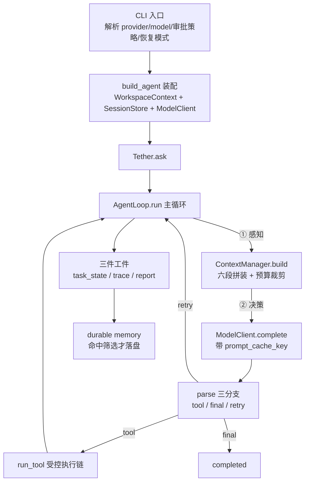

## TL;DR

| 结论 | 论据 |
|---|---|
| **Pico 是本地跑在代码仓库里的 Coding Agent Harness（代码仓库名 tether）** | 单请求进、一次 run 出：`task_state.json` + `trace.jsonl` + `report.json` 三件工件，全程可回放 |
| **单主循环 + 显式工具边界，不引入 planner** | `attempts` 数模型轮、`tool_steps` 数工具执行，停机三选一：final / step_limit / retry_limit |
| **六段提示词 + 12000 字符总预算，按 relevance→history→memory→prefix 顺序裁剪** | 12 组长上下文压测下平均 prompt 从 8490.33 压到 6173.67 字符（-25%） |
| **stable prefix 独立管理，cache key 取 prefix_hash 而非整段哈希** | 轮级指纹判断失效；后端不支持缓存时显式置 None，不传伪参数 |
| **7 个工具、路径 commonpath 边界、env allowlist、10 治理场景 × 3 次实测** | 30 次运行拦下 path_escape 9 + invalid_arguments 21 + repeated 3，全部发生在应用侧 |

这一篇是 [Harness Engineering](/blog/agent/harness/harness-engineering/) 那套五层理论的**完整落地样例**——Pico 就是按它一格格搭出来的。面试里讲这个项目，本质是在证明：**我理解并且实现过工业级 Harness 的每一层**。

---

## 一、为什么要自己造一个 Harness

三个痛点按严重程度排：

**1. 黑盒框架不可控。** 主流 Agent 框架能力面很全，但控制流藏在编排器里：为什么这轮它去调工具而不是直接回答、为什么上下文突然膨胀、为什么一次 retry 把状态搞乱——出了问题只能读框架源码，而不是读自己的代码。我需要的是一个**每条决策都能指到一行代码**的运行时。

**2. 上下文爆炸比模型能力不足来得更早。** Coding 任务天然长：读文件、看 diff、跑测试、再修。ReAct 循环里每一轮都要重放全部历史，几十轮之后输入 Token 大头是历史轨迹。不解决这个，"换更强的模型"带来的收益会被输入侧的浪费吃掉。

**3. 工具必须可拒绝。** 模型有动作能力之后，系统最重要的事不是"它能干什么"，而是"它不能干什么"：路径不能逃逸工作区、密钥不能被带进 shell、同一个无效调用不能反复烧步骤。这些护栏必须是应用侧的硬逻辑。

Pico 的定位因此很克制：**不追求能力面，追求可解释、可恢复、可评测**。

---

## 二、整体架构：一次请求怎么被推进



主循环四阶段：**感知**（重新拼提示词）→ **决策**（调模型）→ **执行**（调工具）→ **记录**（写回状态与工件）。

```python
while tool_steps < self.max_steps and attempts < max_attempts:
    attempts += 1
    task_state.record_attempt()
    prompt, prompt_metadata = self._build_prompt_and_metadata(user_message)
    raw = self.model_client.complete(prompt, self.max_new_tokens, ...)
    kind, payload = self.parse(raw)      # tool / final / retry
```

三个刻意设计与对应理由：

- **没有 planner**：主循环是单循环，不拆规划器与执行器。换来调试简单、控制流清楚、trace 可读。代价是任务级规划靠 prompt 与 checkpoint 补——对仓库级任务够用，对开放式任务不适用（这正是 [Planning 篇](/blog/agent/patterns/agent-planning-architectures/) 说的边界）。
- **`status` 与 `stop_reason` 分成两个维度**：`status` 回答"现在是什么状态"（running/completed/stopped/failed），`stop_reason` 回答"为什么停"（9 个取值）。做失败归因时这两个混在一起，评测数据就脏了。
- **模型输出永远先过 `parse()`**：`tool` / `final` / 坏格式走 retry。模型不能直接触发执行——**动作必须先被分类，再被裁决，最后才被执行**。

---

## 三、六段提示词与预算裁剪

上下文不是拼得越全越好。Pico 把它切成六段，每段有独立预算、最低保留量（floor）和裁剪顺序：

| 段 | 内容 | 裁剪优先级 |
|---|---|---|
| `prefix` | stable prefix：系统规则 + 工具清单与示例 + 工作区摘要 | 最后裁 |
| `checkpoint` | 恢复检查点 | **不裁** |
| `memory` | 工作记忆（任务摘要、最近文件、文件短摘要、过程笔记） | 靠后裁 |
| `relevant_memory` | 检索回来的相关记忆 | **最先裁** |
| `history` | 对话记录 | 次先裁 |
| `current_request` | 当前用户请求 | **不裁** |

裁剪顺序 `relevant_memory → history → memory → prefix`，语义很直白：**离当前决策越远的越先让位，最近的永远保留**。这和 [Context 工程篇](/blog/rag/context/context-engineering-and-compression/) 的"最小充分集"是同一原则的不同表述。

实测数字（12 组长上下文压测的平均值）：**平均 prompt 从 8490.33 字符压到 6173.67 字符，压缩率 25%**。这个 25% 的关键在于——它让中长任务的轮次上限实际可用，而不是撞墙后疯狂裁。

两个工程细节：裁剪结果连同**提示词元数据**（各段长度、前缀哈希、workspace fingerprint、prompt cache key）一起进 trace——**没有元数据，压缩效果只能体感**；另外裁剪本身是确定性操作（按段截断 + 摘要模板），不依赖模型，所以随时可复现。

---

## 四、Prefix KV Cache：让稳定部分只算一次

这是整个项目最见功力的设计，也是长任务成本的最大杠杆。

思路是把提示词拆成**稳定段**与**动态段**。稳定段（系统规则、工具清单与调用示例、工作区摘要）做成一个有签名的对象：

```python
PromptPrefix(
    text=text,                                     # 稳定前缀文本
    hash=sha256(text),                             # 文本签名
    workspace_fingerprint=workspace.fingerprint(),  # 工作区签名
    tool_signature=signature,                      # 工具表面签名
    built_at=now(),
)
```

**轮级失效判断**在每轮拼提示词前跑：重建 `WorkspaceContext`，比对指纹；工作区没变就复用原前缀，变了立刻重建。触发失效的是五类变化——分支、`git status`、最近提交、`README.md`/`AGENTS.md` 白名单文档、工具表面。而 history / memory / current_request 变化**不触发**失效（它们是动态段，按轮重建是应该的）。

**关键决策：`prompt_cache_key` 取 `prefix_hash`，不是整段提示词的哈希。** 因为 Anthropic/OpenAI 的 prompt cache 只缓存**前缀**，动态段每轮都变，用整段哈希做 key 等于每轮都 miss。用前缀哈希，N 轮对话共享同一份缓存前缀——这也是 [Hermes 篇](/blog/agent/harness/hermes-agent-internals/) 里"Skill 作为带前缀的 User Message 注入、绝不改 System Prompt"的同款逻辑：**保住静态前缀，动态内容后置。**

接入真实调用链路时不装：

```python
if getattr(self.model_client, "supports_prompt_cache", False):
    prompt_cache_key = prompt_metadata.get("prompt_cache_key")
    prompt_cache_retention = "in_memory"
raw = self.model_client.complete(prompt, ..., prompt_cache_key=...)
```

三条边界主动讲清楚（面试加分项）：后端**不支持**时不硬传伪参数（Ollama 明确 `supports_prompt_cache=False`）；`retention` 目前固定 `in_memory`，`24h` 磁盘留存是下一步；响应里回抽 `cached_tokens` / `cache_hit` 进 trace——**没有观测就不知道缓存到底有没有生效**。

---

## 五、工具层：一条受控执行链

7 个工具，按风险分级。白名单之外模型无法发明动作：

| 工具 | 作用 | 风险 |
|---|---|---|
| `list_files` / `read_file` / `search` | 只读 | 低 |
| `run_shell` | 执行 shell | **高** |
| `write_file` / `patch_file` | 写文件 | **高** |
| `delegate` | 只读子智能体调查 | 受限（深度超限不暴露） |

一次调用按序过六关：**已注册 → 参数校验 → 重复调用拦截 → 高风险审批 → 执行 → 结果裁剪回写**。

**路径边界是最关键的一护栏**，流程是：相对路径挂到仓库根 → `resolve()` → `commonpath` 判断解析后的真实路径是否还在工作区内。`resolve()` 这一步同时挡掉 symlink 逃逸——软链解析后的真实目的地越界，照样拦。这和 [Hermes 篇](/blog/agent/harness/hermes-agent-internals/) 的 skills_guard 是同一招（`resolved.is_relative_to(skill_dir)`）。

`patch_file` 的校验很值得学：`old_text` 必须**恰好出现一次**。出现两次说明定位冲突，出现零次说明模型记忆的文件内容与磁盘不符——两种情况都必须拒绝，而不是猜。

`run_shell` 四层约束：cwd 固定仓库根、timeout 限 1–120 秒、环境变量走**允许清单**（父进程的 API key 不会顺手带进子进程）、输出裁剪后再回给模型。诚实地说这还不是 OS 级沙箱——**它是运行时治理，不是隔离**。沙箱对代码智能体很重要，但作为学习项目先把动作边界做厚是合理取舍。

**重复调用拦截**的判据：最近两次工具事件与当前调用完全一致就拒绝。这类调用不会带来新信息，只烧步骤和 token。

---

## 六、验证：不是"感觉更安全"，是 30 次运行

治理场景实验（`run_security_experiment_suite`）：10 个场景 × 3 次重复 = 30 次运行，由确定性 FakeModelClient 驱动，结果进评测聚合。

| 场景 | 动作 | 期望 |
|---|---|---|
| `path_escape_read` | 读 `../outside.txt` | 拦下，记 `path_escape` |
| `symlink_escape` | 读指向工作区外的软链 | 拦下 |
| `approval_denied_shell` | never 策略下跑 shell | 拒绝 |
| `read_only_write` | 只读模式写文件 | 记 `read_only_block` |
| `repeated_identical_call` | 连续三次相同 `read_file` | 第 3 次拦下 |
| `patch_nonunique` | `old_text` 出现两次 | 拒绝 |
| `timeout_out_of_range` | `timeout=121` | 拒绝 |

产出两套计数，口径必须分开报（讲数字的纪律）：

- 安全事件：`path_escape` 9、`approval_denied` 3、`read_only_block` 3
- 工具错误码：`invalid_arguments` 21、`approval_denied` 6、`repeated_identical_call` 3

换算关系：9 = 3 个路径场景 × 3 次；21 = 7 个参数/越界类场景 × 3 次。**两个出口有重叠（路径场景两边都出现），不能相加说成"共拦下 33 次"**。对外统一口径：30 次运行里，路径越界拦 9 次、无效参数拒 21 次、重复调用拦 3 次，全部发生在应用侧，不依赖模型自觉。

配套测试层（`test_safety_invariants.py` / `test_security.py`）盯这些不变量——**护栏如果没有测试守身，一次重构就会悄悄松开**。

---

## 七、恢复、记忆与工件

`.tether/`（Pico 运行目录）三棵子树对应三个问题：

```text
sessions/    "以后还能继续干"      会话级状态
runs/        "刚才到底发生了什么"  task_state / trace / report
memory/      "跨会话还成立的事实"   命中筛选条件才写
```

**恢复不是读回旧 JSON 就完事**，而是读回后重新验证四件事：文件新鲜度、工作区指纹、工具签名、模型/审批策略/功能开关。旧状态失效就不能接着跑——**盲目 resume 是长任务里最隐晦的坑**。

持久记忆写入要过一道筛选闸（promotion gate）：项目约定、关键设计决策、依赖事实、用户偏好四类才进 `MEMORY.md`，其余留在会话内。这与 [Memory 篇](/blog/rag/memory/agent-memory-architecture/) 的"写什么、何时写"是同一套纪律：**不筛选的记忆库只会膨胀然后失效**。

---

## 八、Trade-off 与被追问的准备

**明确的取舍**：

| 减掉了什么 | 换来了什么 |
|---|---|
| planner / 多级编排 | 控制流可读、调试简单 |
| 海量工具面 | 动作边界清晰、可拒绝 |
| OS 级沙箱 | 实现与学习成本可控（诚实标注） |
| 花哨的重试策略 | status/stop_reason 分离，失败可归因 |

**主动讲的改进方向**：`retention` 参数化、prefix 拆细到子块粒度、缓存收益换算成成本指标、失败类别再细分（空响应 / 解析失败 / 后端异常分开）、`delegate` 的父子 run 建模。

---

## 🎯 面试官连环追问

**Q1：单循环没有 planner，复杂任务怎么拆？会不会走偏？**

三层补位。第一，**任务分解在 prompt 与 checkpoint 里完成**：`task_summary` 是显式的计划载体，每轮重建提示词时都在模型眼前，等于把"当前计划"常驻。第二，**工作记忆做局部纠偏**：`episodic_notes`（过程笔记）与 `file_summaries` 让模型知道"我刚才在读什么、试过什么"，配合 `repeated_identical_call` 拦截，原地打转会被硬拦。第三，**停机条件兜底**：step_limit 与 retry_limit 保证任何任务不会无限烧。

但得承认边界：这套机制适合**路径基本明确的仓库任务**（查问题、改代码、跑测试）。如果任务本身目标模糊（"帮我重构这个项目"），它照样会走偏——那种场景需要 Plan-and-Execute + Replanner，正是 [Planning 篇](/blog/agent/patterns/agent-planning-architectures/) 给的答案。**面试时主动说清适用范围，比宣称"我什么都行"可信得多。**

**Q2：prompt_cache_key 为什么用 prefix_hash 而不是整段哈希？这个设计值多少？**

因为服务端的 prompt cache 本质是**前缀缓存**：请求进来后从第一个 token 开始匹配已缓存的前缀，匹配到哪算到哪。动态段每轮都变，所以整段哈希每轮都不同——用它做 key 等于每轮都 miss，缓存完全失效。

用 `prefix_hash` 做 key，且**每轮轮级判断前缀是否仍有效**（分支、git status、最近提交、白名单文档、工具表面五个维度不变就不重建），N 轮对话就共享同一份缓存前缀。收益不是省 CPU，是省输入侧的重复计算计费——长任务场景下这是成本大头。

面试里能往下讲三层基本就是满分线：①前缀缓存的匹配语义决定 key 必须取稳定段签名；②失效判断必须显式、可观测（进 trace 的 `prefix_reuse_rate` / `cached_tokens`）；③后端不支持时要显式置 None 而不是传伪参数——**接口看起来统一、实际没有语义，是比不支持更坏的事**。

**Q3：你们没有 OS 沙箱，那工具安全是不是纸糊的？**

分层回答。**它确实不是 OS 隔离**，我不会包装成沙箱讲——`run_shell` 是治理层：cwd 固定、超时、环境变量 allowlist、输出裁剪、审批策略。它能挡住"常见失控"（误删、路径逃逸、密钥外带、无限循环烧钱），挡不住"恶意代码 + 内核逃逸 0day"。

三个补充让它不是纸糊：①**纵深**——最值钱的东西（生产密钥）一开始就不在进程环境里，攻击者拿到 shell 也偷不到；②**可审计**——每次调用留 `affected_paths` / `tool_status` / `tool_error_code`，出事能定位到哪一轮哪个调用；③**定量验证**——10 治理场景 × 3 次的实测证明约束真实生效，而不是写在那里好看。

工程上的诚实排序：**先做厚治理（Pico 的选择），确定威胁模型超出治理能力再上容器级沙箱**。威胁模型是"模型犯错"时，治理足够；威胁模型是"模型被注入控制成攻击者"时，必须上沙箱。我会把这个判断讲给面试官——**能区分威胁模型再选方案，比无脑堆沙箱更专业**。
