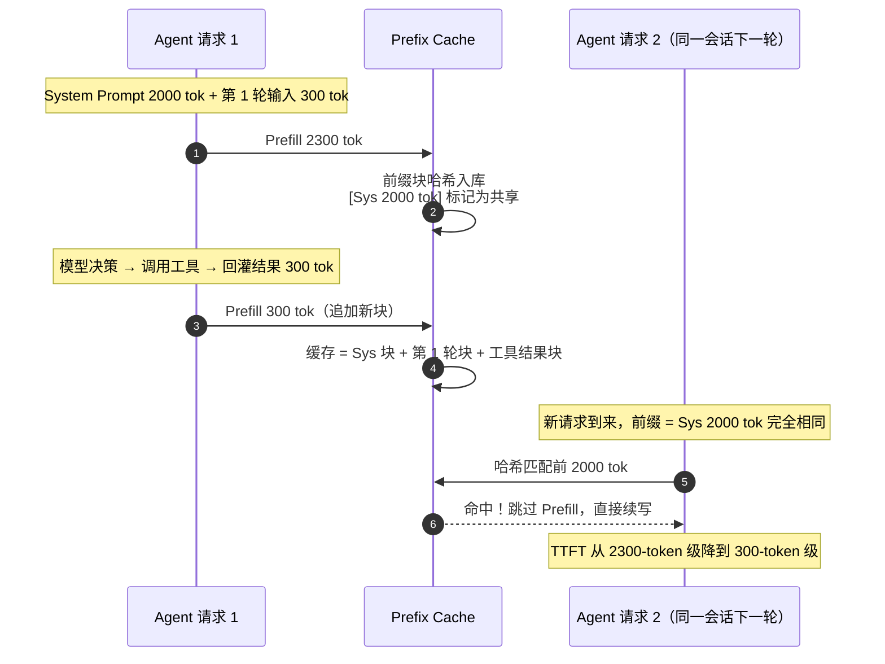

## TL;DR

| 结论 | 论据 |
|---|---|
| **KV Cache 把序列生成的总计算从 O(n³) 压到 O(n²)** | 无缓存时每步重算全部历史；缓存后每步只算 1 个新 token 的投影，与长度 n 的缓存做注意力 |
| **单 token 缓存 = 2 × P × L × H_kv × d_head 字节，与上下文长度无关** | LLaMA-2 7B（MHA）为 512KiB/token，4K 上下文单请求就是 2GiB——**超过权重占用的一成** |
| **GQA 是当前性价比之王，MLA 是压缩极限** | LLaMA-2 70B 用 8 组 GQA 把缓存压到 MHA 的 1/8；DeepSeek-V2 的 MLA 每层每 token 只存 576 个浮点数，比同代 GQA 再小 3~4 倍 |
| **Agent 场景下 Prefix Caching 砍掉 85% 重复 Prefill** | 固定 System Prompt + 多轮工具调用：10 轮 ReAct 的预填充从 33,500 token 降到 5,000 token |
| **前缀缓存的前提是前缀逐字节稳定** | 时间戳、随机 UUID、乱序拼接都会把缓存打碎——这正是 [Harness Engineering](/blog/agent/harness/harness-engineering/) 把 Prompt 组装做成确定性函数的原因 |

承接 [Prefill/Decode 两阶段篇](/blog/production/serving/prefill-and-decode-two-phases/)：Prefill 负责"批量建缓存"，Decode 负责"增量用缓存"。本文算清这份缓存的账；[vLLM 篇](/blog/production/serving/vllm-pagedattention-and-continuous-batching/) 讲工业引擎怎么把它管理到近乎零碎片。

---

## 一、为什么需要 KV Cache：自回归的冗余计算

自回归生成第 \(n\) 个 token 时，如果不缓存，模型要把前 \(n-1\) 个 token 的 Key、Value 投影**全部重算一遍**：

- 无缓存：单步 \(O(n^2)\)，生成整段长度 \(n\) 累计 \(O(n^3)\)；
- 有缓存：每步只为 1 个新 token 算投影，再与长度 \(n\) 的缓存做注意力，单步 \(O(n)\)，整段累计 \(O(n^2)\)。

能这么做的数学前提有三条，缺一不可：

1. **历史无关性**：已生成 token 的 K、V 一旦算出，就不再随后续生成改变——注意力里"查询方向永远是从现在指向过去"；
2. **投影的确定性**：K、V 是输入经固定权重矩阵 \(W_K, W_V\) 的函数，同样输入必然得到同样输出，复用不引入任何近似误差；
3. **因果掩码**：当前 token 只能看自己和过去，历史 K、V 天然构成一个只追加、不改写的日志。

只缓存 K 和 V、不缓存 Q，是因为 Query 只在"当前这一步"使用，算完即弃。这是一笔典型的**空间换时间**交易：用显存换掉重复计算。而 [Prefill/Decode 篇](/blog/production/serving/prefill-and-decode-two-phases/) 算过，Decode 阶段每生成一个 token 都要把整份缓存从显存搬一遍——所以 KV Cache 同时是显存容量和带宽的双重压力源。

---

## 二、显存账本：手推公式，对比四代注意力架构

### 2.1 公式与基准数

单请求 KV Cache 字节数：

\[
\text{KV bytes} = \underbrace{2}_{\text{K 和 V}} \times \underbrace{P}_{\text{精度字节}} \times \underbrace{L}_{\text{层数}} \times \underbrace{H_{kv}}_{\text{KV 头数}} \times \underbrace{d}_{\text{头维度}} \times \underbrace{S}_{\text{序列长}} \times \underbrace{B}_{\text{并发数}}
\]

四个乘数里，**层数和头维度由模型架构锁死，真正可调的只有 \(H_{kv}\) 和 \(P\)**——这正是 GQA/MLA（改结构）和 KV 量化（改精度）的发力点。

以 LLaMA-2 7B 为基准（\(L=32\)，MHA 下 \(H_{kv}=32\)，\(d=128\)，FP16）：

\[
2 \times 2 \times 32 \times 32 \times 128 = 524{,}288\ \text{B} = \mathbf{512\ KiB/token}
\]

4K 上下文 × 1 请求 = **2GiB**；100 并发 = **200GiB**——三张 A100 80G 什么都不干，光装缓存就满了。

### 2.2 四代架构横向对比

| 架构 | 代表模型 | KV 头数 / 表示 | 单 token 缓存 | 相对 MHA |
|---|---|---|---|---|
| **MHA** | LLaMA-2 7B | 32 个独立 KV 头 | 512 KiB | 1×（基准） |
| **GQA** | LLaMA-3 8B | 32 查询头分 8 组共享 | 128 KiB | **1/4** |
| **GQA** | LLaMA-2 70B | 64 查询头分 8 组共享 | 320 KiB | **1/8** |
| **MQA** | 部分小型模型 | 全部查询头共享 1 组 | LLaMA-3 8B 下为 16 KiB | 1/32 |
| **MLA** | DeepSeek-V2/V3 | 每层每 token 仅 576 个浮点（512 潜在向量 + 64 解耦 RoPE 键） | ≈ 67.5 KiB | **约 1/7.6** |

三个值得记住的判断：

1. **GQA 的压缩倍数 = 分组数**，且质量损失极小（LLaMA-2 70B 在标准基准上约 0.2 个百分点）。它已经是 2024 年后新模型的默认选项——选型时看到还在用 MHA 的新模型，可以直接问为什么。
2. **MLA 换了一条路**：GQA 是"减少缓存几个头"，MLA 是"把每个头的表示压进低维潜在空间"（512 维），用时再上投影还原。DeepSeek 论文报告相较其 MHA 前代压缩 93.3%，且困惑度不降反优。代价是注意力 kernel 更复杂、生态绑定深。
3. **MQA 压缩最狠但掉点明显**，主要活在小模型和端侧；服务端主流是 GQA 与 MLA。

### 2.3 容量规划公式

部署前必须算的一笔账：

\[
\text{所需显存} \approx \text{模型权重} + \text{单 token KV} \times \text{最大上下文} \times \text{最大并发}
\]

代入 GQA 的 LLaMA-3 8B：权重 16GB + 128KiB × 4096 × 100 路 = 16 + 50 = **66GB**，一张 A100 80G 刚好。同样的 100 路并发换成 MHA 架构就是 16 + 200 = 216GB——**选型阶段省下的 150GB，比任何推理优化都值钱**。

---

## 三、Prefix Caching：Agent 场景的 85% 省钱术

### 3.1 KV Cache 与 Prefix Caching 是两层东西

- **KV Cache**：一次请求**内部**，为后续 Decode 保存上下文状态；
- **Prefix Caching**：多个请求**之间**，相同前缀的 KV 只算一遍、存一份，后续请求直接复用。

实现形态：vLLM 的自动前缀缓存（按块哈希匹配，见 [vLLM 篇](/blog/production/serving/vllm-pagedattention-and-continuous-batching/)）、SGLang 的 RadixAttention（基数树组织共享前缀）。

### 3.2 算一笔 Agent 多轮 ReAct 的账

典型 Agent 循环（参考 [OpenClaw 架构](/blog/agent/harness/openclaw-architecture/) 的五步流水线）：固定 System Prompt 约 2000 token（人格文件 + 工具定义 + 输出格式），之后每轮"模型决策 → 调用工具 → 结果回灌"新增约 300 token，共 10 轮。

**不开前缀缓存**：每轮都要把完整上下文重新 Prefill 一遍：

\[
\sum_{k=0}^{9} (2000 + 300k) = 20{,}000 + 13{,}500 = 33{,}500\ \text{token}
\]

**开启前缀缓存**：第一轮建缓存，之后每轮只 Prefill 新增的 300 token：

\[
2000 + 300 \times 10 = 5{,}000\ \text{token}
\]

**重复 Prefill 减少 85%。** 按 4K 提示词 Prefill 约 140ms（A100）折算，一次十轮对话从约 1.2s 的纯预填充算力降到 0.18s——省的是 GPU 时间，也是每一轮的 TTFT。

### 3.3 为什么这直接考验 Agent 框架的设计

前缀缓存的命中条件是**前缀逐字节稳定**。以下每一件事都会把命中率打碎：

- System Prompt 里嵌当前时间、随机 UUID、请求 ID；
- 多轮拼接顺序不稳定（工具定义忽前忽后）；
- Few-shot 示例随机抽样、动态排序。

所以 [Harness Engineering](/blog/agent/harness/harness-engineering/) 里"能用硬逻辑保证的确定性，绝不交给模型"这条原则，在推理层有一个冷酷的倒影：**Prompt 组装必须是确定性函数，否则每一轮都在为幻觉般的"微小差异"支付全额 Prefill。** 工程上要把可变部分（时间、用户输入）全部后置，把不变部分（人设、工具 schema、格式约束）全部前置——这不是代码风格问题，是每秒都在烧钱的缓存命中率问题。

---

## 四、显存装不下时：量化、驱逐与引擎级管理

当容量墙真的撞上（长上下文 × 高并发叠加），按代价从低到高有四招：

| 手段 | 原理 | 收益 | 代价 |
|---|---|---|---|
| **KV 量化** | FP16 → FP8/INT4 存储（KVQuant、KIVI） | 缓存直接减半 / 降至 1/4 | 长程依赖任务可能掉点，需场景验证 |
| **缓存驱逐** | 只保留重要 token 的 KV（H2O、SnapKV） | 缓存上限从 O(S) 变成常数 | 有损近似，检索型任务敏感 |
| **换出 / 重算** | 显存不足时把块换到 CPU，或干脆丢弃后重算 | 用时间换空间，防止 OOM | 换出受 PCIe 带宽限制；重算增加 TTFT |
| **架构替换** | 换 GQA/MLA 模型，或 SWA 滑动窗口 | 从根上改变单 token 占用 | 模型选型问题，不是调优问题 |

引擎层的统一答案则是**分页管理**——把缓存切成固定大小的块、按需分配、请求间共享，这正是 [vLLM 的 PagedAttention](/blog/production/serving/vllm-pagedattention-and-continuous-batching/) 解决的核心问题，此处不展开。

---

## 五、生产环境踩坑与 Trade-off

1. **不要用"总显存 ÷ 单 token KV"倒推并发上限**。那意味着把卡跑到 100%，任何到达波动都会 OOM。生产上 KV 水位超过 85% 就该触发扩容或降级（限制 `max_tokens`、拒绝新长请求）。
2. **Prefix Caching 不是免费午餐**。它占用显存存放共享块，且要求引擎维护块哈希表；在**前缀极度分散**的场景（每个用户一套独立 System Prompt），命中率趋近于零，只剩开销。上线前先统计真实前缀重复度。
3. **KV 量化先在小流量灰度**。INT4 在摘要、分类任务上几乎无感，但在长文档精确引用（"第 3 页第 2 段怎么说"）上可能把关键数字糊掉。用业务自己的评测集说话，别看论文指标。
4. **多轮对话的缓存增长常被忽视**。Agent 的工具结果（整段 HTML、长 JSON）全额进 KV，十轮之后缓存可能 90% 是工具垃圾。在 Harness 层裁剪工具返回（截断、摘要、只留 diff），比在推理层做什么优化都直接。
5. **监控 KV Cache 水位与命中率两个指标**。水位决定何时扩容，命中率决定 Prefix Caching 是资产还是负债——没有命中率的缓存监控是不完整的。

---

## 🎯 面试官连环追问

**Q1：给定一个 70B 模型和一张 80G 的卡，怎么估算能扛多少并发？**

分三步。① 算权重：70B × FP16 = 140GB——一张 80G 根本放不下，先解决模型装载（INT4 量化到 35GB 或上第二张卡做 TP），这一步不过后面免谈。② 算单 token KV：LLaMA-2 70B 是 GQA，\(2 \times 2 \times 80 \times 8 \times 128 = 320\) KiB/token。③ 算并发：假设 4K 上下文，\((80 - 35 - \text{激活与余量约 8}) / (320\text{KiB} \times 4096) \approx 37 / 1.25\text{GB} \approx 28\) 路。再乘上 Batch 共享带来的实际吞吐观察。面试时把这套"权重 → 单 token → 并发"的三段式讲出来，比报一个数重要得多——它证明你知道容量墙在哪、以及换 GQA/MLA 模型为什么是最有效的扩容。

**Q2：Prefix Caching 在什么情况下会完全失效？怎么救？**

失效条件：前缀不稳定。典型三种——① System Prompt 里嵌了动态内容（时间戳、计数器）；② 并发多租户共卡时缓存被 LRU 淘汰，热点前缀没抢到显存；③ 请求经过多层网关，每层往里注入自己的头信息再拼进 Prompt。救法对应三层：Harness 层把 Prompt 组装改成"静态前缀 + 动态后缀"的确定性拼接（可变内容一律后置）；引擎层给共享前缀块钉住（pin）或提高其驻留优先级；架构层上前缀相同的请求做亲和路由，打到同一实例。判断有没有救的标准是一个数字：**线上前缀缓存命中率低于 30%，先修 Prompt 组装，再谈别的。**

**Q3：GQA、MLA、KV 量化都能省显存，选型时怎么排序？**

优先级从高到低：**架构 > 量化 > 引擎管理**。原因是作用点和风险完全不同——GQA/MLA 在模型训练阶段就定好，一次受益于整个生命周期，质量损失已被论文和社区验证过（GQA 约 0.2 个点）；KV 量化是推理期的近似，长程任务掉点风险真实存在，但它灵活、可灰度、可回滚；引擎管理（PagedAttention、驱逐、换出）不损失任何精度，是保底手段。所以正确顺序是：选型时就选 GQA/MLA 模型（这是 [Prefill/Decode 篇](/blog/production/serving/prefill-and-decode-two-phases/) 里"选型阶段省 150GB"的由来）→ 容量仍不够再上 FP8 KV 量化并灰度验证 → 最后靠引擎的分页与驱逐兜底。反过来做（先用引擎技巧硬扛 MHA 模型的浪费）是捡芝麻丢西瓜。
