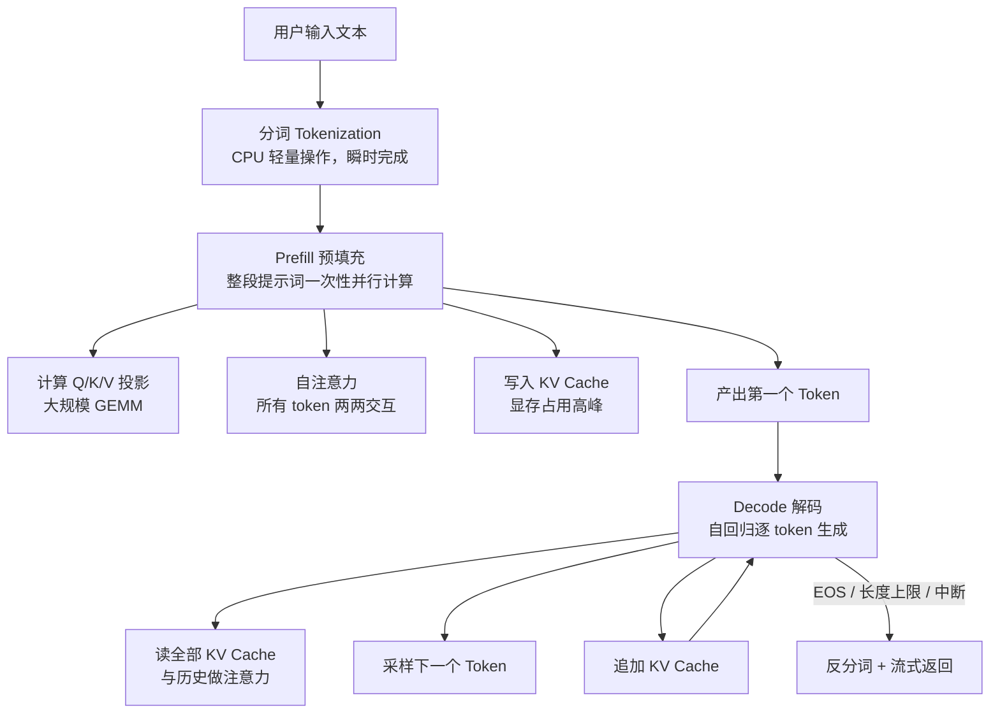
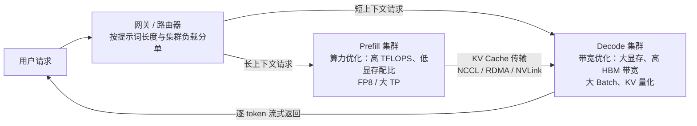

## TL;DR

| 结论 | 论据 |
|---|---|
| **一次生成 = 一次 Prefill（GEMM）+ N 次 Decode（GEMV）** | Prefill 把整段提示词一次性并行算完并写入 KV Cache；Decode 每步只处理 1 个新 token，与全部历史 KV 做注意力 |
| **Compute-Bound 与 Memory-Bound 不是修辞，是能算出来的** | 以 LLaMA-2 7B + A100 为例：4K 提示词 Prefill 的算术强度约 **1300 FLOPs/Byte**，是 A100 Roofline 拐点（156）的 8 倍；单流 Decode 不足 **0.5 FLOPs/Byte**，差三个数量级 |
| **TTFT 由 Prefill 决定，TPOT 由 Decode 决定，两者瓶颈硬件不同** | 4K 提示词 TTFT ≈ 100~150ms（算力说了算）；单流 Decode 的 TPOT 下限 ≈ **7.8ms**（15.5GB 显存流量 ÷ 2TB/s 带宽），堆算力毫无用处 |
| **把两个阶段混在同一批次里互相踩踏，是延迟毛刺的头号来源** | 一个 128K 超长 Prefill 会独占 GPU 上百毫秒，同批次所有 Decode 请求的吐字全部暂停 |
| **两大解法：Chunked Prefill 与 PD 分离** | 前者把长 Prefill 切碎插空执行，牺牲少量 TTFT 换全局 TPOT 稳定；后者从架构上拆成两种集群，让两类负载各用各的最优硬件，代价是 KV Cache 跨节点传输 |

本文是「推理三件套」的第一篇：[KV Cache 底层原理](/blog/production/serving/kv-cache-internals-and-optimization/) 讲两阶段之间那份"草稿纸"怎么管理，[vLLM 架构拆解](/blog/production/serving/vllm-pagedattention-and-continuous-batching/) 讲工业引擎如何把这两个阶段调度到极致。三篇建议连读。

---

## 一、先建立坐标系：一次请求到底在算什么

你把问题发给模型，它不会像普通函数一样"算出一整段答案"。真实过程是四站旅程：

一个好用的类比是**开卷考试**：

- **Prefill = 通读材料 + 做笔记**。试卷和参考资料一次性读完，在草稿纸上记下要点和逻辑关联。全程费脑力，但**不写任何答案**。这份草稿纸就是工程上的 **KV Cache**。
- **Decode = 逐字写答案**。盯着草稿纸，每写一个字都核对上下文。过程轻松，但**只能一个字一个字写，没法跳步**。

两阶段的所有工程差异，都从这个类比里长出来：Prefill 是"集中烧脑"所以**算力紧张**；Decode 是"反复翻笔记"所以**带宽紧张**。下面把这句话算成数字。

---

## 二、核心原理：用 Roofline 模型把两种瓶颈算出来

### 2.1 Roofline 模型：一个数决定算力受限还是带宽受限

GPU 的实际算力上限由两个天花板的最小值决定：

\[
\text{ attainable FLOPs} = \min(\text{峰值算力},\ \text{显存带宽} \times \text{算术强度})
\]

**算术强度（Arithmetic Intensity）** = 每传输 1 字节显存数据，平均能做多少次浮点运算（FLOPs/Byte）。两个天花板相交的那个点叫**脊点（Ridge Point）**：

| GPU | 峰值算力（BF16） | 显存带宽 | 脊点 |
|---|---|---|---|
| A100 80GB | 312 TFLOPS | 2.0 TB/s | **156 FLOPs/Byte** |
| H100 SXM | 990 TFLOPS | 3.35 TB/s | **295 FLOPs/Byte** |

判据只有一条：**算术强度 > 脊点 → 算力受限（Compute-Bound）；< 脊点 → 带宽受限（Memory-Bound）**。所谓"Prefill 是算力密集型、Decode 是带宽密集型"，本质是这两个阶段的算术强度差了三个数量级。

### 2.2 Prefill 算账：GEMM，强度约 1300 FLOPs/Byte

以 LLaMA-2 7B（32 层、隐藏维 4096、32 个注意力头、FP16，权重约 13.5GB）处理 **4096 个 token 的提示词**为例。

Prefill 是标准的 **GEMM（通用矩阵乘）**：每层的计算量

- Q/K/V/O 四个投影矩阵：\(2 \times 4 \times d^2 \times S = 2 \times 4 \times 4096^2 \times 4096 \approx 5.5 \times 10^{11}\) FLOPs
- 注意力分数与加权和（含因果掩码约减半）：\(\approx 1.4 \times 10^{11}\) FLOPs

单层约 \(6.9 \times 10^{11}\)，32 层合计 **\(\approx 2.2 \times 10^{13}\) FLOPs**。

显存流量呢？权重只读一遍（13.5GB），KV Cache 写入 2GiB（4K token × 512KiB，算法见 [KV Cache 篇](/blog/production/serving/kv-cache-internals-and-optimization/)），激活值读写约 1GB，合计约 **16GB**。

\[
\text{Prefill 算术强度} \approx \frac{2.2 \times 10^{13}}{1.6 \times 10^{10}} \approx 1400\ \text{FLOPs/Byte} \gg 156
\]

**是脊点的 8 倍以上，算力严重受限。** 按 A100  BF16 峰值 312 TFLOPS、实际约 50% 利用率估算，TTFT ≈ 70~150ms。这个阶段 GPU 的计算单元全程满载，瓶颈是怎么把矩阵乘算得更快（FlashAttention、算子融合、Tensor Core 利用率）。

### 2.3 Decode 算账：GEMV，强度不足 0.5 FLOPs/Byte

Decode 每步只处理 **1 个新 token**，矩阵乘退化成 **GEMV（矩阵-向量乘）**：

- 每层 FLOPs：投影 \(2 \times 4 \times d^2 \approx 1.3 \times 10^{8}\)，注意力 \(2 \times 2 \times S \times d \approx 6.7 \times 10^{7}\)，合计约 \(2 \times 10^{8}\)，32 层共 **\(6.4 \times 10^{9}\) FLOPs**。
- 每步显存流量：**全部权重 13.5GB + 全部 KV Cache 2GiB ≈ 15.5GB**——注意，每生成一个字，都要把整个模型和整份草稿纸从显存里完整搬一遍。

\[
\text{Decode 算术强度} \approx \frac{6.4 \times 10^{9}}{1.55 \times 10^{10}} \approx 0.4\ \text{FLOPs/Byte} \ll 156
\]

**不到脊点的 0.3%，带宽严重受限。** GPU 的计算单元 99% 以上时间在等数据。这也直接给出 TPOT 的物理下限：

\[
t_{\text{decode}} \ge \frac{15.5\ \text{GB}}{2.0\ \text{TB/s}} \approx 7.8\ \text{ms/token}
\]

实测单流 LLaMA-2 7B 在 A100 上约 100~130 token/s，与这个下限吻合。**给 Decode 堆算力（换更贵的卡）收益极小，堆显存带宽才有用。**

### 2.4 一张表收束两阶段

| 维度 | Prefill | Decode |
|---|---|---|
| 矩阵形态 | GEMM（\(S \times d\) 乘 \(d \times d\)） | GEMV（\(1 \times d\) 乘 \(d \times d\)） |
| 每步处理 token 数 | 整段提示词（成百上千） | 1 个 |
| 算术强度（上例） | ≈ 1400 FLOPs/Byte | ≈ 0.4 FLOPs/Byte |
| 瓶颈 | **算力**（Tensor Core） | **显存带宽**（HBM） |
| 决定指标 | **TTFT**（首 token 延迟） | **TPOT**（每 token 间隔） |
| 典型优化 | FlashAttention、算子融合、Chunked Prefill | KV Cache 压缩、PagedAttention、投机解码、加大 Batch |

### 2.5 Batch 是 Decode 唯一的救赎——但救不彻底

Batch 为 \(B\) 时，\(B\) 路 GEMV 可以合并成一个 GEMM：FLOPs 乘以 \(B\)，而**权重和 KV Cache 的读取被所有请求摊薄**（同一批数据读一遍，算 \(B\) 份）。算术强度近似变为 \(0.4 \times B\)：

- \(B = 32\)：强度 ≈ 13，仍是脊点的 1/12，带宽受限；
- \(B = 390\)：强度 ≈ 156，才够到脊点。

但 \(B = 32\) 时 KV Cache 已要 \(32 \times 2\text{GiB} = 64\text{GiB}\)（4K 上下文、MHA），单张 A100 连权重带缓存放不下 390 路。**结论：Decode 永远是带宽受限，工程上只能把 Batch 堆到显存允许的最大值。** 这正是推理引擎全部围绕"省显存、堆并发"做文章的原因——也是 [KV Cache 篇](/blog/production/serving/kv-cache-internals-and-optimization/) 和 [vLLM 篇](/blog/production/serving/vllm-pagedattention-and-continuous-batching/) 的主线。

---

## 三、TTFT 与 TPOT：两种体验，两套 SLO

理解两阶段后，延迟指标就不再是一锅粥：

| 指标 | 归属阶段 | 物理决定因素 | 常见 SLO |
|---|---|---|---|
| **TTFT**（Time To First Token） | Prefill | 提示词长度 × 算力；队列等待 | 长文问答 < 1~3s；日常聊天 < 500ms |
| **TPOT / ITL**（Time Per Output Token） | Decode | 显存流量 ÷ 带宽 × 当前 Batch | 50~100ms/token，接近人类阅读速度 |

由此推出两类场景的优化重点完全相反：

- **长文档问答**（长 Prefill + 短 Decode）：体验由 TTFT 决定。要缩短首字等待，得压缩 Prefill——Prompt 裁剪、Prefix Caching、Chunked Prefill。
- **日常聊天**（短 Prefill + 长 Decode）：体验由 TPOT 决定。要吐字流畅，得扩大 Batch、压缩 KV Cache。

线上排查时，先问"慢在哪一段"，再决定优化方向：

| 现象 | 更可能的问题 |
|---|---|
| 等很久才出现第一个 token | Prefill 重（提示词长 / RAG 片段塞太多 / 历史没裁剪）、排队久、调度慢 |
| 首字出来后后续输出很慢 | Decode 慢、并发 Batch 过大、KV Cache 压力 |
| 长上下文请求明显拖慢一切 | Prefill 与 KV Cache 占用压力（见下文混合干扰） |
| 短请求延迟波动大 | Batching、队列、限流或资源隔离问题 |
| Streaming 一顿一顿 | Decode 调度不稳定，或下游传输链路阻塞 |

一个常见误区：**把 Streaming 当成性能优化**。Streaming 不减少任何计算量，它只是让用户更早看到进度。Decode 本身慢， streaming 救不了。

---

## 四、混合批次的相互干扰，与两大架构解法

### 4.1 问题：一个长 Prefill 卡死整个批次

真实服务里请求同时到达，有的在 Prefill、有的在 Decode（详见 [vLLM 篇](/blog/production/serving/vllm-pagedattention-and-continuous-batching/) 的调度器）。GPU 的计算是**整批次共享**的：一个 128K token 的超长 Prefill 要独占算力 1 秒以上，这期间同批次所有 Decode 请求的吐字全部暂停——用户的打字流突然卡住，就是这里来的。

两类干扰方向：

- **Prefill 干扰 Decode**：长 Prefill 独占算力 → Decode 的 TPOT 出现毛刺；
- **Decode 干扰 Prefill**：Decode 为了堆大 Batch 占满显存 → 新 Prefill 排不进来，TTFT 飙高。

### 4.2 解法一：Chunked Prefill——把长 Prefill 切碎插空执行

把长提示词的 Prefill 切成固定大小的 chunk（典型 512~2048 token），调度器**每个迭代步只执行一个 chunk，其余算力留给 Decode**。代价是长提示词的 TTFT 略微变差（切块间插入了别人的 Decode 步），收益是全体 Decode 请求的 TPOT 抖动被压平。

它治标：两阶段仍跑在同一批 GPU 上，仍共享算力与显存，只是从"互相踩踏"变成"轮流使用"。要根治，得动架构。

### 4.3 解法二：PD 分离（Prefill-Decode Disaggregation）

既然两阶段的资源需求截然相反——Prefill 要**算力**、Decode 要**带宽 + 显存容量**——那就拆成两种集群，中间用高速网络传 KV Cache：

三个关键设计点：

1. **KV Cache 传输是核心成本**。LLaMA-3 8B（GQA，128KiB/token）一个 4K 上下文的 KV 约 512MiB，200Gbps RDMA 传一轮约 21ms；128K 上下文就是 4GiB/请求。传输占比高时，PD 分离的收益会被网络吃掉。
2. **调度变成两级**：全局路由器决定请求去哪，各集群内部再有自己的批调度。路由要尽量把相同前缀的请求送到同一 Prefill 节点，否则 Prefix Caching 命中率崩塌。
3. **适合谁**：提示词长且流量大的场景（长文分析、Agent 多轮工具调用——见 [OpenClaw 架构](/blog/agent/harness/openclaw-architecture/) 里工具结果不断回灌上下文的那种循环）。流量小、提示词短时，Chunked Prefill 已经够用，上 PD 分离纯属自虐。

---

## 五、生产环境踩坑与 Trade-off 权衡

1. **Chunked Prefill 的 chunk size 没有万能值**。切太小（如 128），调度开销占比上升、长提示词 TTFT 明显变差；切太大（如 8192），插空粒度粗，Decode 毛刺又回来了。经验起点 512~2048，用自己流量的提示词长度分布做压测校准。部分引擎改用**token 预算制**（每迭代步总计算 token 数封顶），比固定 chunk 更平滑。
2. **别用平均提示词长度做容量规划**。请求长度是重尾分布：99% 的请求 2K 以内，1% 的请求 128K。按均值规划显存，那 1% 会 OOM；按最大值规划，利用率惨不忍睹。正确做法是分级 SLO + 准入控制（超长请求排队或降级到更大实例）。
3. **RAG 场景的 Prefill 变重要警惕**。检索片段、聊天历史、System Prompt 全部进上下文，Prefill 悄悄吃掉 TTFT——[Agent 记忆系统](/blog/rag/memory/agent-memory-architecture/) 里讲的上下文裁剪，放在推理层就是实打实的 TTFT 优化。
4. **监控必须把 TTFT 和 TPOT 分开看**。只盯总耗时，会出现"P50 很好、P99 爆炸"的盲区——而 P99 的爆炸几乎总是混合批次干扰或抢占导致的。分开监控才能定位是 Prefill 排队还是 Decode 掉速。
5. **扩容方向要想清楚**。Decode 是带宽受限，加卡（TP）对单请求 TPOT 帮助有限，真正的杠杆是堆显存容量以扩大 Batch；Prefill 是算力受限，加卡直接缩短 TTFT。这就是 PD 分离"两种集群分开扩"的容量规划逻辑。

---

## 🎯 面试官连环追问

**Q1：Decode 阶段为什么不能靠加大 Batch 变成算力受限？Batch 要多大才行？**

算术强度随 Batch 线性增长（\(0.4 \times B\)），要到 A100 的脊点 156 需要 \(B \approx 390\)。但 KV Cache 容量墙先到：390 路 × 4K 上下文 × 512KiB ≈ 780GiB，单卡绝无可能。换成 GQA 架构（LLaMA-3 8B，128KiB/token）也要约 195GiB。所以现实中 Batch 上限通常是 64~512（引擎的 `max_num_seqs`），Decode **始终**工作在带宽受限区。推论：所有 Decode 侧优化（KV 量化、GQA/MLA、PagedAttention）本质都是在省那 15.5GB 的搬运量，而不是在省算力。

**Q2：Chunked Prefill 会不会让长提示词的 TTFT 变差？生产上怎么权衡？**

会，而且这是它的定义性代价：长 Prefill 被切成多块轮流执行，最后一个 chunk 跑完才能产出首 token，中间插入了其他请求的 Decode 步，TTFT 必然略增。权衡分场景：

- **交互式聊天为主**：TPOT 毛刺直接破坏"打字感"，必须开 Chunked Prefill，长提示词用户多等几十毫秒无感；
- **长文问答 / 文档总结为主**：用户对 TTFT 极度敏感（等 3 秒和等 3.2 秒是两种体验），反而应该**关掉** Chunked Prefill 或把 chunk 开到 4K 以上，换取最低首字延迟；
- **两者混合**：上 PD 分离，让长 Prefill 去专属集群，不占用交互流量的任何资源。

**Q3：PD 分离解决了什么根本问题？它的代价是什么？什么时候不值得上？**

根本问题：**两阶段的资源需求相反，混合部署必然互相干扰，而任何调度技巧都只是缓解、不是消除**。PD 分离把"缓解"变成"隔离"——Prefill 集群按算力最优配置（甚至可以用 FP8、激进算子融合），Decode 集群按显存容量和带宽最优配置，两边的扩容策略也彻底分开。

代价有三：① **KV 传输**：4K 上下文 GQA 模型约 512MiB/请求，128K 就是 4GiB，网络带宽不够时传输延迟直接加到 TTFT 上；② **调度复杂度**：两级调度 + 前缀亲和路由，路由抖动会打崩 Prefix Caching 命中率；③ **故障域变多**：Prefill 集群挂了，所有新请求 TTFT 归零。

判断标准很直接：**提示词中位长度 < 2K、单集群 GPU 利用率健康时，不值得上**；只有当长 Prefill 与 Decode 的相互干扰已经实测影响到 SLO（比如 Decode TPOT 毛刺 > 30%、长请求 TTFT P99 > 5s），PD 分离才是对症解。在此之前，Chunked Prefill + Prefix Caching + KV Cache 管理（后两篇的主题）性价比高一个数量级。
