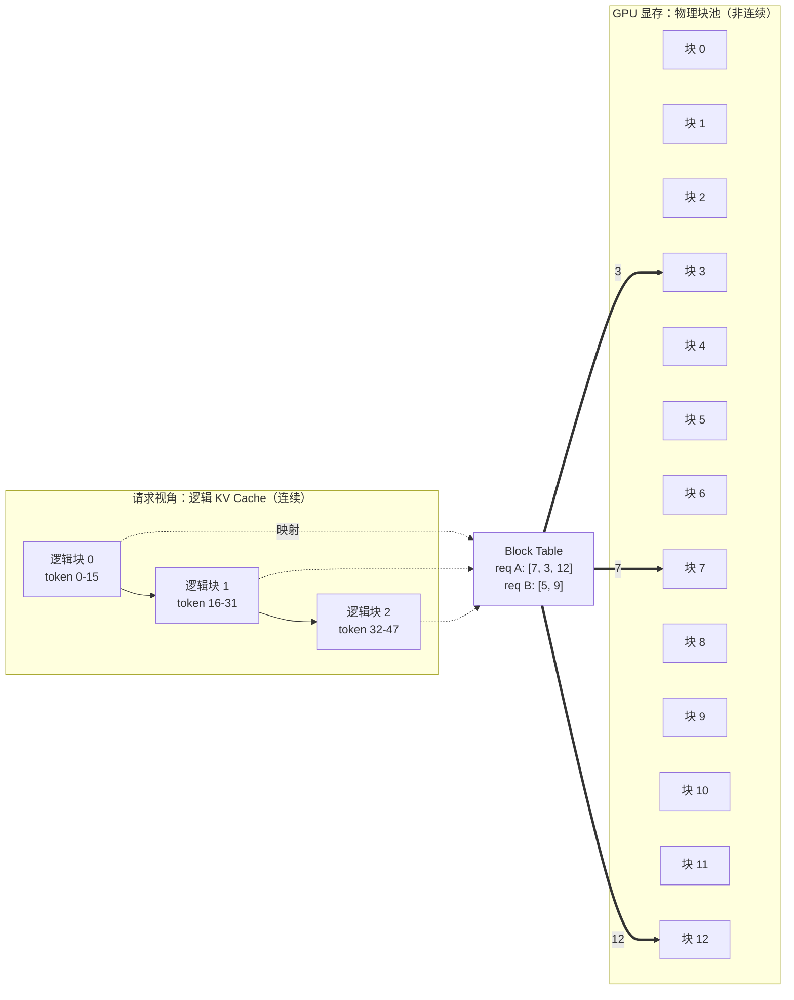

## TL;DR

| 结论 | 论据 |
|---|---|
| **LLM 服务的真正瓶颈不是算力，是 KV Cache 的显存管理** | [Prefill/Decode 篇](/blog/production/serving/prefill-and-decode-two-phases/) 算过：Decode 是带宽受限，能塞进多少请求直接决定吞吐 |
| **朴素连续分配有三重浪费：过度预留、内部碎片、外部碎片** | 按最大长度 2000 token 预留，实际平均只用 50~120；空闲显存被打成无法使用的小碎片 |
| **PagedAttention = 把 OS 虚拟内存搬进显存** | KV Cache 切成 16-token 的块按需分配，逻辑块经块表映射到**非连续**物理块，内部碎片上限从"整个预留空间"降到"一个块" |
| **写时复制（CoW）让共享前缀与并行采样零冗余** | 相同前缀只存一份物理块，请求分叉时才复制；ShareGPT 实测显存省 54%、吞吐最高提升 22 倍 |
| **Continuous Batching 以迭代为粒度换人，GPU 永不停摆** | 静态批处理等最慢请求；迭代级调度让完成的插槽立即被新请求填充，实测吞吐从 95 → 320 tokens/s |

三件套的收官篇：前两篇（[Prefill/Decode](/blog/production/serving/prefill-and-decode-two-phases/)、[KV Cache](/blog/production/serving/kv-cache-internals-and-optimization/)）讲清了"算什么、存多少"，本篇讲工业引擎"怎么调度"。

---

## 一、问题：朴素的服务方式浪费在哪

传统推理栈（HuggingFace Pipeline 式）给每个请求**按可能的最大生成长度预留一整块连续显存**。假设上限 2000 token，请求刚到就占住 2000 的 KV Cache 空间——而真实世界的答案长度是重尾分布，**多数请求只生成几十个 token**。浪费分三种：

| 浪费类型 | 机制 | 量级 |
|---|---|---|
| **过度预留（内部碎片）** | 按最大长度分配，实际只用前端一小截 | 请求平均只用 5% 的空间，剩下 95% 被锁死 |
| **外部碎片** | 不同长度请求分配/释放交错，空闲显存被打散成不连续小块 | 总空闲够，但拼不出一个连续大块，新请求照样 OOM |
| **无法跨请求共享** | 相同 System Prompt 前缀各存各的 | N 个请求就存 N 份，重复占用 |

```text
朴素分配：每个请求抓住一大块连续显存

请求 A: [#### used (50) .............. 预留 2000，锁死 ..............]
请求 B: [###### used (120) ............ 预留 2000，锁死 ..............]
请求 C: [## used (20) ................. 预留 2000，锁死 ................]

剩余空闲：分散的小间隙 → 任何新请求都塞不进来 → OOM
```

vLLM 的两个核心设计——**PagedAttention** 治前两种浪费，**Continuous Batching** 治 GPU 空转——正好各管一头。

---

## 二、PagedAttention：把 OS 虚拟内存搬进显存

### 2.1 核心思想：逻辑块、物理块与块表

PagedAttention（vLLM，OSDI 2023）完全复刻操作系统虚拟内存的三件套：

- **逻辑块（Logical Block）**：每个请求眼中的连续 KV Cache，按固定大小切块（默认 **16 token/块**）；
- **物理块（Physical Block）**：GPU 显存里等大的块池，**按需分配、无需连续**；
- **块表（Block Table）**：每请求一张小表，记录逻辑块 → 物理块的映射，由引擎维护。



注意力 kernel 计算时，通过块表把逻辑位置翻译成物理块地址再读取——**上层完全感知不到物理碎片的存在**。

### 2.2 碎片账：从"整个预留空间"降到"一个块"

- **内部碎片上限**：只有每请求最后一个块可能没用满，最大浪费 = block_size − 1 个 token。16-token 块、GQA 模型（128KiB/token）下最坏浪费 15 × 128KiB ≈ 1.8MB/请求，占 4K 上下文总缓存的 **0.4%**——对比朴素分配的 95%，可以认为清零。
- **外部碎片**：所有块等大，任何空闲块都能服务任何请求，碎片在数学上不可见。
- **按需分配**：块只在写满时才申请新块，请求结束立即整表回收进空闲池。

### 2.3 源码级拆解：块分配器在做什么

简化自 vLLM 的块管理逻辑：

```python
class BlockSpaceManager:
    def allocate(self, request_id, num_tokens):
        # 按块向上取整：逻辑 token 数 → 物理块数
        num_required_blocks = ceil_div(num_tokens, self.block_size)
        # 从空闲池弹出物理块——不要求在显存里相邻
        physical_blocks = [self.free_blocks.pop() for _ in range(num_required_blocks)]
        self.block_tables[request_id] = physical_blocks
        return physical_blocks

    def append_token(self, request_id, token_id):
        last_block = self.block_tables[request_id][-1]
        if self._is_block_full(last_block):
            # 当前块写满 → 申请一个新块，追加到块表末尾
            new_block = self.free_blocks.pop()
            self.block_tables[request_id].append(new_block)
            # 写入新块
        else:
            # 写入当前块末尾
            ...
```

三个设计细节值得注意：

1. **块大小是权衡参数**：块越大，块表越短、kernel 访存越顺序；但内部碎片上限随块线性增长。16 是 vLLM 的默认甜点；显存极度紧张时可调 8，追吞吐时可调 32。
2. **写满才分配**：请求随时可能 EOS，未写满的块同样会被回收，不会出现"预留了但永远不用"。
3. **回收是 O(块数)**：请求结束，整表 push 回空闲池，立即可被等待队列中的新请求使用——这正是 Continuous Batching 能立刻填上插槽的前提。

---

## 三、写时复制：共享前缀与并行采样的零冗余

分页结构天然带来一个红利：**多个请求的块表可以指向同一批物理块**。

```mermaid
flowchart TD
    subgraph SHARED["共享前缀块（内存中仅一份）"]
        S1["物理块 B1<br/>System Prompt token 0-15"]
        S2["物理块 B2<br/>System Prompt token 16-31"]
        S1 --> S2
    end
    subgraph A["请求 A（block table: B1, B2, B5）"]
        A1["独有块 B5<br/>用户 A 的输入"]
    end
    subgraph B["请求 B（block table: B1, B2, B6）"]
        B1b["独有块 B6<br/>用户 B 的输入"]
    end
    subgraph C["并行采样束 2（block table: B1, B2, B7）"]
        C1["独有块 B7<br/>采样分叉后的内容"]
    end
    S2 --> A1
    S2 --> B1b
    S2 --> C1
    A1 -.->|"写入触发 CoW<br/>复制出私有副本"| COW["Copy-on-Write"]
    COW -.-> A1
```



两类典型场景：

1. **相同前缀**（Prefix Caching 的物理基础）：成百上千请求共享同一段 System Prompt，KV 只算一遍、只存一份。结合 [KV Cache 篇](/blog/production/serving/kv-cache-internals-and-optimization/) 的账，这就是 Agent 场景省 85% 重复 Prefill 的存储侧支撑。新版 vLLM 用**块哈希表**做前缀匹配（请求到达时按块内容哈希查表，命中即挂载），把前缀复用做成了自动行为。
2. **并行采样 / Beam Search**：多个候选序列共享开头，只在分叉点各自持有新块。任一候选要写入共享块时，触发 **Copy-on-Write**：先复制出私有副本，再改副本，其他候选无感。

---

## 四、Continuous Batching：迭代级调度与抢占

### 4.1 静态批处理的木桶效应

朴素批处理收集一批请求，**必须等整个批次全部完成**才能开始下一批。请求长度幂律分布下，20-token 的短请求早早算完，它的 GPU 插槽却要为 800-token 的长请求空转数百步；同时为了对齐张量形状，大量 `<PAD>` token 白算 30%~50% 的算力。

```text
静态批处理：整批等最慢的

步骤:    1    2    3    4    5    6    7    8
请求 A:  X    X    X    done  -    -    -    -    ← 完成即闲置
请求 B:  X    X    X    X    X    X    X    done

迭代级连续批处理：完成的插槽立即换人

步骤:    1    2    3    4    5    6    7    8
插槽 1:  A    A    A    C    C    C    D    D    ← A 完 → C 进 → D 进
插槽 2:  B    B    B    B    B    B    B    done
```

### 4.2 调度器每个迭代做什么

```python
class Scheduler:
    def schedule(self, waiting_queue, running_requests):
        # 1. 摘除已完成请求，PagedAttention 立即回收其全部物理块
        self.running = [r for r in self.running if not r.finished]

        # 2. 统计剩余可用块
        free_blocks = self.kv_cache_manager.get_free_blocks()

        # 3. 从等待队列尽可能多地准入新请求（受块数约束）
        while waiting_queue and free_blocks > 0:
            req = waiting_queue.pop(0)
            if req.required_blocks <= free_blocks:
                self.running.append(req)
                free_blocks -= req.required_blocks
            else:
                break  # 显存不足，暂停准入——见下面的抢占

        return self.running
```

注意第 3 步的 `break`：**新请求准入失败时，vLLM 不是拒绝服务，而是触发抢占**。

### 4.3 抢占：重算 vs 换出

显存耗尽且等待队列非空时，必须牺牲部分运行中请求腾地方。两条路线：

| 策略 | 做法 | 适用 |
|---|---|---|
| **重算（Recompute）** | 直接丢弃 victim 的 KV 块，只保留 prompt，后续重新 Prefill | 默认首选。短序列重算几百 token 远快于一次 PCIe 往返 |
| **换出（Swap）** | 把 victim 的 KV 块整体拷贝到 CPU 内存，稍后换回 | 序列极长、重算代价高时才有优势 |

工程判断：**换出的实际速度常被高估**。KV Cache 动辄数百 MB 到数 GB，PCIe 4.0 x16 约 30GB/s，搬 1GB 就要 33ms，还要占用 CPU 内存和调度复杂度；而重算一个 512-token 前缀在现代卡上只要几十毫秒。所以生产配置里 recompute 是更稳的默认，只有超长上下文场景值得开 swap。

### 4.4 与 Chunked Prefill 的合流

现代 vLLM（V1 架构起）把 [Prefill/Decode 篇](/blog/production/serving/prefill-and-decode-two-phases/) 讲的 Chunked Prefill 收进调度器：每个迭代步按 **token 预算**混合调度——一部分算力给新请求的 prefill chunk，一部分给在跑请求的 decode 步。两篇的优化在调度器这一个点上会师。

---

## 五、生产环境踩坑与 Trade-off

1. **`block_size` 别盲目动**。调大省块表开销但抬高内部碎片上限，调小反之。除非有实测数据支撑，保持默认 16。
2. **`max_num_seqs` 是延迟与吞吐的总闸**。它决定 decode batch 上限：调大 → 吞吐升、单请求 TPOT 变差（batch 内互相摊薄带宽）；调小 → 交互延迟好、吞吐掉。交互型服务 64~128 起步，离线批处理类可到 256+。
3. **抢占要进监控**。`preemption` 计数持续上涨 = 显存规划不足或准入太贪。它直接表现为 TTFT 毛刺（victim 被重算）。看到 P99 TTFT 爆炸，先查这个指标，别去动模型。
4. **前缀缓存依赖确定性 Prompt 组装**。块哈希匹配要求前缀逐字节一致——时间戳、随机 ID 一律后置。这是 [Harness Engineering](/blog/agent/harness/harness-engineering/) 与推理引擎之间最实战的一条耦合线。
5. **组合优化的收益是乘出来的**。某 Llama-3-70B 压测（2×8×A100）：基线 95 tokens/s → Continuous Batching 320 → PagedAttention 580 → INT4 量化 + 投机采样 920。**任何单项都不足以达标，全套才行**——这就是生产级推理服务必须成体系优化的原因。

---

## 🎯 面试官连环追问

**Q1：PagedAttention 的"近乎零碎片"是有代价的，代价是什么？**

两个代价。① **块表间接寻址**：注意力 kernel 每读一块都要查一次块表，地址不连续，无法像朴素分配那样做整齐的批量访存，kernel 实现复杂度显著上升（需要定制 CUDA kernel 在 gather 语义下保持带宽利用率）。② **块大小的离散化**：16 token 一块意味着任何分配都是 16 的倍数，最后一块的平均浪费约半个块。这两个代价都被"碎片从 95% 降到 0.4%"的收益完全覆盖，所以是笔划算交易——但面试时说得出代价，才证明你不是只会背"零碎片"三个字。

**Q2：Continuous Batching 下，一个新到达的请求为什么要等空闲块，而不是直接把显存里"看起来空闲"的缓存抢过来？**

因为运行中请求的 KV Cache 是**活跃状态**，抢占它们是有损操作（重算或换出都要付出真实延迟），而空闲池里的块是零成本回收。调度器的正确行为是：先用空闲块尽量准入；只有等待队列里有请求**且**空闲块持续不足时，才按策略挑 victim 抢占——通常优先抢"已生成 token 少、重算便宜"的请求。这个优先级设计有个反直觉点：**长生成长请求反而常被保留**，因为它的重算代价最高；真正被抢的是刚起步的请求。理解这条，才理解调度器不是简单的"先进先出"。

**Q3：如果让你判断一个推理服务该不该从 vLLM 迁到 SGLang，你看哪几个指标？**

三个。① **前缀共享度**：如果线上大量请求共享长 System Prompt 或多轮 Agent 会话（参考 [OpenClaw 架构](/blog/agent/harness/openclaw-architecture/) 的循环形态），SGLang 的 RadixAttention（基数树前缀复用）通常比 vLLM 的块哈希匹配命中率更高、跨请求复用更激进；前缀高度离散则两者拉不开差距。② **结构化生成与程序化 Prompt 占比**：SGLang 对约束解码、JSON 模式这类"编译期就知道形状"的负载优化更深。③ **团队运维成本**：vLLM 生态和文档更厚，踩坑资料多；SGLang 迭代快但破坏性变更也多。迁移决策从来不只是 benchmark 数字——**先用自己流量的前缀长度分布和共享度画像，再决定**，这是比"谁吞吐高 10%"更可靠的判据。
