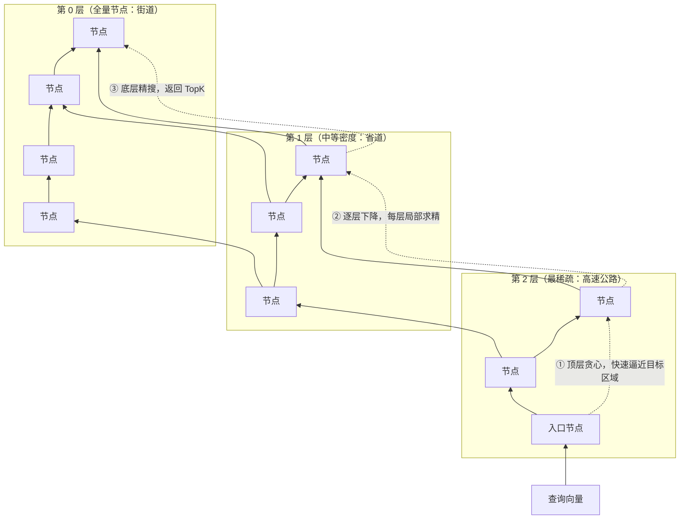
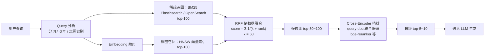

## TL;DR

| 结论 | 论据 |
|---|---|
| **ANNS 索引是在召回率、内存、构建耗时三个维度上做交易** | Flat 100% 召回但全表扫；IVF_PQ 内存压到 1/32 但召回掉到 0.8 档；HNSW 召回 0.95+ 但构建慢、内存翻倍 |
| **HNSW 是在线检索的默认答案** | 分层跳表 + 小世界图，查询近似 O(log N)，支持增量插入，参数 M / efConstruction / efSearch 三个旋钮各管一档 |
| **纯向量检索对专有名词、错误码、型号编号是结构性失灵** | Embedding 把稀有 token 平滑进语义空间，"Err_0x80070005" 和任意十六进制串的向量距离都很近——这类查询 BM25 是降维打击 |
| **生产级检索是流水线，不是单一索引** | BM25 与 Dense 双路各召回 top-100 → RRF 倒数秩融合（免分数归一化）→ Cross-Encoder 精排 top-5 |
| **索引选型先看数据规模，再看查询形态** | 10 万级 Flat 就够；百万级 HNSW；千万级以上再考虑分片或专用库——选型决策树见 [数据库选型篇](/blog/backend/storage/database-selection-for-llm-agents/) |

上一篇 [Agent 记忆系统](/blog/rag/memory/agent-memory-architecture/) 讲"记什么、怎么分层"，本文讲"怎么又快又准地取出来"——检索管线是记忆系统的读取侧引擎。

---

## 一、不可能三角：召回率 × 内存 × 构建耗时

精确最近邻（kNN）要对每个查询算完全部距离，\(O(N \times D)\)。数据量一上来就必须换**近似最近邻（ANNS）**：牺牲可接受的精度，换查询速度。所有索引都在三个维度上做交易：

| 索引 | Recall@10（典型） | 内存（相对原始向量） | 构建耗时 | 一句话画像 |
|---|---|---|---|---|
| **Flat** | 1.00 | 1× | 零（无需构建） | 精确但全表扫，10 万级以下随便用 |
| **IVF_FLAT** | 0.85~0.95 | 1× | 中（k-means） | 聚类裁剪搜索范围，向量不压缩 |
| **IVF_PQ** | 0.75~0.90 | **1/16 ~ 1/32** | 中（k-means + 码本训练） | 乘积量化压存储，内存敏感场景之王 |
| **HNSW** | 0.95+ | 1.1~1.5×（含图边） | 慢（图构建 + 高内存峰值） | 在线检索默认解，查询快且支持增量 |
| **DiskANN** | 0.95+ | 极低（图在磁盘） | 很慢 | 十亿级规模、内存放不下时的选择 |

**三角的本质**：召回率是用户价值，内存是钱，构建耗时是工程时间。没有免费午餐——IVF_PQ 用召回换内存，HNSW 用内存和构建时间换召回，Flat 用查询时间换零成本。选型 = 确认你的场景里哪个维度最便宜。

---

## 二、四种索引的底层机制

### 2.1 IVF：先分堆，再只搜相关的几堆

倒排文件索引。构建时用 k-means 把向量空间切成 `nlist` 个簇，每簇一个质心；查询时先找距离最近的若干簇（只算 `nprobe` 个质心），再在簇内精确扫描。

\[
\text{搜索范围} = \frac{N}{\text{nlist}} \times \text{nprobe}
\]

- `nprobe` 是召回/延迟的总旋钮：扫的簇越多召回越高、越慢。经验起点 `nprobe = nlist/10`，用 Recall@K 实测校准；
- 质心数常用经验公式 `nlist ≈ 4√N`（100 万向量约 4000 簇）；
- 失效模式：**簇边界处的查询**——向量恰好落在两个簇中间时，目标可能在没被扫的簇里，召回骤降。

### 2.2 PQ：把每个向量压成一小串字节

乘积量化。把 768 维向量切成 \(m\) 个子空间（如 \(m=96\)，每个 8 维），每个子空间用 k-means 学出 256 个中心（1 字节编码）。原向量 3072 字节（FP32）→ **96 字节，压缩 32 倍**。

查询时用 **ADC（非对称距离计算）**：查询向量保持全精度，与码本预计算查找表，累加各子空间距离。IVF_PQ = IVF 裁范围 + PQ 压计算，是内存敏感场景（千万级、单机内存吃紧）的主力。

代价是量化误差：8 维压成 1 字节，细粒度相似度被抹平，召回天然低于 IVF_FLAT 和 HNSW。

### 2.3 HNSW：分层跳表 + 小世界图

HNSW（Hierarchical Navigable Small World）是在线系统的默认答案，结构是两样经典数据结构的合体：

- **跳表层**：节点按概率随机分配到不同层，越高层节点越少。查询从顶层入口出发，每层贪心跳到更近的邻居，直到本层找不到更近的，下降一层；
- **小世界层**：底层是全量图，每个节点连 \(M\) 个近邻（典型 M=16），保证底层能精搜到底；
- **复杂度**：查询与插入都近似 \(O(\log N)\)，且**支持在线增删**——这对知识库持续更新的 RAG 是关键属性（IVF 新增数据要重新聚类，代价高）。

三个旋钮：

| 参数 | 作用阶段 | 调大的效果 | 常见取值 |
|---|---|---|---|
| **M** | 构建 | 召回 ↑，内存 ↑，构建变慢 | 8 / 16 / 32 |
| **efConstruction** | 构建 | 图质量 ↑，构建时间 ↑ | 100~400 |
| **efSearch** | 查询 | 召回 ↑，查询延迟 ↑ | 50~200 |

**先花构建时间，再花查询时间**：efConstruction 决定图的质量上限，efSearch 在上限内做查询时的召回/延迟权衡。生产惯例：构建期给足 efConstruction（如 200），查询期按延迟预算调 efSearch，用 Recall@K 实测找拐点。

---

## 三、为什么纯向量检索对专有名词极度拉胯

这是混合检索存在的根本原因，四个结构性失灵：

1. **稀有 token 被语义平滑吞掉**。Embedding 模型按子词切分，"Err_0x80070005"、"SN-2024-0871" 这类串被拆成无意义碎片，向量落在语义空间的"无名之地"——跟任意十六进制串的距离都差不多。而 BM25 把它们当精确词项，一抓一个准。
2. **语义相近 ≠ 用户要的精确匹配**。用户搜 "iPhone 15 Pro"， dense 检索会觉得 "iPhone 15"、"iPhone 14 Pro" 的余弦相似度全都 0.9+，型号差异被平滑；BM25 的词项匹配直接锁定精确型号。
3. **否定与布尔逻辑无法表达**。"不支持退换的订单怎么处理"——向量检索分不清"支持"和"不支持"，两者的句子向量几乎一样近；稀疏侧至少能把"不"作为词项区分开。
4. **领域新词是 OOV**。内部工单号、产品代号、新人名，embedding 没见过，语义表示趋近默认值，检索退化为"按频率排序"。

**规律**：查询里含**编号、型号、错误码、人名、版本号、缩写**的概率越高，越不能只靠向量。企业知识库、客服、运维文档三类场景是重灾区——而这三类恰恰是 RAG 落地最多的场景。

---

## 四、生产级闭环：双路召回 → RRF → Cross-Encoder

### 4.1 为什么用 RRF 而不是分数加权

两路分数**不可比**：BM25 分数无上界（词频驱动，可能到几十），余弦相似度固定在 [-1, 1]。任何加权公式都在比苹果和橘子。RRF（Reciprocal Rank Fusion）只用**排名**：

\[
\text{RRF}(d) = \sum_{i \in \{\text{BM25, Dense}\}} \frac{1}{k + \text{rank}_i(d)}, \quad k = 60
\]

排第 1 的文档从两路各拿 \(1/61\)，排第 100 的只有 \(1/160\)——头部文档的优势被放大，且不需要任何分数归一化。\(k=60\) 是论文经验值，加大 \(k\) 会让头部优势趋平，一般不用动。

### 4.2 Cross-Encoder 为什么是最后一道且不可替代

双塔模型（bi-encoder）里 query 和 doc **各自独立编码**，相关性只能在向量点积里近似；Cross-Encoder 把 query 和 doc **拼成一个序列联合编码**，注意力层能让查询词和文档词直接交互——精度高一个档次，代价是无法预计算文档向量，每个 (query, doc) 对都要跑一次前向。

所以它只能精排候选集：50~100 对 × 每对几毫秒到几十毫秒（GPU），预算 100~500ms，换取 top-5 质量的质变。**这是用算力换精度的标准买卖**，也是为什么它必须站在 RRF 融合之后——前面的召回负责"快和多"，它负责"准"。

### 4.3 工程闭环的三条补丁

1. **查询改写**：HyDE（让 LLM 先生成假设答案再检索）、多查询（一个查询拆成多个角度）能显著改善召回，代价是多路编码的延迟；
2. **元数据过滤前置**：租户、时间范围、文档类型的过滤要在向量检索**之前**用过滤索引做掉，否则先召回后过滤会导致结果数量不足（pgvector 生产踩坑之首，详见 [数据库选型篇](/blog/backend/storage/database-selection-for-llm-agents/)）；
3. **评测先行**：Recall@K、MRR、NDCG 三个指标建好基线再调参——没有 Recall@10 的实测曲线，efSearch 调到多少都是玄学。

---

## 五、生产环境踩坑与 Trade-off

1. **索引选型先看规模再看形态**。10 万级文档 Flat 全表扫只要几十毫秒，上 HNSW 纯属浪费构建时间；百万级 HNSW 是甜点；千万级以上先算内存（1M × 768 维 FP32 = 3GB，图边再涨 30%），再决定分片还是上专用库。
2. **混合检索的两路都要可观测**。哪一路贡献了最终 top-5？上线 A/B：关掉 BM25 看 NDCG 掉多少，关掉 Dense 再看——很多团队直到线上出事才发现某一路的索引早就挂了（返回空但被静默降级）。
3. **分词决定 BM25 的上限**。中文场景分词器（ik、jieba）选错，专有名词被切碎，稀疏侧直接残废。自定义词典（产品名、内部术语）要能热更新。
4. **精排模型是延迟预算里最贵的一段**。50 对的精排在 GPU 上也要 100ms+；文档片段过长时先截断再精排，并给精排设超时降级（超时则跳过，直接用 RRF 结果）。
5. **检索服务的可用性不能裸奔**。在线检索链路挂任何一段（ES 集群、向量库），RAG 整体瘫。后端存储的选主、共识、降级设计有成熟教训可抄——Redis 哨兵那篇 [quorum 与 Leader 选举](/blog/backend/redis/sentinel-quorum-and-raft-leader-election/) 讲透的"静默降级"风险，适用于任何带集群选主轴子的检索栈。

---

## 🎯 面试官连环追问

**Q1：HNSW 和 IVF 的核心差异是什么？什么场景必须选 HNSW？**

差异有三：① 结构上，IVF 是"聚类 + 倒排"的划分式索引，HNSW 是图的导航式索引；② 增量上，IVF 新增数据要么挂在原簇上（分布漂移后召回退化），要么定期重建（贵），HNSW 插入只需从顶层往下找邻居建边，天然在线；③ 内存上，IVF_FLAT 只存质心和向量，HNSW 额外存每个节点的 \(M\) 条边。**必须选 HNSW 的场景**：数据持续更新（知识库天天加文档）、查询延迟要求稳定（图导航的延迟方差远小于 IVF 的"扫几个簇"）。反过来，数据一次性灌入、几乎只读、内存吃紧（可接受 IVF_PQ 的量化误差），IVF 系更合适。

**Q2：RRF 融合两路召回，如果其中一路质量明显差，融合会不会被拖累？**

会，而且这是常见误区——"多一路总比少一路强"不成立。RRF 按名次计入，烂一路持续把不相关文档塞进前 100，就会挤掉好一路的头部结果在融合榜上的位置。工程上的处理：① **离线评测每路的独立贡献**（A/B 关一路测 NDCG），质量不达标的一路修好再上；② 用**加权 RRF** 给高质路更高权重，但权重必须用评测集标定，不能拍脑袋；③ **候选池分层**：好一路出 top-30 全进融合，差一路只允许出 top-10——限制烂路的影响力半径。记住：融合解决的是"两路互补"，不是"两路互相兜底"。

**Q3：从零搭一个百万级知识库的检索链路，给出完整选型和参数。**

分四步，每步给出可验证的数字。① **规模核算**：100 万片段 × 768 维，FP32 原始 3GB，HNSW 图边约 +30%，单机 32GB 内存可承载，无需分片。② **索引**：HNSW，M=16、efConstruction=200、efSearch 起步 64，用 5000 条标注查询画 Recall@10 曲线，按 P99 延迟预算（如 50ms）定点。③ **流水线**：ES（ik 分词 + 自定义词典）BM25 与 HNSW 各召回 top-100，RRF(k=60) 融合，bge-reranker 精排 top-50 取 top-5；两路召回分别打点，精排设 200ms 超时降级。④ **运维**：ES 与向量库都要多副本，写入走批量 + 副本确认，检索走读副本；索引重建（换 embedding 模型时必然发生）要能灰度——新索引双写、影子流量验证、再切流。四个环节里，②的参数没有"标准答案"，③的流水线结构才是真正的工程分水岭。
